# Где взять пассивку и как её перенести

🧬<b>Разведение</b>
Детёныш наследует пассивки родителей. Чем больше у родителей нужных пассивок, тем выше шанс.

🏥<b>Операционный стол</b>
Ставит пассивку за золото. Открывается технологией после победы на арене.

💉<b>Имплант</b>
Одноразовый предмет из Древних реликвий — расходуется при установке.

<input type="search" class="pfq" placeholder="Найти пассивку…" autocomplete="off">
<button type="button" data-rk="5">🌈 Радужные</button><button type="button" data-rk="4">🥇 Золотые</button><button type="button" data-rk="3">Редкие</button><button type="button" data-rk="1-2">Обычные</button><button type="button" data-rk="neg">🔻 Отрицательные</button>

Радужная<b>Бог разрушения</b>

Атака +40%Защита +20%Макс. HP -50%🌳

🧬 разведение

Передаётся детёнышу от родителя с этой пассивкой.

💉 имплант · расходуется

Падает из Древних реликвий:<table class="dch"><tr class="r5"><td>Сияющие артефакты древн. цив.</td><td>0.81%</td></tr><tr class="r4"><td>Светящиеся артефакты древн. цив.</td><td>0.41%</td></tr><tr class="r3"><td>Красивые артефакты древн. цив.</td><td>0.2%</td></tr></table>

<a class="pmore" href="../../passivki/god_of_destruction/">Подробнее →</a>

Радужная<b>Дьявольские руки</b>

Скорость работы +90%Рассудок уменьшает быстрее +15%🌳

🧬 разведение

Передаётся детёнышу от родителя с этой пассивкой.

💉 имплант · расходуется

Падает из Древних реликвий:<table class="dch"><tr class="r5"><td>Сияющие артефакты древн. цив.</td><td>0.81%</td></tr><tr class="r4"><td>Светящиеся артефакты древн. цив.</td><td>0.41%</td></tr><tr class="r3"><td>Красивые артефакты древн. цив.</td><td>0.2%</td></tr></table>

<a class="pmore" href="../../passivki/demons_hand/">Подробнее →</a>

Радужная<b>Живая стена святилища</b>

Защита +50%Атака -30%🌳

🧬 разведение

Передаётся детёнышу от родителя с этой пассивкой.

💉 имплант · расходуется

Падает из Древних реликвий:<table class="dch"><tr class="r5"><td>Сияющие артефакты древн. цив.</td><td>0.81%</td></tr><tr class="r4"><td>Светящиеся артефакты древн. цив.</td><td>0.41%</td></tr><tr class="r3"><td>Красивые артефакты древн. цив.</td><td>0.2%</td></tr></table>

<a class="pmore" href="../../passivki/sanctified_meat_shield/">Подробнее →</a>

Радужная<b>Небожитель</b>

Рассудок уменьшается медленнее +50%Скорость работы -20%🌳

🧬 разведение

Передаётся детёнышу от родителя с этой пассивкой.

💉 имплант · расходуется

Падает из Древних реликвий:<table class="dch"><tr class="r5"><td>Сияющие артефакты древн. цив.</td><td>0.81%</td></tr><tr class="r4"><td>Светящиеся артефакты древн. цив.</td><td>0.41%</td></tr><tr class="r3"><td>Красивые артефакты древн. цив.</td><td>0.2%</td></tr></table>

<a class="pmore" href="../../passivki/hermit_sage/">Подробнее →</a>

Радужная<b>Обоюдоострый святой меч</b>

Атака +50%Защита -30%🌳

🧬 разведение

Передаётся детёнышу от родителя с этой пассивкой.

💉 имплант · расходуется

Падает из Древних реликвий:<table class="dch"><tr class="r5"><td>Сияющие артефакты древн. цив.</td><td>0.81%</td></tr><tr class="r4"><td>Светящиеся артефакты древн. цив.</td><td>0.41%</td></tr><tr class="r3"><td>Красивые артефакты древн. цив.</td><td>0.2%</td></tr></table>

<a class="pmore" href="../../passivki/twin_edged_holy_blade/">Подробнее →</a>

Радужная<b>Прыжок между измерениями</b>

Повышение скорости передвижения +50%Уровень сытости уменьшается быстрее +15%🌳

🧬 разведение

Передаётся детёнышу от родителя с этой пассивкой.

💉 имплант · расходуется

Падает из Древних реликвий:<table class="dch"><tr class="r5"><td>Сияющие артефакты древн. цив.</td><td>0.81%</td></tr><tr class="r4"><td>Светящиеся артефакты древн. цив.</td><td>0.41%</td></tr><tr class="r3"><td>Красивые артефакты древн. цив.</td><td>0.2%</td></tr></table>

<a class="pmore" href="../../passivki/dimensional_leap/">Подробнее →</a>

Радужная<b>Рассада божественного древа</b>

Сытость уменьшается медленнее +50% HP -20%🌳

🧬 разведение

Передаётся детёнышу от родителя с этой пассивкой.

💉 имплант · расходуется

Падает из Древних реликвий:<table class="dch"></table>

<a class="pmore" href="../../passivki/world_trees_bounty/">Подробнее →</a>

Золотая<b>Алмазное тело</b>

Защита +30%
<small class="efn">Иммунитет к оглушению Иммунитет к отбрасыванию</small>

🧬 разведение

Передаётся детёнышу от родителя с этой пассивкой.

💉 имплант · расходуется

Падает из Древних реликвий:<table class="dch"><tr class="r5"><td>Сияющие артефакты древн. цив.</td><td>0.81%</td></tr><tr class="r4"><td>Светящиеся артефакты древн. цив.</td><td>0.41%</td></tr><tr class="r3"><td>Красивые артефакты древн. цив.</td><td>0.2%</td></tr></table>

<a class="pmore" href="../../passivki/diamond_body/">Подробнее →</a>

Золотая<b>Аскет</b>

Уровень сытости снижается медленнее +20%

🧬 разведение

Передаётся детёнышу от родителя с этой пассивкой.

💉 имплант · расходуется

Падает из Древних реликвий:<table class="dch"><tr class="r5"><td>Сияющие артефакты древн. цив.</td><td>0.81%</td></tr><tr class="r4"><td>Светящиеся артефакты древн. цив.</td><td>0.41%</td></tr><tr class="r3"><td>Красивые артефакты древн. цив.</td><td>0.2%</td></tr></table>

<a class="pmore" href="../../passivki/mastery_of_fasting/">Подробнее →</a>

Золотая<b>Бессмертие</b>

Восстанавливает HP в размере 5% от нанесённого урона. Естественное восстановление HP Палла +100%Атака +15%

🧬 разведение

Передаётся детёнышу от родителя с этой пассивкой.

💉 имплант · расходуется

Падает из Древних реликвий:<table class="dch"><tr class="r5"><td>Сияющие артефакты древн. цив.</td><td>3.89%</td></tr></table>

<a class="pmore" href="../../passivki/immortality/">Подробнее →</a>

Золотая<b>Божественная скорость</b>

<small class="efn">Увеличение скорости передвижения на 30%</small>

🧬 разведение

Передаётся детёнышу от родителя с этой пассивкой.

💉 имплант · расходуется

Падает из Древних реликвий:<table class="dch"><tr class="r5"><td>Сияющие артефакты древн. цив.</td><td>0.81%</td></tr><tr class="r4"><td>Светящиеся артефакты древн. цив.</td><td>0.41%</td></tr><tr class="r3"><td>Красивые артефакты древн. цив.</td><td>0.2%</td></tr></table>

<a class="pmore" href="../../passivki/swift/">Подробнее →</a>

Золотая<b>Вампир</b>

<small class="efn">Поглощает 5% от нанесённого урона и восстанавливает HP. Активен даже в ночное время.</small>

🧬 разведение

Передаётся детёнышу от родителя с этой пассивкой.

💉 имплант · расходуется

Падает из Древних реликвий:<table class="dch"><tr class="r5"><td>Сияющие артефакты древн. цив.</td><td>0.81%</td></tr><tr class="r4"><td>Светящиеся артефакты древн. цив.</td><td>0.41%</td></tr><tr class="r3"><td>Красивые артефакты древн. цив.</td><td>0.2%</td></tr></table>

<a class="pmore" href="../../passivki/vampiric/">Подробнее →</a>

Золотая<b>Ведьма</b>

<small class="efn">Увеличение тёмного урона на 30%</small><small class="efn">Увеличение ледяного урона на 30%</small>

🐣 с рождения

Есть у 1 палов: Бэллануар Либеро

🧬 разведение

Передаётся детёнышу от родителя с этой пассивкой.

<a class="pmore" href="../../passivki/siren_of_the_void/">Подробнее →</a>

Золотая<b>Вечное пламя</b>

<small class="efn">Увеличение огненного урона на 30%</small><small class="efn">Увеличение урона молнии на 30%</small>

🐣 с рождения

Есть у 1 палов: Блазамут Рю

🧬 разведение

Передаётся детёнышу от родителя с этой пассивкой.

<a class="pmore" href="../../passivki/eternal_flame/">Подробнее →</a>

Золотая<b>Вечный двигатель</b>

Макс. выносливость +75% *Действует только для Палов, которых можно оседлать.

🧬 разведение

Передаётся детёнышу от родителя с этой пассивкой.

💉 имплант · расходуется

Падает из Древних реликвий:<table class="dch"><tr class="r5"><td>Сияющие артефакты древн. цив.</td><td>0.81%</td></tr><tr class="r4"><td>Светящиеся артефакты древн. цив.</td><td>0.41%</td></tr><tr class="r3"><td>Красивые артефакты древн. цив.</td><td>0.2%</td></tr></table>

<a class="pmore" href="../../passivki/eternal_engine/">Подробнее →</a>

Золотая<b>Виртуоз</b>

Скорость работы +75%

🧬 разведение

Передаётся детёнышу от родителя с этой пассивкой.

💉 имплант · расходуется

Падает из Древних реликвий:<table class="dch"><tr class="r5"><td>Сияющие артефакты древн. цив.</td><td>0.81%</td></tr><tr class="r4"><td>Светящиеся артефакты древн. цив.</td><td>0.41%</td></tr><tr class="r3"><td>Красивые артефакты древн. цив.</td><td>0.2%</td></tr></table>

<a class="pmore" href="../../passivki/remarkable_craftsmanship/">Подробнее →</a>

Золотая<b>Демон-бог</b>

Атака +30%Защита +5%

🧬 разведение

Передаётся детёнышу от родителя с этой пассивкой.

💉 имплант · расходуется

Падает из Древних реликвий:<table class="dch"><tr class="r5"><td>Сияющие артефакты древн. цив.</td><td>0.81%</td></tr><tr class="r4"><td>Светящиеся артефакты древн. цив.</td><td>0.41%</td></tr><tr class="r3"><td>Красивые артефакты древн. цив.</td><td>0.2%</td></tr></table>

<a class="pmore" href="../../passivki/demon_god/">Подробнее →</a>

Золотая<b>Захватчик</b>

<small class="efn">Увеличение тёмного урона на 30%</small><small class="efn">Увеличение драконьего урона на 30%</small>

🐣 с рождения

Есть у 1 палов: Зенолорд

🧬 разведение

Передаётся детёнышу от родителя с этой пассивкой.

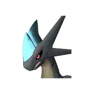
<a class="pmore" href="../../passivki/invader/">Подробнее →</a>

Золотая<b>Кровь - это топливо</b>

<small class="efn">Поглощает 0% от нанесённого урона и восстанавливает HP. Активен даже в ночное время.</small>

🧬 разведение

Передаётся детёнышу от родителя с этой пассивкой.

<a class="pmore" href="../../passivki/blood_is_fuel/">Подробнее →</a>

Золотая<b>Легенда</b>

Атака +20%Защита +20%
<small class="efn">Увеличение скорости передвижения на 20%</small>

🐣 с рождения

Есть у 7 палов: Фросталлион, Фросталлион Нокт, Джетрагон, Некромус, Нептилиус, Панталус, Паладиус

🧬 разведение

Передаётся детёнышу от родителя с этой пассивкой.

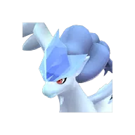+3
<a class="pmore" href="../../passivki/legend/">Подробнее →</a>

Золотая<b>Лёгкое тело</b>

Количество прыжков во время езды: +1

🧬 разведение

Передаётся детёнышу от родителя с этой пассивкой.

<a class="pmore" href="../../passivki/lightfooted/">Подробнее →</a>

Золотая<b>Малое увеличение атаки ур.4</b>

Атака +12%

🧬 разведение

Передаётся детёнышу от родителя с этой пассивкой.

<a class="pmore" href="../../passivki/attack_up_s_lv_4/">Подробнее →</a>

Золотая<b>Небесное скольжение</b>

Количество прыжков во время езды: +2

🧬 разведение

Передаётся детёнышу от родителя с этой пассивкой.

💉 имплант · расходуется

Падает из Древних реликвий:<table class="dch"><tr class="r5"><td>Сияющие артефакты древн. цив.</td><td>3.89%</td></tr></table>

<a class="pmore" href="../../passivki/sky_strider/">Подробнее →</a>

Золотая<b>Непреклонный дух</b>

Показатель рассудка снижается медленнее +20%

🧬 разведение

Передаётся детёнышу от родителя с этой пассивкой.

💉 имплант · расходуется

Падает из Древних реликвий:<table class="dch"><tr class="r5"><td>Сияющие артефакты древн. цив.</td><td>0.81%</td></tr><tr class="r4"><td>Светящиеся артефакты древн. цив.</td><td>0.41%</td></tr><tr class="r3"><td>Красивые артефакты древн. цив.</td><td>0.2%</td></tr></table>

<a class="pmore" href="../../passivki/heart_of_the_immovable_king/">Подробнее →</a>

Золотая<b>Нянька</b>

Пока находится на базе, скорость разведение яиц Палов на племенной ферме +30%, скорость вылупления +30%

🧬 разведение

Передаётся детёнышу от родителя с этой пассивкой.

💉 имплант · расходуется

Падает из Древних реликвий:<table class="dch"><tr class="r5"><td>Сияющие артефакты древн. цив.</td><td>3.89%</td></tr></table>

<a class="pmore" href="../../passivki/babysitter/">Подробнее →</a>

Золотая<b>Объёмы добычи руды ур.5</b>

<small class="efn">Количество выпадаемых камня и руды очень значительно увеличивается</small>

🧬 разведение

Передаётся детёнышу от родителя с этой пассивкой.

<a class="pmore" href="../../passivki/mining_yield_up_lv_5/">Подробнее →</a>

Золотая<b>Объёмы лесозаготовки ур.5</b>

<small class="efn">Количество выпадаемой древесины очень значительно увеличивается</small>

🧬 разведение

Передаётся детёнышу от родителя с этой пассивкой.

<a class="pmore" href="../../passivki/logging_yield_up_lv_5/">Подробнее →</a>

Золотая<b>Особая конституция</b>

Регенерация HP Палов и игрока +50%Защита +25%
<small class="efn">Иммунитет к урону от яда Иммунитет к урону от горения</small>

🧬 разведение

Передаётся детёнышу от родителя с этой пассивкой.

💉 имплант · расходуется

Падает из Древних реликвий:<table class="dch"><tr class="r5"><td>Сияющие артефакты древн. цив.</td><td>3.89%</td></tr></table>

<a class="pmore" href="../../passivki/idiosyncratic/">Подробнее →</a>

Золотая<b>Повелитель волн</b>

<small class="efn">Увеличение скорости передвижения по воде на 50%</small>

🧬 разведение

Передаётся детёнышу от родителя с этой пассивкой.

💉 имплант · расходуется

Падает из Древних реликвий:<table class="dch"><tr class="r5"><td>Сияющие артефакты древн. цив.</td><td>0.81%</td></tr><tr class="r4"><td>Светящиеся артефакты древн. цив.</td><td>0.41%</td></tr><tr class="r3"><td>Красивые артефакты древн. цив.</td><td>0.2%</td></tr></table>

<a class="pmore" href="../../passivki/king_of_the_waves/">Подробнее →</a>

Золотая<b>Сокращение водного урона ур.4</b>

Защита от воды +35%

🧬 разведение

Передаётся детёнышу от родителя с этой пассивкой.

<a class="pmore" href="../../passivki/water_damage_reduction_lv_4/">Подробнее →</a>

Золотая<b>Сокращение драконьего урона ур.4</b>

Защита от дракона +35%

🧬 разведение

Передаётся детёнышу от родителя с этой пассивкой.

<a class="pmore" href="../../passivki/dragon_damage_reduction_lv_4/">Подробнее →</a>

Золотая<b>Сокращение земного урона ур.4</b>

Защита от земли +35%

🧬 разведение

Передаётся детёнышу от родителя с этой пассивкой.

<a class="pmore" href="../../passivki/ground_damage_reduction_lv_4/">Подробнее →</a>

Золотая<b>Сокращение ледяного урона ур.4</b>

Защита от льда +35%

🧬 разведение

Передаётся детёнышу от родителя с этой пассивкой.

<a class="pmore" href="../../passivki/ice_damage_reduction_lv_4/">Подробнее →</a>

Золотая<b>Сокращение нейтрального урона ур.4</b>

Защита от нейтральной стихии +35%

🧬 разведение

Передаётся детёнышу от родителя с этой пассивкой.

<a class="pmore" href="../../passivki/neutral_damage_reduction_lv_4/">Подробнее →</a>

Золотая<b>Сокращение огненного урона ур.4</b>

Защита от огня +35%

🧬 разведение

Передаётся детёнышу от родителя с этой пассивкой.

<a class="pmore" href="../../passivki/fire_damage_reduction_lv_4/">Подробнее →</a>

Золотая<b>Сокращение травяного урона ур.4</b>

Защита от травы +35%

🧬 разведение

Передаётся детёнышу от родителя с этой пассивкой.

<a class="pmore" href="../../passivki/grass_damage_reduction_lv_4/">Подробнее →</a>

Золотая<b>Сокращение тёмного урона ур.4</b>

Защита от тьмы +35%

🧬 разведение

Передаётся детёнышу от родителя с этой пассивкой.

<a class="pmore" href="../../passivki/dark_damage_reduction_lv_4/">Подробнее →</a>

Золотая<b>Сокращение урона молнии ур.4</b>

Защита от молнии +35%

🧬 разведение

Передаётся детёнышу от родителя с этой пассивкой.

<a class="pmore" href="../../passivki/electric_damage_reduction_lv_4/">Подробнее →</a>

Золотая<b>Спаситель</b>

<small class="efn">Увеличение нейтрального урона на 30%</small><small class="efn">Увеличение травяного урона на 30%</small>

🐣 с рождения

Есть у 1 палов: Харталис

🧬 разведение

Передаётся детёнышу от родителя с этой пассивкой.

<a class="pmore" href="../../passivki/savior/">Подробнее →</a>

Золотая<b>Тяжёлая броня</b>

<small class="efn">Иммунитет к урону от взрывов</small>

🧬 разведение

Передаётся детёнышу от родителя с этой пассивкой.

💉 имплант · расходуется

Падает из Древних реликвий:<table class="dch"><tr class="r5"><td>Сияющие артефакты древн. цив.</td><td>3.89%</td></tr></table>

<a class="pmore" href="../../passivki/heavily_armored/">Подробнее →</a>

Золотая<b>Увеличение HP ур.4</b>

Макс. HP +25%

🧬 разведение

Передаётся детёнышу от родителя с этой пассивкой.

<a class="pmore" href="../../passivki/health_up_lv_4/">Подробнее →</a>

Золотая<b>Увеличение атаки Пала ур.4</b>

Атака +16%

🧬 разведение

Передаётся детёнышу от родителя с этой пассивкой.

<a class="pmore" href="../../passivki/pal_attack_up_lv_4/">Подробнее →</a>

Золотая<b>Увеличение атаки ур.4</b>

Атака +20%

🧬 разведение

Передаётся детёнышу от родителя с этой пассивкой.

<a class="pmore" href="../../passivki/attack_up_lv_4/">Подробнее →</a>

Золотая<b>Увеличение водного урона Палов ур.4</b>

Урон водой +20%

🧬 разведение

Передаётся детёнышу от родителя с этой пассивкой.

<a class="pmore" href="../../passivki/pal_water_damage_enhancement_lv_4/">Подробнее →</a>

Золотая<b>Увеличение грозового урона Палов ур.4</b>

Урон молнией +20%

🧬 разведение

Передаётся детёнышу от родителя с этой пассивкой.

<a class="pmore" href="../../passivki/pal_electric_damage_enhancement_lv_4/">Подробнее →</a>

Золотая<b>Увеличение драконьего урона Палов ур.4</b>

Урон драконом +20%

🧬 разведение

Передаётся детёнышу от родителя с этой пассивкой.

<a class="pmore" href="../../passivki/pal_dragon_damage_enhancement_lv_4/">Подробнее →</a>

Золотая<b>Увеличение защиты Пала ур.4</b>

Защита +20%

🧬 разведение

Передаётся детёнышу от родителя с этой пассивкой.

<a class="pmore" href="../../passivki/pal_defense_up_lv_4/">Подробнее →</a>

Золотая<b>Увеличение защиты ур.4</b>

Защита +25%

🧬 разведение

Передаётся детёнышу от родителя с этой пассивкой.

<a class="pmore" href="../../passivki/defense_up_lv_4/">Подробнее →</a>

Золотая<b>Увеличение земного урона Палов ур.4</b>

Урон землёй +20%

🧬 разведение

Передаётся детёнышу от родителя с этой пассивкой.

<a class="pmore" href="../../passivki/pal_ground_damage_enhancement_lv_4/">Подробнее →</a>

Золотая<b>Увеличение ледяного урона Палов ур.4</b>

Урон льдом +20%

🧬 разведение

Передаётся детёнышу от родителя с этой пассивкой.

<a class="pmore" href="../../passivki/pal_ice_damage_enhancement_lv_4/">Подробнее →</a>

Золотая<b>Увеличение нейтрального урона Палов ур.4</b>

Урон нейтральной стихией +20%

🧬 разведение

Передаётся детёнышу от родителя с этой пассивкой.

<a class="pmore" href="../../passivki/pal_neutral_damage_enhancement_lv_4/">Подробнее →</a>

Золотая<b>Увеличение огненного урона Палов ур.4</b>

Урон огнём +20%

🧬 разведение

Передаётся детёнышу от родителя с этой пассивкой.

<a class="pmore" href="../../passivki/pal_fire_damage_enhancement_lv_4/">Подробнее →</a>

Золотая<b>Увеличение травяного урона Палов ур.4</b>

Урон травой +20%

🧬 разведение

Передаётся детёнышу от родителя с этой пассивкой.

<a class="pmore" href="../../passivki/pal_grass_damage_enhancement_lv_4/">Подробнее →</a>

Золотая<b>Увеличение тёмного урона Палов ур.4</b>

Урон тьмой +20%

🧬 разведение

Передаётся детёнышу от родителя с этой пассивкой.

<a class="pmore" href="../../passivki/pal_dark_damage_enhancement_lv_4/">Подробнее →</a>

Золотая<b>Удачливый</b>

Атака +15%Защита +15%Скорость работы +20%

🧬 разведение

Передаётся детёнышу от родителя с этой пассивкой.

<a class="pmore" href="../../passivki/lucky/">Подробнее →</a>

Золотая<b>Ураганный нрав</b>

Атака +0%
<small class="efn">Снижение времени перезарядки активных навыков на 0%</small>

🧬 разведение

Передаётся детёнышу от родителя с этой пассивкой.

<a class="pmore" href="../../passivki/tempest_fury/">Подробнее →</a>

Золотая<b>Ускоренная работа ур.4</b>

Скорость работы +25%

🧬 разведение

Передаётся детёнышу от родителя с этой пассивкой.

<a class="pmore" href="../../passivki/speedy_worker_lv_4/">Подробнее →</a>

Золотая<b>Хозяин фермы</b>

Фермерство: Рабочие умения +2

🧬 разведение

Передаётся детёнышу от родителя с этой пассивкой.

<a class="pmore" href="../../passivki/ranch_master/">Подробнее →</a>

Золотая<b>Царь-рыба</b>

Защита +20%
<small class="efn">Увеличение водного урона на 20%</small><small class="efn">Увеличение ледяного урона на 20%</small>

🐣 с рождения

Есть у 1 палов: Нептилиус

🧬 разведение

Передаётся детёнышу от родителя с этой пассивкой.

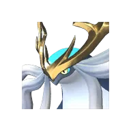
<a class="pmore" href="../../passivki/lunker/">Подробнее →</a>

Золотая<b>Щедрость</b>

Количество предметов, выпадающих с этого Палла, +100%

🧬 разведение

Передаётся детёнышу от родителя с этой пассивкой.

<a class="pmore" href="../../passivki/lavish_hospitality/">Подробнее →</a>

Редкая<b>Бесконечная выносливость</b>

Макс. выносливость +50% *Действует только для Палов, которых можно оседлать.

🧬 разведение

Передаётся детёнышу от родителя с этой пассивкой.

🏥 операционный стол

Стоимость: 50 000 золота

<a class="pmore" href="../../passivki/infinite_stamina/">Подробнее →</a>

Редкая<b>Благородный</b>

Цена продажи предметов увеличена на +5%

🧬 разведение

Передаётся детёнышу от родителя с этой пассивкой.

🏥 операционный стол

Стоимость: 50 000 золота

<a class="pmore" href="../../passivki/noble/">Подробнее →</a>

Редкая<b>Божественный дракон</b>

<small class="efn">Увеличение драконьего урона на 30%</small>

🐣 с рождения

Есть у 1 палов: Джетрагон

🧬 разведение

Передаётся детёнышу от родителя с этой пассивкой.

<a class="pmore" href="../../passivki/divine_dragon/">Подробнее →</a>

Редкая<b>Владыка морей</b>

<small class="efn">Увеличение водного урона на 30%</small>

🐣 с рождения

Есть у 1 палов: Йормунтайд

🧬 разведение

Передаётся детёнышу от родителя с этой пассивкой.

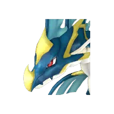
<a class="pmore" href="../../passivki/lord_of_the_sea/">Подробнее →</a>

Редкая<b>Вождь Тэнраку</b>

Атака +20%Скорость +10%

🧬 разведение

Передаётся детёнышу от родителя с этой пассивкой.

<a class="pmore" href="../../passivki/jarl_of_feybreak/">Подробнее →</a>

Редкая<b>Гуру диет</b>

Уровень сытости снижается медленнее +15%

🧬 разведение

Передаётся детёнышу от родителя с этой пассивкой.

🏥 операционный стол

Стоимость: 50 000 золота

<a class="pmore" href="../../passivki/diet_lover/">Подробнее →</a>

Редкая<b>Дух радушия</b>

Количество предметов, выпадающих с этого Палла, +50%

🧬 разведение

Передаётся детёнышу от родителя с этой пассивкой.

<a class="pmore" href="../../passivki/service_minded/">Подробнее →</a>

Редкая<b>Духовный лидер Братства Вечного Пламени</b>

Атака +20%Скорость +10%

🧬 разведение

Передаётся детёнышу от родителя с этой пассивкой.

<a class="pmore" href="../../passivki/brothers_of_the_eternal_pyre_soul_leader/">Подробнее →</a>

Редкая<b>Жаростойкость ур.3</b>

Защита от жары +3%

🧬 разведение

Передаётся детёнышу от родителя с этой пассивкой.

<a class="pmore" href="../../passivki/heat_resistance_lv_3/">Подробнее →</a>

Редкая<b>Жаростойкость ур.3 / Морозостойкость ур.3</b>

Защита от холода +3%Защита от жары +3%

🧬 разведение

Передаётся детёнышу от родителя с этой пассивкой.

<a class="pmore" href="../../passivki/heat_resistance_lv_3_cold_resistance_lv_3/">Подробнее →</a>

Редкая<b>Император земли</b>

<small class="efn">Увеличение земляного урона на 30%</small>

🐣 с рождения

Есть у 1 палов: Анубис

🧬 разведение

Передаётся детёнышу от родителя с этой пассивкой.

<a class="pmore" href="../../passivki/earth_emperor/">Подробнее →</a>

Редкая<b>Император льда</b>

<small class="efn">Увеличение ледяного урона на 30%</small>

🐣 с рождения

Есть у 1 палов: Фросталлион

🧬 разведение

Передаётся детёнышу от родителя с этой пассивкой.

<a class="pmore" href="../../passivki/ice_emperor/">Подробнее →</a>

Редкая<b>Император молнии</b>

<small class="efn">Увеличение урона молнии на 30%</small>

🐣 с рождения

Есть у 1 палов: Орсерк

🧬 разведение

Передаётся детёнышу от родителя с этой пассивкой.

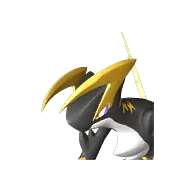
<a class="pmore" href="../../passivki/lord_of_lightning/">Подробнее →</a>

Редкая<b>Император огня</b>

<small class="efn">Увеличение огненного урона на 30%</small>

🐣 с рождения

Есть у 1 палов: Блазамут

🧬 разведение

Передаётся детёнышу от родителя с этой пассивкой.

<a class="pmore" href="../../passivki/flame_emperor/">Подробнее →</a>

Редкая<b>Командир штурма</b>

<small class="efn">Увеличение атаки игрока на 10%</small>

🧬 разведение

Передаётся детёнышу от родителя с этой пассивкой.

🏥 операционный стол

Стоимость: 50 000 золота

<a class="pmore" href="../../passivki/vanguard/">Подробнее →</a>

Редкая<b>Король духов</b>

<small class="efn">Увеличение травяного урона на 30%</small>

🐣 с рождения

Есть у 1 палов: Лилин

🧬 разведение

Передаётся детёнышу от родителя с этой пассивкой.

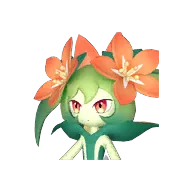
<a class="pmore" href="../../passivki/spirit_emperor/">Подробнее →</a>

Редкая<b>Король тьмы</b>

<small class="efn">Увеличение тёмного урона на 30%</small>

🐣 с рождения

Есть у 2 палов: Фросталлион Нокт, Некромус

🧬 разведение

Передаётся детёнышу от родителя с этой пассивкой.

<a class="pmore" href="../../passivki/lord_of_the_underworld/">Подробнее →</a>

Редкая<b>Крепкое тело</b>

Защита +20%
<small class="efn">Иммунитет к оглушению</small>

🧬 разведение

Передаётся детёнышу от родителя с этой пассивкой.

🏥 операционный стол

Стоимость: 50 000 золота

<a class="pmore" href="../../passivki/burly_body/">Подробнее →</a>

Редкая<b>Крупная рыбка</b>

Защита +5%
<small class="efn">Увеличение водного урона на 5%</small><small class="efn">Увеличение ледяного урона на 5%</small>

🧬 разведение

Передаётся детёнышу от родителя с этой пассивкой.

<a class="pmore" href="../../passivki/whopper/">Подробнее →</a>

Редкая<b>Лидер лесозаготовок</b>

<small class="efn">Увеличение эффективности рубки игрока на 25%</small>

🧬 разведение

Передаётся детёнышу от родителя с этой пассивкой.

🏥 операционный стол

Стоимость: 50 000 золота

<a class="pmore" href="../../passivki/logging_foreman/">Подробнее →</a>

Редкая<b>Лидер общества Лунных цветов</b>

Атака +20%Скорость +10%

🧬 разведение

Передаётся детёнышу от родителя с этой пассивкой.

<a class="pmore" href="../../passivki/leader_of_the_moonflowers/">Подробнее →</a>

Редкая<b>Малое увеличение атаки ур.3</b>

Атака +9%

🧬 разведение

Передаётся детёнышу от родителя с этой пассивкой.

<a class="pmore" href="../../passivki/attack_up_s_lv_3/">Подробнее →</a>

Редкая<b>Мастер обороны</b>

<small class="efn">Увеличение защиты игрока на 10%</small>

🧬 разведение

Передаётся детёнышу от родителя с этой пассивкой.

🏥 операционный стол

Стоимость: 50 000 золота

<a class="pmore" href="../../passivki/stronghold_strategist/">Подробнее →</a>

Редкая<b>Мастер перезарядки</b>

Скорость перезарядки игрока увеличена на +4%

🧬 разведение

Передаётся детёнышу от родителя с этой пассивкой.

🏥 операционный стол

Стоимость: 50 000 золота

<a class="pmore" href="../../passivki/reload_master/">Подробнее →</a>

Редкая<b>Мастеровитый</b>

Скорость работы +50%

🧬 разведение

Передаётся детёнышу от родителя с этой пассивкой.

🏥 операционный стол

Стоимость: 50 000 золота

<a class="pmore" href="../../passivki/artisan/">Подробнее →</a>

Редкая<b>Морозостойкость ур.3</b>

Защита от холода +3%

🧬 разведение

Передаётся детёнышу от родителя с этой пассивкой.

<a class="pmore" href="../../passivki/cold_resistance_lv_3/">Подробнее →</a>

Редкая<b>Мотиватор</b>

<small class="efn">Увеличение скорости работы игрока на 25%</small>

🧬 разведение

Передаётся детёнышу от родителя с этой пассивкой.

🏥 операционный стол

Стоимость: 50 000 золота

<a class="pmore" href="../../passivki/motivational_leader/">Подробнее →</a>

Редкая<b>Начальник отряда Генетических Исследований</b>

Атака +20%Скорость +10%

🧬 разведение

Передаётся детёнышу от родителя с этой пассивкой.

<a class="pmore" href="../../passivki/pal_genetic_research_unit_commander/">Подробнее →</a>

Редкая<b>Начальник рудника</b>

<small class="efn">Увеличение эффективности добычи игрока на 25%</small>

🧬 разведение

Передаётся детёнышу от родителя с этой пассивкой.

🏥 операционный стол

Стоимость: 50 000 золота

<a class="pmore" href="../../passivki/mine_foreman/">Подробнее →</a>

Редкая<b>Объёмы добычи руды ур.3</b>

<small class="efn">Количество выпадаемых камня и руды значительно увеличивается</small>

🧬 разведение

Передаётся детёнышу от родителя с этой пассивкой.

<a class="pmore" href="../../passivki/mining_yield_up_lv_3/">Подробнее →</a>

Редкая<b>Объёмы добычи руды ур.4</b>

<small class="efn">Количество выпадаемых камня и руды существенно увеличивается</small>

🧬 разведение

Передаётся детёнышу от родителя с этой пассивкой.

<a class="pmore" href="../../passivki/mining_yield_up_lv_4/">Подробнее →</a>

Редкая<b>Объёмы лесозаготовки ур.3</b>

<small class="efn">Количество выпадаемой древесины значительно увеличивается</small>

🧬 разведение

Передаётся детёнышу от родителя с этой пассивкой.

<a class="pmore" href="../../passivki/logging_yield_up_lv_3/">Подробнее →</a>

Редкая<b>Объёмы лесозаготовки ур.4</b>

<small class="efn">Количество выпадаемой древесины существенно увеличивается</small>

🧬 разведение

Передаётся детёнышу от родителя с этой пассивкой.

<a class="pmore" href="../../passivki/logging_yield_up_lv_4/">Подробнее →</a>

Редкая<b>Офицер Общества Вигилантов острова Палпагос</b>

Атака +20%Скорость +10%

🧬 разведение

Передаётся детёнышу от родителя с этой пассивкой.

<a class="pmore" href="../../passivki/pidf_commander/">Подробнее →</a>

Редкая<b>Офицер отряда Браконьеров Рейн</b>

Атака +20%
<small class="efn">Увеличение скорости передвижения на 10%</small>

🧬 разведение

Передаётся детёнышу от родителя с этой пассивкой.

<a class="pmore" href="../../passivki/rayne_syndicate_boss/">Подробнее →</a>

Редкая<b>Ребёнок фермы</b>

Фермерство: Рабочие умения +1

🧬 разведение

Передаётся детёнышу от родителя с этой пассивкой.

<a class="pmore" href="../../passivki/farmhand/">Подробнее →</a>

Редкая<b>Свирепый</b>

Атака +20%

🧬 разведение

Передаётся детёнышу от родителя с этой пассивкой.

🏥 операционный стол

Стоимость: 50 000 золота

<a class="pmore" href="../../passivki/ferocious/">Подробнее →</a>

Редкая<b>Святое небо</b>

<small class="efn">Увеличение нейтрального урона на 30%</small>

🐣 с рождения

Есть у 1 палов: Паладиус

🧬 разведение

Передаётся детёнышу от родителя с этой пассивкой.

<a class="pmore" href="../../passivki/celestial_emperor/">Подробнее →</a>

Редкая<b>Снижение усталости</b>

Снижение расхода выносливости игрока на +5%

🧬 разведение

Передаётся детёнышу от родителя с этой пассивкой.

🏥 операционный стол

Стоимость: 50 000 золота

<a class="pmore" href="../../passivki/wellness_watcher/">Подробнее →</a>

Редкая<b>Сокращение водного урона ур.3</b>

Защита от воды +30%

🧬 разведение

Передаётся детёнышу от родителя с этой пассивкой.

<a class="pmore" href="../../passivki/water_damage_reduction_lv_3/">Подробнее →</a>

Редкая<b>Сокращение драконьего урона ур.3</b>

Защита от дракона +30%

🧬 разведение

Передаётся детёнышу от родителя с этой пассивкой.

<a class="pmore" href="../../passivki/dragon_damage_reduction_lv_3/">Подробнее →</a>

Редкая<b>Сокращение земного урона ур.3</b>

Защита от земли +30%

🧬 разведение

Передаётся детёнышу от родителя с этой пассивкой.

<a class="pmore" href="../../passivki/earth_damage_reduction_lv_3/">Подробнее →</a>

Редкая<b>Сокращение ледяного урона ур.3</b>

Защита от льда +30%

🧬 разведение

Передаётся детёнышу от родителя с этой пассивкой.

<a class="pmore" href="../../passivki/ice_damage_reduction_lv_3/">Подробнее →</a>

Редкая<b>Сокращение нейтрального урона ур.3</b>

Защита от нейтральной стихии +30%

🧬 разведение

Передаётся детёнышу от родителя с этой пассивкой.

<a class="pmore" href="../../passivki/neutral_damage_reduction_lv_3/">Подробнее →</a>

Редкая<b>Сокращение огненного урона ур.3</b>

Защита от огня +30%

🧬 разведение

Передаётся детёнышу от родителя с этой пассивкой.

<a class="pmore" href="../../passivki/fire_damage_reduction_lv_3/">Подробнее →</a>

Редкая<b>Сокращение травяного урона ур.3</b>

Защита от травы +30%

🧬 разведение

Передаётся детёнышу от родителя с этой пассивкой.

<a class="pmore" href="../../passivki/grass_damage_reduction_lv_3/">Подробнее →</a>

Редкая<b>Сокращение тёмного урона ур.3</b>

Защита от тьмы +30%

🧬 разведение

Передаётся детёнышу от родителя с этой пассивкой.

<a class="pmore" href="../../passivki/dark_damage_reduction_lv_3/">Подробнее →</a>

Редкая<b>Сокращение урона молнии ур.3</b>

Защита от молнии +30%

🧬 разведение

Передаётся детёнышу от родителя с этой пассивкой.

<a class="pmore" href="../../passivki/electric_damage_reduction_lv_3/">Подробнее →</a>

Редкая<b>Тренер по исцелению</b>

Восстановление HP игрока на +5%

🧬 разведение

Передаётся детёнышу от родителя с этой пассивкой.

🏥 операционный стол

Стоимость: 50 000 золота

<a class="pmore" href="../../passivki/healing_coach/">Подробнее →</a>

Редкая<b>Трудоголик</b>

Показатель рассудка снижается медленнее +15%

🧬 разведение

Передаётся детёнышу от родителя с этой пассивкой.

🏥 операционный стол

Стоимость: 50 000 золота

<a class="pmore" href="../../passivki/workaholic/">Подробнее →</a>

Редкая<b>Увеличение HP ур.3</b>

Макс. HP +20%

🧬 разведение

Передаётся детёнышу от родителя с этой пассивкой.

<a class="pmore" href="../../passivki/health_up_lv_3/">Подробнее →</a>

Редкая<b>Увеличение атаки Пала ур.3</b>

Атака +12%

🧬 разведение

Передаётся детёнышу от родителя с этой пассивкой.

<a class="pmore" href="../../passivki/pal_attack_up_lv_3/">Подробнее →</a>

Редкая<b>Увеличение атаки ур.3</b>

Атака +15%

🧬 разведение

Передаётся детёнышу от родителя с этой пассивкой.

<a class="pmore" href="../../passivki/attack_up_lv_3/">Подробнее →</a>

Редкая<b>Увеличение водного урона Палов ур. 3</b>

Урон водой +18%

🧬 разведение

Передаётся детёнышу от родителя с этой пассивкой.

<a class="pmore" href="../../passivki/pal_water_damage_enhancement_lv_3/">Подробнее →</a>

Редкая<b>Увеличение грозового урона Палов ур.3</b>

Урон молнией +18%

🧬 разведение

Передаётся детёнышу от родителя с этой пассивкой.

<a class="pmore" href="../../passivki/pal_electric_damage_enhancement_lv_3/">Подробнее →</a>

Редкая<b>Увеличение добычи и вырубки</b>

<small class="efn">Значительно увеличивает добычу древесины, камня и руды</small>

🧬 разведение

Передаётся детёнышу от родителя с этой пассивкой.

<a class="pmore" href="../../passivki/logging_mining_yield_up/">Подробнее →</a>

Редкая<b>Увеличение драконьего урона Палов ур.3</b>

Урон драконом +18%

🧬 разведение

Передаётся детёнышу от родителя с этой пассивкой.

<a class="pmore" href="../../passivki/pal_dragon_damage_enhancement_lv_3/">Подробнее →</a>

Редкая<b>Увеличение защиты Пала ур.3</b>

Защита +15%

🧬 разведение

Передаётся детёнышу от родителя с этой пассивкой.

<a class="pmore" href="../../passivki/pal_defense_up_lv_3/">Подробнее →</a>

Редкая<b>Увеличение защиты ур.3</b>

Защита +20%

🧬 разведение

Передаётся детёнышу от родителя с этой пассивкой.

<a class="pmore" href="../../passivki/defense_up_lv_3/">Подробнее →</a>

Редкая<b>Увеличение земного урона Палов ур.3</b>

Урон землёй +18%

🧬 разведение

Передаётся детёнышу от родителя с этой пассивкой.

<a class="pmore" href="../../passivki/pal_ground_damage_enhancement_lv_3/">Подробнее →</a>

Редкая<b>Увеличение ледяного урона Палов ур.3</b>

Урон льдом +18%

🧬 разведение

Передаётся детёнышу от родителя с этой пассивкой.

<a class="pmore" href="../../passivki/pal_ice_damage_enhancement_lv_3/">Подробнее →</a>

Редкая<b>Увеличение макс. переносимого веса ур.3</b>

Переносимый вес +200 (игроку)

🧬 разведение

Передаётся детёнышу от родителя с этой пассивкой.

<a class="pmore" href="../../passivki/max_carrying_capacity_lv_3/">Подробнее →</a>

Редкая<b>Увеличение нейтрального урона Палов ур.3</b>

Урон нейтральной стихией +18%

🧬 разведение

Передаётся детёнышу от родителя с этой пассивкой.

<a class="pmore" href="../../passivki/pal_neutral_damage_enhancement_lv_3/">Подробнее →</a>

Редкая<b>Увеличение огненного урона Палов ур.3</b>

Урон огнём +18%

🧬 разведение

Передаётся детёнышу от родителя с этой пассивкой.

<a class="pmore" href="../../passivki/pal_fire_damage_enhancement_lv_3/">Подробнее →</a>

Редкая<b>Увеличение опыта Пала ур.3</b>

Опыт пала +50%

🧬 разведение

Передаётся детёнышу от родителя с этой пассивкой.

<a class="pmore" href="../../passivki/pal_exp_up_lv_3/">Подробнее →</a>

Редкая<b>Увеличение травяного урона Палов ур.3</b>

Урон травой +18%

🧬 разведение

Передаётся детёнышу от родителя с этой пассивкой.

<a class="pmore" href="../../passivki/pal_grass_damage_enhancement_lv_3/">Подробнее →</a>

Редкая<b>Увеличение тёмного урона Палов ур.3</b>

Урон тьмой +18%

🧬 разведение

Передаётся детёнышу от родителя с этой пассивкой.

<a class="pmore" href="../../passivki/pal_dark_damage_enhancement_lv_3/">Подробнее →</a>

Редкая<b>Уверенно плавает</b>

<small class="efn">Увеличение скорости передвижения по воде на 40%</small>

🧬 разведение

Передаётся детёнышу от родителя с этой пассивкой.

🏥 операционный стол

Стоимость: 50 000 золота

<a class="pmore" href="../../passivki/ace_swimmer/">Подробнее →</a>

Редкая<b>Умелый бегун</b>

<small class="efn">Увеличение скорости передвижения на 20%</small>

🧬 разведение

Передаётся детёнышу от родителя с этой пассивкой.

🏥 операционный стол

Стоимость: 50 000 золота

<a class="pmore" href="../../passivki/runner/">Подробнее →</a>

Редкая<b>Ускоренная работа ур.3</b>

Скорость работы +20%

🧬 разведение

Передаётся детёнышу от родителя с этой пассивкой.

<a class="pmore" href="../../passivki/speedy_worker_lv_3/">Подробнее →</a>

Редкая<b>Учредитель Организации по Защите Палов</b>

Атака +20%Скорость +10%

🧬 разведение

Передаётся детёнышу от родителя с этой пассивкой.

<a class="pmore" href="../../passivki/free_pal_alliance_founder/">Подробнее →</a>

Редкая<b>Филантроп</b>

<small class="efn">Пока назначен на племенную ферму, скорость производства яиц увеличивается на 100%.</small>

🧬 разведение

Передаётся детёнышу от родителя с этой пассивкой.

🏥 операционный стол

Стоимость: 50 000 золота

<a class="pmore" href="../../passivki/philanthropist/">Подробнее →</a>

Редкая<b>Хладнокровный</b>

Атака +10%
<small class="efn">Снижение времени перезарядки активных навыков на 30%</small>

🧬 разведение

Передаётся детёнышу от родителя с этой пассивкой.

🏥 операционный стол

Стоимость: 50 000 золота

<a class="pmore" href="../../passivki/serenity/">Подробнее →</a>

Хорошая<b>Жаростойкость ур.2</b>

Защита от жары +2%

🧬 разведение

Передаётся детёнышу от родителя с этой пассивкой.

<a class="pmore" href="../../passivki/heat_resistance_lv_2/">Подробнее →</a>

Хорошая<b>Жаростойкость ур.2 / Морозостойкость ур.2</b>

Защита от холода +2%Защита от жары +2%

🧬 разведение

Передаётся детёнышу от родителя с этой пассивкой.

<a class="pmore" href="../../passivki/heat_resistance_lv_2_cold_resistance_lv_2/">Подробнее →</a>

Хорошая<b>Малое увеличение атаки ур.2</b>

Атака +6%

🧬 разведение

Передаётся детёнышу от родителя с этой пассивкой.

<a class="pmore" href="../../passivki/attack_up_s_lv_2/">Подробнее →</a>

Хорошая<b>Мистер мускул</b>

Атака +30%Скорость работы -50%

🧬 разведение

Передаётся детёнышу от родителя с этой пассивкой.

🏥 операционный стол

Стоимость: 50 000 золота

<a class="pmore" href="../../passivki/musclehead/">Подробнее →</a>

Хорошая<b>Морозостойкость ур.2</b>

Защита от холода +2%

🧬 разведение

Передаётся детёнышу от родителя с этой пассивкой.

<a class="pmore" href="../../passivki/cold_resistance_lv_2/">Подробнее →</a>

Хорошая<b>Сокращение водного урона ур.2</b>

Защита от воды +25%

🧬 разведение

Передаётся детёнышу от родителя с этой пассивкой.

<a class="pmore" href="../../passivki/water_damage_reduction_lv_2/">Подробнее →</a>

Хорошая<b>Сокращение драконьего урона ур.2</b>

Защита от дракона +25%

🧬 разведение

Передаётся детёнышу от родителя с этой пассивкой.

<a class="pmore" href="../../passivki/dragon_damage_reduction_lv_2/">Подробнее →</a>

Хорошая<b>Сокращение земного урона ур.2</b>

Защита от земли +25%

🧬 разведение

Передаётся детёнышу от родителя с этой пассивкой.

<a class="pmore" href="../../passivki/earth_damage_reduction_lv_2/">Подробнее →</a>

Хорошая<b>Сокращение ледяного урона ур.2</b>

Защита от льда +25%

🧬 разведение

Передаётся детёнышу от родителя с этой пассивкой.

<a class="pmore" href="../../passivki/ice_damage_reduction_lv_2/">Подробнее →</a>

Хорошая<b>Сокращение нейтрального урона ур.2</b>

Защита от нейтральной стихии +25%

🧬 разведение

Передаётся детёнышу от родителя с этой пассивкой.

<a class="pmore" href="../../passivki/neutral_damage_reduction_lv_2/">Подробнее →</a>

Хорошая<b>Сокращение огненного урона ур.2</b>

Защита от огня +25%

🧬 разведение

Передаётся детёнышу от родителя с этой пассивкой.

<a class="pmore" href="../../passivki/fire_damage_reduction_lv_2/">Подробнее →</a>

Хорошая<b>Сокращение травяного урона ур.2</b>

Защита от травы +25%

🧬 разведение

Передаётся детёнышу от родителя с этой пассивкой.

<a class="pmore" href="../../passivki/grass_damage_reduction_lv_2/">Подробнее →</a>

Хорошая<b>Сокращение тёмного урона ур.2</b>

Защита от тьмы +25%

🧬 разведение

Передаётся детёнышу от родителя с этой пассивкой.

<a class="pmore" href="../../passivki/dark_damage_reduction_lv_2/">Подробнее →</a>

Хорошая<b>Сокращение урона молнии ур.2</b>

Защита от молнии +25%

🧬 разведение

Передаётся детёнышу от родителя с этой пассивкой.

<a class="pmore" href="../../passivki/electric_damage_reduction_lv_2/">Подробнее →</a>

Хорошая<b>Тяжеловес</b>

Защита +20%
<small class="efn">Иммунитет к отбрасыванию</small>

🐣 с рождения

Есть у 19 палов: Аэгидрон, Бралоха, Брончерри, Брончерри Аква, Дуалит, Дуалит Нокт, Кингпака, Кингпака Крист…

🧬 разведение

Передаётся детёнышу от родителя с этой пассивкой.

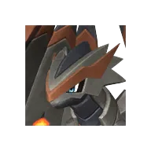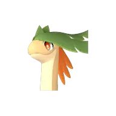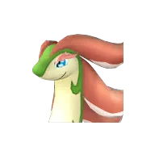+15
<a class="pmore" href="../../passivki/heavyweight/">Подробнее →</a>

Хорошая<b>Увеличение HP ур.2</b>

Макс. HP +15%

🧬 разведение

Передаётся детёнышу от родителя с этой пассивкой.

<a class="pmore" href="../../passivki/health_up_lv_2/">Подробнее →</a>

Хорошая<b>Увеличение атаки Пала ур.2</b>

Атака +8%

🧬 разведение

Передаётся детёнышу от родителя с этой пассивкой.

<a class="pmore" href="../../passivki/pal_attack_up_lv_2/">Подробнее →</a>

Хорошая<b>Увеличение атаки ур.2</b>

Атака +10%

🧬 разведение

Передаётся детёнышу от родителя с этой пассивкой.

<a class="pmore" href="../../passivki/attack_up_lv_2/">Подробнее →</a>

Хорошая<b>Увеличение водного урона Палов ур. 2</b>

Урон водой +12%

🧬 разведение

Передаётся детёнышу от родителя с этой пассивкой.

<a class="pmore" href="../../passivki/pal_water_damage_enhancement_lv_2/">Подробнее →</a>

Хорошая<b>Увеличение грозового урона Палов ур.2</b>

Урон молнией +12%

🧬 разведение

Передаётся детёнышу от родителя с этой пассивкой.

<a class="pmore" href="../../passivki/pal_electric_damage_enhancement_lv_2/">Подробнее →</a>

Хорошая<b>Увеличение драконьего урона Палов ур.2</b>

Урон драконом +12%

🧬 разведение

Передаётся детёнышу от родителя с этой пассивкой.

<a class="pmore" href="../../passivki/pal_dragon_damage_enhancement_lv_2/">Подробнее →</a>

Хорошая<b>Увеличение защиты Пала ур.2</b>

Защита +10%

🧬 разведение

Передаётся детёнышу от родителя с этой пассивкой.

<a class="pmore" href="../../passivki/pal_defense_up_lv_2/">Подробнее →</a>

Хорошая<b>Увеличение защиты ур.2</b>

Защита +15%

🧬 разведение

Передаётся детёнышу от родителя с этой пассивкой.

<a class="pmore" href="../../passivki/defense_up_lv_2/">Подробнее →</a>

Хорошая<b>Увеличение земного урона Палов ур.2</b>

Урон землёй +12%

🧬 разведение

Передаётся детёнышу от родителя с этой пассивкой.

<a class="pmore" href="../../passivki/pal_ground_damage_enhancement_lv_2/">Подробнее →</a>

Хорошая<b>Увеличение ледяного урона Палов ур.2</b>

Урон льдом +12%

🧬 разведение

Передаётся детёнышу от родителя с этой пассивкой.

<a class="pmore" href="../../passivki/pal_ice_damage_enhancement_lv_2/">Подробнее →</a>

Хорошая<b>Увеличение нейтрального урона Палов ур.2</b>

Урон нейтральной стихией +12%

🧬 разведение

Передаётся детёнышу от родителя с этой пассивкой.

<a class="pmore" href="../../passivki/pal_neutral_damage_enhancement_lv_2/">Подробнее →</a>

Хорошая<b>Увеличение огненного урона Палов ур.2</b>

Урон огнём +12%

🧬 разведение

Передаётся детёнышу от родителя с этой пассивкой.

<a class="pmore" href="../../passivki/pal_fire_damage_enhancement_lv_2/">Подробнее →</a>

Хорошая<b>Увеличение опыта Пала ур.2</b>

Опыт пала +40%

🧬 разведение

Передаётся детёнышу от родителя с этой пассивкой.

<a class="pmore" href="../../passivki/pal_exp_up_lv_2/">Подробнее →</a>

Хорошая<b>Увеличение травяного урона Палов ур.2</b>

Урон травой +12%

🧬 разведение

Передаётся детёнышу от родителя с этой пассивкой.

<a class="pmore" href="../../passivki/pal_grass_damage_enhancement_lv_2/">Подробнее →</a>

Хорошая<b>Увеличение тёмного урона Палов ур.2</b>

Урон тьмой +12%

🧬 разведение

Передаётся детёнышу от родителя с этой пассивкой.

<a class="pmore" href="../../passivki/pal_dark_damage_enhancement_lv_2/">Подробнее →</a>

Хорошая<b>Ускоренная работа ур.2</b>

Скорость работы +15%

🧬 разведение

Передаётся детёнышу от родителя с этой пассивкой.

<a class="pmore" href="../../passivki/speedy_worker_lv_2/">Подробнее →</a>

Обычная<b>Агрессивный</b>

Атака +10%Защита -10%

🧬 разведение

Передаётся детёнышу от родителя с этой пассивкой.

<a class="pmore" href="../../passivki/aggressive/">Подробнее →</a>

Обычная<b>Аномальный</b>

<small class="efn">Снижение нейтрального урона на 10%</small>

🐣 с рождения

Есть у 1 палов: Ловандер

🧬 разведение

Передаётся детёнышу от родителя с этой пассивкой.

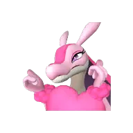
<a class="pmore" href="../../passivki/abnormal/">Подробнее →</a>

Обычная<b>Аромат трав</b>

<small class="efn">Увеличение травяного урона на 10%</small>

🧬 разведение

Передаётся детёнышу от родителя с этой пассивкой.

<a class="pmore" href="../../passivki/fragrant_foliage/">Подробнее →</a>

Обычная<b>Бессердечный</b>

<small class="efn">Увеличение ледяного урона на 10%</small>

🧬 разведение

Передаётся детёнышу от родителя с этой пассивкой.

<a class="pmore" href="../../passivki/coldblooded/">Подробнее →</a>

Обычная<b>Бессонница</b>

<small class="efn">Активен и продолжает работать даже ночью.</small>

🧬 разведение

Передаётся детёнышу от родителя с этой пассивкой.

🏥 операционный стол

Стоимость: 10 000 золота

<a class="pmore" href="../../passivki/insomnia/">Подробнее →</a>

Обычная<b>Большое увеличение водного урона</b>

Урон водой +3%

🧬 разведение

Передаётся детёнышу от родителя с этой пассивкой.

<a class="pmore" href="../../passivki/water_damage_enhancement_large/">Подробнее →</a>

Обычная<b>Большое увеличение водного урона</b>

Урон водой +3%

🧬 разведение

Передаётся детёнышу от родителя с этой пассивкой.

<a class="pmore" href="../../passivki/water_damage_enhancement_large/">Подробнее →</a>

Обычная<b>Большое увеличение драконьего урона</b>

Урон драконом +3%

🧬 разведение

Передаётся детёнышу от родителя с этой пассивкой.

<a class="pmore" href="../../passivki/dragon_damage_enhancement_large/">Подробнее →</a>

Обычная<b>Большое увеличение драконьего урона</b>

Урон драконом +3%

🧬 разведение

Передаётся детёнышу от родителя с этой пассивкой.

<a class="pmore" href="../../passivki/dragon_damage_enhancement_large/">Подробнее →</a>

Обычная<b>Большое увеличение драконьего урона</b>

Урон драконом +3%

🧬 разведение

Передаётся детёнышу от родителя с этой пассивкой.

<a class="pmore" href="../../passivki/dragon_damage_enhancement_large/">Подробнее →</a>

Обычная<b>Большое увеличение земного урона</b>

Урон землёй +3%

🧬 разведение

Передаётся детёнышу от родителя с этой пассивкой.

<a class="pmore" href="../../passivki/ground_damage_enhancement_large/">Подробнее →</a>

Обычная<b>Большое увеличение ледяного урона</b>

Урон льдом +3%

🧬 разведение

Передаётся детёнышу от родителя с этой пассивкой.

<a class="pmore" href="../../passivki/ice_damage_enhancement_large/">Подробнее →</a>

Обычная<b>Большое увеличение ледяного урона</b>

Урон льдом +3%

🧬 разведение

Передаётся детёнышу от родителя с этой пассивкой.

<a class="pmore" href="../../passivki/ice_damage_enhancement_large/">Подробнее →</a>

Обычная<b>Большое увеличение ледяного урона</b>

Урон льдом +3%

🧬 разведение

Передаётся детёнышу от родителя с этой пассивкой.

<a class="pmore" href="../../passivki/ice_damage_enhancement_large/">Подробнее →</a>

Обычная<b>Большое увеличение ледяного урона</b>

Урон льдом +3%

🧬 разведение

Передаётся детёнышу от родителя с этой пассивкой.

<a class="pmore" href="../../passivki/ice_damage_enhancement_large/">Подробнее →</a>

Обычная<b>Большое увеличение ледяного урона</b>

Урон льдом +3%

🧬 разведение

Передаётся детёнышу от родителя с этой пассивкой.

<a class="pmore" href="../../passivki/ice_damage_enhancement_large/">Подробнее →</a>

Обычная<b>Большое увеличение нейтрального урона</b>

Урон нейтральной стихией +3%

🧬 разведение

Передаётся детёнышу от родителя с этой пассивкой.

<a class="pmore" href="../../passivki/neutral_damage_enhancement_large/">Подробнее →</a>

Обычная<b>Большое увеличение нейтрального урона</b>

Урон нейтральной стихией +3%

🧬 разведение

Передаётся детёнышу от родителя с этой пассивкой.

<a class="pmore" href="../../passivki/neutral_damage_enhancement_large/">Подробнее →</a>

Обычная<b>Большое увеличение огненного урона</b>

Урон огнём +3%

🧬 разведение

Передаётся детёнышу от родителя с этой пассивкой.

<a class="pmore" href="../../passivki/fire_damage_enhancement_large/">Подробнее →</a>

Обычная<b>Большое увеличение огненного урона</b>

Урон огнём +3%

🧬 разведение

Передаётся детёнышу от родителя с этой пассивкой.

<a class="pmore" href="../../passivki/fire_damage_enhancement_large/">Подробнее →</a>

Обычная<b>Большое увеличение огненного урона</b>

Урон огнём +3%

🧬 разведение

Передаётся детёнышу от родителя с этой пассивкой.

<a class="pmore" href="../../passivki/fire_damage_enhancement_large/">Подробнее →</a>

Обычная<b>Большое увеличение огненного урона</b>

Урон огнём +3%

🧬 разведение

Передаётся детёнышу от родителя с этой пассивкой.

<a class="pmore" href="../../passivki/fire_damage_enhancement_large/">Подробнее →</a>

Обычная<b>Большое увеличение травяного урона</b>

Урон травой +3%

🧬 разведение

Передаётся детёнышу от родителя с этой пассивкой.

<a class="pmore" href="../../passivki/grass_damage_enhancement_large/">Подробнее →</a>

Обычная<b>Большое увеличение травяного урона</b>

Урон травой +3%

🧬 разведение

Передаётся детёнышу от родителя с этой пассивкой.

<a class="pmore" href="../../passivki/grass_damage_enhancement_large/">Подробнее →</a>

Обычная<b>Большое увеличение тёмного урона</b>

Урон тьмой +3%

🧬 разведение

Передаётся детёнышу от родителя с этой пассивкой.

<a class="pmore" href="../../passivki/dark_damage_enhancement_large/">Подробнее →</a>

Обычная<b>Большое увеличение урона молнией</b>

Урон молнией +3%

🧬 разведение

Передаётся детёнышу от родителя с этой пассивкой.

<a class="pmore" href="../../passivki/electric_damage_enhancement_large/">Подробнее →</a>

Обычная<b>Ботанический барьер</b>

<small class="efn">Снижение травяного урона 10%</small>

🧬 разведение

Передаётся детёнышу от родителя с этой пассивкой.

<a class="pmore" href="../../passivki/botanical_barrier/">Подробнее →</a>

Обычная<b>Вес сфер +1</b>

Сила броска сферы +16%

🧬 разведение

Передаётся детёнышу от родителя с этой пассивкой.

<a class="pmore" href="../../passivki/sphere_weight_1/">Подробнее →</a>

Обычная<b>Водостойкость</b>

<small class="efn">Снижение водного урона 10%</small>

🧬 разведение

Передаётся детёнышу от родителя с этой пассивкой.

<a class="pmore" href="../../passivki/waterproof/">Подробнее →</a>

Обычная<b>Горячее тело</b>

<small class="efn">Снижение ледяного урона 10%</small>

🧬 разведение

Передаётся детёнышу от родителя с этой пассивкой.

<a class="pmore" href="../../passivki/heated_body/">Подробнее →</a>

Обычная<b>Грубый</b>

Атака +15%Скорость работы -10%

🐣 с рождения

Есть у 2 палов: Горират, Горират Терра

🧬 разведение

Передаётся детёнышу от родителя с этой пассивкой.

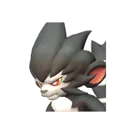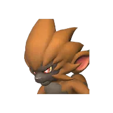
<a class="pmore" href="../../passivki/hooligan/">Подробнее →</a>

Обычная<b>Дальность полёта сферы +1</b>

Сила броска сферы +1%

🧬 разведение

Передаётся детёнышу от родителя с этой пассивкой.

<a class="pmore" href="../../passivki/sphere_range_1/">Подробнее →</a>

Обычная<b>Дальность полёта сферы +2</b>

Сила броска сферы +2%

🧬 разведение

Передаётся детёнышу от родителя с этой пассивкой.

<a class="pmore" href="../../passivki/sphere_range_2/">Подробнее →</a>

Обычная<b>Диэлектрик</b>

<small class="efn">Снижение урона молнией 10%</small>

🧬 разведение

Передаётся детёнышу от родителя с этой пассивкой.

<a class="pmore" href="../../passivki/insulated_body/">Подробнее →</a>

Обычная<b>Дополнительный прыжок +1</b>

Дополнительный прыжок +1

🧬 разведение

Передаётся детёнышу от родителя с этой пассивкой.

<a class="pmore" href="../../passivki/jump_count_increase_1/">Подробнее →</a>

Обычная<b>Дополнительный прыжок +2</b>

Дополнительный прыжок +2

🧬 разведение

Передаётся детёнышу от родителя с этой пассивкой.

<a class="pmore" href="../../passivki/jump_count_increase_2/">Подробнее →</a>

Обычная<b>Дополнительный прыжок +3</b>

Дополнительный прыжок +3

🧬 разведение

Передаётся детёнышу от родителя с этой пассивкой.

<a class="pmore" href="../../passivki/jump_count_increase_3/">Подробнее →</a>

Обычная<b>Драконья кровь</b>

<small class="efn">Увеличение драконьего урона на 10%</small>

🧬 разведение

Передаётся детёнышу от родителя с этой пассивкой.

<a class="pmore" href="../../passivki/blood_of_the_dragon/">Подробнее →</a>

Обычная<b>Жаростойкость ур.1</b>

Защита от жары +1%

🧬 разведение

Передаётся детёнышу от родителя с этой пассивкой.

<a class="pmore" href="../../passivki/heat_resistance_lv_1/">Подробнее →</a>

Обычная<b>Жаростойкость ур.1 / Морозостойкость ур.1</b>

Защита от холода +1%Защита от жары +1%

🧬 разведение

Передаётся детёнышу от родителя с этой пассивкой.

<a class="pmore" href="../../passivki/heat_resistance_lv_1_cold_resistance_lv_1/">Подробнее →</a>

Обычная<b>Жизнерадостный</b>

<small class="efn">Снижение тёмного урона 10%</small>

🧬 разведение

Передаётся детёнышу от родителя с этой пассивкой.

<a class="pmore" href="../../passivki/cheery/">Подробнее →</a>

Обычная<b>Играющий с водой</b>

<small class="efn">Увеличение водного урона на 10%</small>

🧬 разведение

Передаётся детёнышу от родителя с этой пассивкой.

<a class="pmore" href="../../passivki/hydromaniac/">Подробнее →</a>

Обычная<b>Играющий с огнём</b>

<small class="efn">Увеличение огненного урона на 10%</small>

🧬 разведение

Передаётся детёнышу от родителя с этой пассивкой.

<a class="pmore" href="../../passivki/pyromaniac/">Подробнее →</a>

Обычная<b>Изящное плавание</b>

<small class="efn">Увеличение скорости передвижения по воде на 30%</small>

🧬 разведение

Передаётся детёнышу от родителя с этой пассивкой.

🏥 операционный стол

Стоимость: 10 000 золота

<a class="pmore" href="../../passivki/sleek_stroke/">Подробнее →</a>

Обычная<b>Иммунитет к урону от взрывов</b>

Обезвреживает взрывные споры +1%Обезвреживает взрывные споры +1%Защита от взрывов +100%Защита от взрывов +100%

🧬 разведение

Передаётся детёнышу от родителя с этой пассивкой.

<a class="pmore" href="../../passivki/explosion_immunity/">Подробнее →</a>

Обычная<b>Иммунитет к урону от ядовитого газа</b>

Иммунитет к ядовитому газу +0%Иммунитет к ядовитому газу +0%

🧬 разведение

Передаётся детёнышу от родителя с этой пассивкой.

<a class="pmore" href="../../passivki/toxic_gas_immunity/">Подробнее →</a>

Обычная<b>Искривление траектории сферы +1</b>

Сила броска сферы +7%

🧬 разведение

Передаётся детёнышу от родителя с этой пассивкой.

<a class="pmore" href="../../passivki/sphere_curve_1/">Подробнее →</a>

Обычная<b>Конденсатор</b>

<small class="efn">Увеличение урона молнии на 10%</small>

🧬 разведение

Передаётся детёнышу от родителя с этой пассивкой.

<a class="pmore" href="../../passivki/capacitor/">Подробнее →</a>

Обычная<b>Корпоративный раб</b>

Скорость работы +30%Атака -30%

🧬 разведение

Передаётся детёнышу от родителя с этой пассивкой.

🏥 операционный стол

Стоимость: 10 000 золота

<a class="pmore" href="../../passivki/work_slave/">Подробнее →</a>

Обычная<b>Крепыш</b>

Макс. выносливость +25% *Действует только для Палов, которых можно оседлать.

🧬 разведение

Передаётся детёнышу от родителя с этой пассивкой.

🏥 операционный стол

Стоимость: 10 000 золота

<a class="pmore" href="../../passivki/fit_as_a_fiddle/">Подробнее →</a>

Обычная<b>Любитель загара</b>

<small class="efn">Снижение огненного урона 10%</small>

🧬 разведение

Передаётся детёнышу от родителя с этой пассивкой.

<a class="pmore" href="../../passivki/suntan_lover/">Подробнее →</a>

Обычная<b>Мазохист</b>

Защита +15%Атака -15%

🧬 разведение

Передаётся детёнышу от родителя с этой пассивкой.

<a class="pmore" href="../../passivki/masochist/">Подробнее →</a>

Обычная<b>Малое увеличение атаки ур.1</b>

Атака +3%

🧬 разведение

Передаётся детёнышу от родителя с этой пассивкой.

<a class="pmore" href="../../passivki/attack_up_s_lv_1/">Подробнее →</a>

Обычная<b>Малое увеличение водного урона</b>

Урон водой +1%

🧬 разведение

Передаётся детёнышу от родителя с этой пассивкой.

<a class="pmore" href="../../passivki/water_damage_enhancement_small/">Подробнее →</a>

Обычная<b>Малое увеличение водного урона</b>

Урон водой +1%

🧬 разведение

Передаётся детёнышу от родителя с этой пассивкой.

<a class="pmore" href="../../passivki/water_damage_enhancement_small/">Подробнее →</a>

Обычная<b>Малое увеличение водного урона</b>

Урон водой +1%

🧬 разведение

Передаётся детёнышу от родителя с этой пассивкой.

<a class="pmore" href="../../passivki/water_damage_enhancement_small/">Подробнее →</a>

Обычная<b>Малое увеличение водного урона</b>

Урон водой +1%

🧬 разведение

Передаётся детёнышу от родителя с этой пассивкой.

<a class="pmore" href="../../passivki/water_damage_enhancement_small/">Подробнее →</a>

Обычная<b>Малое увеличение грозового урона</b>

Урон молнией +1%

🧬 разведение

Передаётся детёнышу от родителя с этой пассивкой.

<a class="pmore" href="../../passivki/electric_damage_enhancement_small/">Подробнее →</a>

Обычная<b>Малое увеличение грозового урона</b>

Урон молнией +1%

🧬 разведение

Передаётся детёнышу от родителя с этой пассивкой.

<a class="pmore" href="../../passivki/electric_damage_enhancement_small/">Подробнее →</a>

Обычная<b>Малое увеличение грозового урона</b>

Урон молнией +1%

🧬 разведение

Передаётся детёнышу от родителя с этой пассивкой.

<a class="pmore" href="../../passivki/electric_damage_enhancement_small/">Подробнее →</a>

Обычная<b>Малое увеличение грозового урона</b>

Урон молнией +1%

🧬 разведение

Передаётся детёнышу от родителя с этой пассивкой.

<a class="pmore" href="../../passivki/electric_damage_enhancement_small/">Подробнее →</a>

Обычная<b>Малое увеличение грозового урона</b>

Урон молнией +1%

🧬 разведение

Передаётся детёнышу от родителя с этой пассивкой.

<a class="pmore" href="../../passivki/electric_damage_enhancement_small/">Подробнее →</a>

Обычная<b>Малое увеличение грозового урона</b>

Урон молнией +1%

🧬 разведение

Передаётся детёнышу от родителя с этой пассивкой.

<a class="pmore" href="../../passivki/electric_damage_enhancement_small/">Подробнее →</a>

Обычная<b>Малое увеличение грозового урона</b>

Урон молнией +1%

🧬 разведение

Передаётся детёнышу от родителя с этой пассивкой.

<a class="pmore" href="../../passivki/electric_damage_enhancement_small/">Подробнее →</a>

Обычная<b>Малое увеличение грозового урона</b>

Урон молнией +1%

🧬 разведение

Передаётся детёнышу от родителя с этой пассивкой.

<a class="pmore" href="../../passivki/electric_damage_enhancement_small/">Подробнее →</a>

Обычная<b>Малое увеличение драконьего урона</b>

Урон драконом +1%

🧬 разведение

Передаётся детёнышу от родителя с этой пассивкой.

<a class="pmore" href="../../passivki/dragon_damage_enhancement_small/">Подробнее →</a>

Обычная<b>Малое увеличение драконьего урона</b>

Урон драконом +1%

🧬 разведение

Передаётся детёнышу от родителя с этой пассивкой.

<a class="pmore" href="../../passivki/dragon_damage_enhancement_small/">Подробнее →</a>

Обычная<b>Малое увеличение драконьего урона</b>

Урон драконом +1%

🧬 разведение

Передаётся детёнышу от родителя с этой пассивкой.

<a class="pmore" href="../../passivki/dragon_damage_enhancement_small/">Подробнее →</a>

Обычная<b>Малое увеличение драконьего урона</b>

Урон драконом +1%

🧬 разведение

Передаётся детёнышу от родителя с этой пассивкой.

<a class="pmore" href="../../passivki/dragon_damage_enhancement_small/">Подробнее →</a>

Обычная<b>Малое увеличение земного урона</b>

Урон землёй +1%

🧬 разведение

Передаётся детёнышу от родителя с этой пассивкой.

<a class="pmore" href="../../passivki/ground_damage_enhancement_small/">Подробнее →</a>

Обычная<b>Малое увеличение земного урона</b>

Урон землёй +1%

🧬 разведение

Передаётся детёнышу от родителя с этой пассивкой.

<a class="pmore" href="../../passivki/ground_damage_enhancement_small/">Подробнее →</a>

Обычная<b>Малое увеличение земного урона</b>

Урон землёй +1%

🧬 разведение

Передаётся детёнышу от родителя с этой пассивкой.

<a class="pmore" href="../../passivki/ground_damage_enhancement_small/">Подробнее →</a>

Обычная<b>Малое увеличение земного урона</b>

Урон землёй +1%

🧬 разведение

Передаётся детёнышу от родителя с этой пассивкой.

<a class="pmore" href="../../passivki/ground_damage_enhancement_small/">Подробнее →</a>

Обычная<b>Малое увеличение земного урона</b>

Урон землёй +1%

🧬 разведение

Передаётся детёнышу от родителя с этой пассивкой.

<a class="pmore" href="../../passivki/ground_damage_enhancement_small/">Подробнее →</a>

Обычная<b>Малое увеличение земного урона</b>

Урон землёй +1%

🧬 разведение

Передаётся детёнышу от родителя с этой пассивкой.

<a class="pmore" href="../../passivki/ground_damage_enhancement_small/">Подробнее →</a>

Обычная<b>Малое увеличение земного урона</b>

Урон землёй +1%

🧬 разведение

Передаётся детёнышу от родителя с этой пассивкой.

<a class="pmore" href="../../passivki/ground_damage_enhancement_small/">Подробнее →</a>

Обычная<b>Малое увеличение земного урона</b>

Урон землёй +1%

🧬 разведение

Передаётся детёнышу от родителя с этой пассивкой.

<a class="pmore" href="../../passivki/ground_damage_enhancement_small/">Подробнее →</a>

Обычная<b>Малое увеличение земного урона</b>

Урон землёй +1%

🧬 разведение

Передаётся детёнышу от родителя с этой пассивкой.

<a class="pmore" href="../../passivki/ground_damage_enhancement_small/">Подробнее →</a>

Обычная<b>Малое увеличение ледяного урона</b>

Урон льдом +1%

🧬 разведение

Передаётся детёнышу от родителя с этой пассивкой.

<a class="pmore" href="../../passivki/ice_damage_enhancement_small/">Подробнее →</a>

Обычная<b>Малое увеличение ледяного урона</b>

Урон льдом +1%

🧬 разведение

Передаётся детёнышу от родителя с этой пассивкой.

<a class="pmore" href="../../passivki/ice_damage_enhancement_small/">Подробнее →</a>

Обычная<b>Малое увеличение ледяного урона</b>

Урон льдом +1%

🧬 разведение

Передаётся детёнышу от родителя с этой пассивкой.

<a class="pmore" href="../../passivki/ice_damage_enhancement_small/">Подробнее →</a>

Обычная<b>Малое увеличение ледяного урона</b>

Урон льдом +1%

🧬 разведение

Передаётся детёнышу от родителя с этой пассивкой.

<a class="pmore" href="../../passivki/ice_damage_enhancement_small/">Подробнее →</a>

Обычная<b>Малое увеличение ледяного урона</b>

Урон льдом +1%

🧬 разведение

Передаётся детёнышу от родителя с этой пассивкой.

<a class="pmore" href="../../passivki/ice_damage_enhancement_small/">Подробнее →</a>

Обычная<b>Малое увеличение нейтрального урона</b>

Урон нейтральной стихией +1%

🧬 разведение

Передаётся детёнышу от родителя с этой пассивкой.

<a class="pmore" href="../../passivki/neutral_damage_enhancement_small/">Подробнее →</a>

Обычная<b>Малое увеличение нейтрального урона</b>

Урон нейтральной стихией +1%

🧬 разведение

Передаётся детёнышу от родителя с этой пассивкой.

<a class="pmore" href="../../passivki/neutral_damage_enhancement_small/">Подробнее →</a>

Обычная<b>Малое увеличение нейтрального урона</b>

Урон нейтральной стихией +1%

🧬 разведение

Передаётся детёнышу от родителя с этой пассивкой.

<a class="pmore" href="../../passivki/neutral_damage_enhancement_small/">Подробнее →</a>

Обычная<b>Малое увеличение нейтрального урона</b>

Урон нейтральной стихией +1%

🧬 разведение

Передаётся детёнышу от родителя с этой пассивкой.

<a class="pmore" href="../../passivki/neutral_damage_enhancement_small/">Подробнее →</a>

Обычная<b>Малое увеличение нейтрального урона</b>

Урон нейтральной стихией +1%

🧬 разведение

Передаётся детёнышу от родителя с этой пассивкой.

<a class="pmore" href="../../passivki/neutral_damage_enhancement_small/">Подробнее →</a>

Обычная<b>Малое увеличение нейтрального урона</b>

Урон нейтральной стихией +1%

🧬 разведение

Передаётся детёнышу от родителя с этой пассивкой.

<a class="pmore" href="../../passivki/neutral_damage_enhancement_small/">Подробнее →</a>

Обычная<b>Малое увеличение огненного урона</b>

Урон огнём +1%

🧬 разведение

Передаётся детёнышу от родителя с этой пассивкой.

<a class="pmore" href="../../passivki/fire_damage_enhancement_small/">Подробнее →</a>

Обычная<b>Малое увеличение огненного урона</b>

Урон огнём +1%

🧬 разведение

Передаётся детёнышу от родителя с этой пассивкой.

<a class="pmore" href="../../passivki/fire_damage_enhancement_small/">Подробнее →</a>

Обычная<b>Малое увеличение огненного урона</b>

Урон огнём +1%

🧬 разведение

Передаётся детёнышу от родителя с этой пассивкой.

<a class="pmore" href="../../passivki/fire_damage_enhancement_small/">Подробнее →</a>

Обычная<b>Малое увеличение огненного урона</b>

Урон огнём +1%

🧬 разведение

Передаётся детёнышу от родителя с этой пассивкой.

<a class="pmore" href="../../passivki/fire_damage_enhancement_small/">Подробнее →</a>

Обычная<b>Малое увеличение огненного урона</b>

Урон огнём +1%

🧬 разведение

Передаётся детёнышу от родителя с этой пассивкой.

<a class="pmore" href="../../passivki/fire_damage_enhancement_small/">Подробнее →</a>

Обычная<b>Малое увеличение огненного урона</b>

Урон огнём +1%

🧬 разведение

Передаётся детёнышу от родителя с этой пассивкой.

<a class="pmore" href="../../passivki/fire_damage_enhancement_small/">Подробнее →</a>

Обычная<b>Малое увеличение травяного урона</b>

Урон травой +1%

🧬 разведение

Передаётся детёнышу от родителя с этой пассивкой.

<a class="pmore" href="../../passivki/grass_damage_enhancement_small/">Подробнее →</a>

Обычная<b>Малое увеличение травяного урона</b>

Урон травой +1%

🧬 разведение

Передаётся детёнышу от родителя с этой пассивкой.

<a class="pmore" href="../../passivki/grass_damage_enhancement_small/">Подробнее →</a>

Обычная<b>Малое увеличение травяного урона</b>

Урон травой +1%

🧬 разведение

Передаётся детёнышу от родителя с этой пассивкой.

<a class="pmore" href="../../passivki/grass_damage_enhancement_small/">Подробнее →</a>

Обычная<b>Малое увеличение травяного урона</b>

Урон травой +1%

🧬 разведение

Передаётся детёнышу от родителя с этой пассивкой.

<a class="pmore" href="../../passivki/grass_damage_enhancement_small/">Подробнее →</a>

Обычная<b>Малое увеличение травяного урона</b>

Урон травой +1%

🧬 разведение

Передаётся детёнышу от родителя с этой пассивкой.

<a class="pmore" href="../../passivki/grass_damage_enhancement_small/">Подробнее →</a>

Обычная<b>Малое увеличение травяного урона</b>

Урон травой +1%

🧬 разведение

Передаётся детёнышу от родителя с этой пассивкой.

<a class="pmore" href="../../passivki/grass_damage_enhancement_small/">Подробнее →</a>

Обычная<b>Малое увеличение травяного урона</b>

Урон травой +1%

🧬 разведение

Передаётся детёнышу от родителя с этой пассивкой.

<a class="pmore" href="../../passivki/grass_damage_enhancement_small/">Подробнее →</a>

Обычная<b>Малое увеличение травяного урона</b>

Урон травой +1%

🧬 разведение

Передаётся детёнышу от родителя с этой пассивкой.

<a class="pmore" href="../../passivki/grass_damage_enhancement_small/">Подробнее →</a>

Обычная<b>Малое увеличение тёмного урона</b>

Урон тьмой +1%

🧬 разведение

Передаётся детёнышу от родителя с этой пассивкой.

<a class="pmore" href="../../passivki/dark_damage_enhancement_small/">Подробнее →</a>

Обычная<b>Малое увеличение тёмного урона</b>

Урон тьмой +1%

🧬 разведение

Передаётся детёнышу от родителя с этой пассивкой.

<a class="pmore" href="../../passivki/dark_damage_enhancement_small/">Подробнее →</a>

Обычная<b>Малое увеличение тёмного урона</b>

Урон тьмой +1%

🧬 разведение

Передаётся детёнышу от родителя с этой пассивкой.

<a class="pmore" href="../../passivki/dark_damage_enhancement_small/">Подробнее →</a>

Обычная<b>Малое увеличение тёмного урона</b>

Урон тьмой +1%

🧬 разведение

Передаётся детёнышу от родителя с этой пассивкой.

<a class="pmore" href="../../passivki/dark_damage_enhancement_small/">Подробнее →</a>

Обычная<b>Малое увеличение тёмного урона</b>

Урон тьмой +1%

🧬 разведение

Передаётся детёнышу от родителя с этой пассивкой.

<a class="pmore" href="../../passivki/dark_damage_enhancement_small/">Подробнее →</a>

Обычная<b>Малое увеличение тёмного урона</b>

Урон тьмой +1%

🧬 разведение

Передаётся детёнышу от родителя с этой пассивкой.

<a class="pmore" href="../../passivki/dark_damage_enhancement_small/">Подробнее →</a>

Обычная<b>Малое увеличение тёмного урона</b>

Урон тьмой +1%

🧬 разведение

Передаётся детёнышу от родителя с этой пассивкой.

<a class="pmore" href="../../passivki/dark_damage_enhancement_small/">Подробнее →</a>

Обычная<b>Малое увеличение тёмного урона</b>

Урон тьмой +1%

🧬 разведение

Передаётся детёнышу от родителя с этой пассивкой.

<a class="pmore" href="../../passivki/dark_damage_enhancement_small/">Подробнее →</a>

Обычная<b>Малое увеличение тёмного урона</b>

Урон тьмой +1%

🧬 разведение

Передаётся детёнышу от родителя с этой пассивкой.

<a class="pmore" href="../../passivki/dark_damage_enhancement_small/">Подробнее →</a>

Обычная<b>Малое увеличение тёмного урона</b>

Урон тьмой +1%

🧬 разведение

Передаётся детёнышу от родителя с этой пассивкой.

<a class="pmore" href="../../passivki/dark_damage_enhancement_small/">Подробнее →</a>

Обычная<b>Малое увеличение тёмного урона</b>

Урон тьмой +1%

🧬 разведение

Передаётся детёнышу от родителя с этой пассивкой.

<a class="pmore" href="../../passivki/dark_damage_enhancement_small/">Подробнее →</a>

Обычная<b>Малое увеличение тёмного урона</b>

Урон тьмой +1%

🧬 разведение

Передаётся детёнышу от родителя с этой пассивкой.

<a class="pmore" href="../../passivki/dark_damage_enhancement_small/">Подробнее →</a>

Обычная<b>Малое увеличение тёмного урона</b>

Урон тьмой +1%

🧬 разведение

Передаётся детёнышу от родителя с этой пассивкой.

<a class="pmore" href="../../passivki/dark_damage_enhancement_small/">Подробнее →</a>

Обычная<b>Малое увеличение тёмного урона</b>

Урон тьмой +1%

🧬 разведение

Передаётся детёнышу от родителя с этой пассивкой.

<a class="pmore" href="../../passivki/dark_damage_enhancement_small/">Подробнее →</a>

Обычная<b>Малое увеличение тёмного урона</b>

Урон тьмой +1%

🧬 разведение

Передаётся детёнышу от родителя с этой пассивкой.

<a class="pmore" href="../../passivki/dark_damage_enhancement_small/">Подробнее →</a>

Обычная<b>Малое увеличение тёмного урона</b>

Урон тьмой +1%

🧬 разведение

Передаётся детёнышу от родителя с этой пассивкой.

<a class="pmore" href="../../passivki/dark_damage_enhancement_small/">Подробнее →</a>

Обычная<b>Малое увеличение урона молнией</b>

Урон молнией +1%

🧬 разведение

Передаётся детёнышу от родителя с этой пассивкой.

<a class="pmore" href="../../passivki/electric_damage_enhancement_small/">Подробнее →</a>

Обычная<b>Малоежка</b>

Уровень сытости снижается медленнее +10%

🧬 разведение

Передаётся детёнышу от родителя с этой пассивкой.

🏥 операционный стол

Стоимость: 10 000 золота

<a class="pmore" href="../../passivki/dainty_eater/">Подробнее →</a>

Обычная<b>Морозостойкость ур.1</b>

Защита от холода +1%

🧬 разведение

Передаётся детёнышу от родителя с этой пассивкой.

<a class="pmore" href="../../passivki/cold_resistance_lv_1/">Подробнее →</a>

Обычная<b>Неизвестные биоклетки</b>

Атака +10%
<small class="efn">Снижение огненного урона на 15%</small><small class="efn">Снижение урона молнии на 15%</small>

🐣 с рождения

Есть у 3 палов: Зеноведа, Зеногард, Зенолорд

🧬 разведение

Передаётся детёнышу от родителя с этой пассивкой.

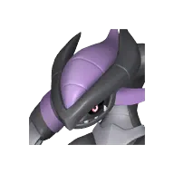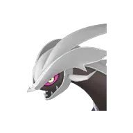
<a class="pmore" href="../../passivki/otherworldly_cells/">Подробнее →</a>

Обычная<b>Нетерпеливый</b>

<small class="efn">Снижение времени перезарядки активных навыков на 15%</small>

🧬 разведение

Передаётся детёнышу от родителя с этой пассивкой.

🏥 операционный стол

Стоимость: 10 000 золота

<a class="pmore" href="../../passivki/impatient/">Подробнее →</a>

Обычная<b>Объёмы добычи руды ур.1</b>

<small class="efn">Количество выпадаемых камня и руды немного увеличивается</small>

🧬 разведение

Передаётся детёнышу от родителя с этой пассивкой.

<a class="pmore" href="../../passivki/mining_yield_up_lv_1/">Подробнее →</a>

Обычная<b>Объёмы добычи руды ур.2</b>

<small class="efn">Количество выпадаемых камня и руды увеличивается</small>

🧬 разведение

Передаётся детёнышу от родителя с этой пассивкой.

<a class="pmore" href="../../passivki/mining_yield_up_lv_2/">Подробнее →</a>

Обычная<b>Объёмы лесозаготовки ур.1</b>

<small class="efn">Количество выпадаемой древесины немного увеличивается</small>

🧬 разведение

Передаётся детёнышу от родителя с этой пассивкой.

<a class="pmore" href="../../passivki/logging_yield_up_lv_1/">Подробнее →</a>

Обычная<b>Объёмы лесозаготовки ур.2</b>

<small class="efn">Количество выпадаемой древесины увеличивается</small>

🧬 разведение

Передаётся детёнышу от родителя с этой пассивкой.

<a class="pmore" href="../../passivki/logging_yield_up_lv_2/">Подробнее →</a>

Обычная<b>Оптимист</b>

Показатель рассудка снижается медленнее +10%

🧬 разведение

Передаётся детёнышу от родителя с этой пассивкой.

🏥 операционный стол

Стоимость: 10 000 золота

<a class="pmore" href="../../passivki/positive_thinker/">Подробнее →</a>

Обычная<b>Отважный</b>

Атака +10%

🧬 разведение

Передаётся детёнышу от родителя с этой пассивкой.

🏥 операционный стол

Стоимость: 10 000 золота

<a class="pmore" href="../../passivki/brave/">Подробнее →</a>

Обычная<b>Отклонение траектории сферы</b>

Сила броска сферы +8%

🧬 разведение

Передаётся детёнышу от родителя с этой пассивкой.

<a class="pmore" href="../../passivki/sphere_slider/">Подробнее →</a>

Обычная<b>Покров ночи</b>

<small class="efn">Увеличение тёмного урона на 10%</small>

🧬 разведение

Передаётся детёнышу от родителя с этой пассивкой.

<a class="pmore" href="../../passivki/veil_of_darkness/">Подробнее →</a>

Обычная<b>Проворный</b>

<small class="efn">Увеличение скорости передвижения на 10%</small>

🧬 разведение

Передаётся детёнышу от родителя с этой пассивкой.

🏥 операционный стол

Стоимость: 10 000 золота

<a class="pmore" href="../../passivki/nimble/">Подробнее →</a>

Обычная<b>Рывок в воздухе +1</b>

Рывок в воздухе +1

🧬 разведение

Передаётся детёнышу от родителя с этой пассивкой.

<a class="pmore" href="../../passivki/aerial_dash_1/">Подробнее →</a>

Обычная<b>Рывок в воздухе +2</b>

Рывок в воздухе +2

🧬 разведение

Передаётся детёнышу от родителя с этой пассивкой.

<a class="pmore" href="../../passivki/aerial_dash_2/">Подробнее →</a>

Обычная<b>Рывок в воздухе +3</b>

Рывок в воздухе +3

🧬 разведение

Передаётся детёнышу от родителя с этой пассивкой.

<a class="pmore" href="../../passivki/aerial_dash_3/">Подробнее →</a>

Обычная<b>Рывок в воздухе +4</b>

Рывок в воздухе +4

🧬 разведение

Передаётся детёнышу от родителя с этой пассивкой.

<a class="pmore" href="../../passivki/aerial_dash_4/">Подробнее →</a>

Обычная<b>Садист</b>

Атака +15%Защита -15%

🐣 с рождения

Есть у 1 палов: Сплаттерина

🧬 разведение

Передаётся детёнышу от родителя с этой пассивкой.

<a class="pmore" href="../../passivki/sadist/">Подробнее →</a>

Обычная<b>Самонаведение сферы</b>

Сила броска сферы +19%

🧬 разведение

Передаётся детёнышу от родителя с этой пассивкой.

<a class="pmore" href="../../passivki/sphere_homing/">Подробнее →</a>

Обычная<b>Сейсмостойкость</b>

<small class="efn">Снижение земного урона 10%</small>

🧬 разведение

Передаётся детёнышу от родителя с этой пассивкой.

<a class="pmore" href="../../passivki/earthquake_resistant/">Подробнее →</a>

Обычная<b>Сила земли</b>

<small class="efn">Увеличение земляного урона на 10%</small>

🧬 разведение

Передаётся детёнышу от родителя с этой пассивкой.

<a class="pmore" href="../../passivki/power_of_gaia/">Подробнее →</a>

Обычная<b>Сокращение водного урона ур.1</b>

Защита от воды +15%

🧬 разведение

Передаётся детёнышу от родителя с этой пассивкой.

<a class="pmore" href="../../passivki/water_damage_reduction_lv_1/">Подробнее →</a>

Обычная<b>Сокращение драконьего урона ур.1</b>

Защита от дракона +15%

🧬 разведение

Передаётся детёнышу от родителя с этой пассивкой.

<a class="pmore" href="../../passivki/dragon_damage_reduction_lv_1/">Подробнее →</a>

Обычная<b>Сокращение земного урона ур.1</b>

Защита от земли +15%

🧬 разведение

Передаётся детёнышу от родителя с этой пассивкой.

<a class="pmore" href="../../passivki/earth_damage_reduction_lv_1/">Подробнее →</a>

Обычная<b>Сокращение ледяного урона ур.1</b>

Защита от льда +15%

🧬 разведение

Передаётся детёнышу от родителя с этой пассивкой.

<a class="pmore" href="../../passivki/ice_damage_reduction_lv_1/">Подробнее →</a>

Обычная<b>Сокращение нейтрального урона ур.1</b>

Защита от нейтральной стихии +15%

🧬 разведение

Передаётся детёнышу от родителя с этой пассивкой.

<a class="pmore" href="../../passivki/neutral_damage_reduction_lv_1/">Подробнее →</a>

Обычная<b>Сокращение огненного урона ур.1</b>

Защита от огня +15%

🧬 разведение

Передаётся детёнышу от родителя с этой пассивкой.

<a class="pmore" href="../../passivki/fire_damage_reduction_lv_1/">Подробнее →</a>

Обычная<b>Сокращение травяного урона ур.1</b>

Защита от травы +15%

🧬 разведение

Передаётся детёнышу от родителя с этой пассивкой.

<a class="pmore" href="../../passivki/grass_damage_reduction_lv_1/">Подробнее →</a>

Обычная<b>Сокращение тёмного урона ур.1</b>

Защита от тьмы +15%

🧬 разведение

Передаётся детёнышу от родителя с этой пассивкой.

<a class="pmore" href="../../passivki/dark_damage_reduction_lv_1/">Подробнее →</a>

Обычная<b>Сокращение урона молнии ур.1</b>

Защита от молнии +15%

🧬 разведение

Передаётся детёнышу от родителя с этой пассивкой.

<a class="pmore" href="../../passivki/electric_damage_reduction_lv_1/">Подробнее →</a>

Обычная<b>Состояние пустоты</b>

<small class="efn">Увеличение нейтрального урона на 10%</small>

🧬 разведение

Передаётся детёнышу от родителя с этой пассивкой.

<a class="pmore" href="../../passivki/spirit_of_zen/">Подробнее →</a>

Обычная<b>Среднее увеличение водного урона</b>

Урон водой +2%

🧬 разведение

Передаётся детёнышу от родителя с этой пассивкой.

<a class="pmore" href="../../passivki/water_damage_enhancement_medium/">Подробнее →</a>

Обычная<b>Среднее увеличение водного урона</b>

Урон водой +2%

🧬 разведение

Передаётся детёнышу от родителя с этой пассивкой.

<a class="pmore" href="../../passivki/water_damage_enhancement_medium/">Подробнее →</a>

Обычная<b>Среднее увеличение водного урона</b>

Урон водой +2%

🧬 разведение

Передаётся детёнышу от родителя с этой пассивкой.

<a class="pmore" href="../../passivki/water_damage_enhancement_medium/">Подробнее →</a>

Обычная<b>Среднее увеличение водного урона</b>

Урон водой +2%

🧬 разведение

Передаётся детёнышу от родителя с этой пассивкой.

<a class="pmore" href="../../passivki/water_damage_enhancement_medium/">Подробнее →</a>

Обычная<b>Среднее увеличение грозового урона</b>

Урон молнией +2%

🧬 разведение

Передаётся детёнышу от родителя с этой пассивкой.

<a class="pmore" href="../../passivki/electric_damage_enhancement_medium/">Подробнее →</a>

Обычная<b>Среднее увеличение грозового урона</b>

Урон молнией +2%

🧬 разведение

Передаётся детёнышу от родителя с этой пассивкой.

<a class="pmore" href="../../passivki/electric_damage_enhancement_medium/">Подробнее →</a>

Обычная<b>Среднее увеличение грозового урона</b>

Урон молнией +2%

🧬 разведение

Передаётся детёнышу от родителя с этой пассивкой.

<a class="pmore" href="../../passivki/electric_damage_enhancement_medium/">Подробнее →</a>

Обычная<b>Среднее увеличение драконьего урона</b>

Урон драконом +2%

🧬 разведение

Передаётся детёнышу от родителя с этой пассивкой.

<a class="pmore" href="../../passivki/dragon_damage_enhancement_medium/">Подробнее →</a>

Обычная<b>Среднее увеличение драконьего урона</b>

Урон драконом +2%

🧬 разведение

Передаётся детёнышу от родителя с этой пассивкой.

<a class="pmore" href="../../passivki/dragon_damage_enhancement_medium/">Подробнее →</a>

Обычная<b>Среднее увеличение драконьего урона</b>

Урон драконом +2%

🧬 разведение

Передаётся детёнышу от родителя с этой пассивкой.

<a class="pmore" href="../../passivki/dragon_damage_enhancement_medium/">Подробнее →</a>

Обычная<b>Среднее увеличение драконьего урона</b>

Урон драконом +2%

🧬 разведение

Передаётся детёнышу от родителя с этой пассивкой.

<a class="pmore" href="../../passivki/dragon_damage_enhancement_medium/">Подробнее →</a>

Обычная<b>Среднее увеличение земного урона</b>

Урон землёй +2%

🧬 разведение

Передаётся детёнышу от родителя с этой пассивкой.

<a class="pmore" href="../../passivki/ground_damage_enhancement_medium/">Подробнее →</a>

Обычная<b>Среднее увеличение земного урона</b>

Урон землёй +2%

🧬 разведение

Передаётся детёнышу от родителя с этой пассивкой.

<a class="pmore" href="../../passivki/ground_damage_enhancement_medium/">Подробнее →</a>

Обычная<b>Среднее увеличение земного урона</b>

Урон землёй +2%

🧬 разведение

Передаётся детёнышу от родителя с этой пассивкой.

<a class="pmore" href="../../passivki/ground_damage_enhancement_medium/">Подробнее →</a>

Обычная<b>Среднее увеличение земного урона</b>

Урон землёй +2%

🧬 разведение

Передаётся детёнышу от родителя с этой пассивкой.

<a class="pmore" href="../../passivki/ground_damage_enhancement_medium/">Подробнее →</a>

Обычная<b>Среднее увеличение земного урона</b>

Урон землёй +2%

🧬 разведение

Передаётся детёнышу от родителя с этой пассивкой.

<a class="pmore" href="../../passivki/ground_damage_enhancement_medium/">Подробнее →</a>

Обычная<b>Среднее увеличение ледяного урона</b>

Урон льдом +2%

🧬 разведение

Передаётся детёнышу от родителя с этой пассивкой.

<a class="pmore" href="../../passivki/ice_damage_enhancement_medium/">Подробнее →</a>

Обычная<b>Среднее увеличение ледяного урона</b>

Урон льдом +2%

🧬 разведение

Передаётся детёнышу от родителя с этой пассивкой.

<a class="pmore" href="../../passivki/ice_damage_enhancement_medium/">Подробнее →</a>

Обычная<b>Среднее увеличение ледяного урона</b>

Урон льдом +2%

🧬 разведение

Передаётся детёнышу от родителя с этой пассивкой.

<a class="pmore" href="../../passivki/ice_damage_enhancement_medium/">Подробнее →</a>

Обычная<b>Среднее увеличение ледяного урона</b>

Урон льдом +2%

🧬 разведение

Передаётся детёнышу от родителя с этой пассивкой.

<a class="pmore" href="../../passivki/ice_damage_enhancement_medium/">Подробнее →</a>

Обычная<b>Среднее увеличение нейтрального урона</b>

Урон нейтральной стихией +2%

🧬 разведение

Передаётся детёнышу от родителя с этой пассивкой.

<a class="pmore" href="../../passivki/neutral_damage_enhancement_medium/">Подробнее →</a>

Обычная<b>Среднее увеличение нейтрального урона</b>

Урон нейтральной стихией +2%

🧬 разведение

Передаётся детёнышу от родителя с этой пассивкой.

<a class="pmore" href="../../passivki/neutral_damage_enhancement_medium/">Подробнее →</a>

Обычная<b>Среднее увеличение нейтрального урона</b>

Урон нейтральной стихией +2%

🧬 разведение

Передаётся детёнышу от родителя с этой пассивкой.

<a class="pmore" href="../../passivki/neutral_damage_enhancement_medium/">Подробнее →</a>

Обычная<b>Среднее увеличение огненного урона</b>

Урон огнём +2%

🧬 разведение

Передаётся детёнышу от родителя с этой пассивкой.

<a class="pmore" href="../../passivki/fire_damage_enhancement_medium/">Подробнее →</a>

Обычная<b>Среднее увеличение огненного урона</b>

Урон огнём +2%

🧬 разведение

Передаётся детёнышу от родителя с этой пассивкой.

<a class="pmore" href="../../passivki/fire_damage_enhancement_medium/">Подробнее →</a>

Обычная<b>Среднее увеличение огненного урона</b>

Урон огнём +2%

🧬 разведение

Передаётся детёнышу от родителя с этой пассивкой.

<a class="pmore" href="../../passivki/fire_damage_enhancement_medium/">Подробнее →</a>

Обычная<b>Среднее увеличение огненного урона</b>

Урон огнём +2%

🧬 разведение

Передаётся детёнышу от родителя с этой пассивкой.

<a class="pmore" href="../../passivki/fire_damage_enhancement_medium/">Подробнее →</a>

Обычная<b>Среднее увеличение травяного урона</b>

Урон травой +2%

🧬 разведение

Передаётся детёнышу от родителя с этой пассивкой.

<a class="pmore" href="../../passivki/grass_damage_enhancement_medium/">Подробнее →</a>

Обычная<b>Среднее увеличение травяного урона</b>

Урон травой +2%

🧬 разведение

Передаётся детёнышу от родителя с этой пассивкой.

<a class="pmore" href="../../passivki/grass_damage_enhancement_medium/">Подробнее →</a>

Обычная<b>Среднее увеличение травяного урона</b>

Урон травой +2%

🧬 разведение

Передаётся детёнышу от родителя с этой пассивкой.

<a class="pmore" href="../../passivki/grass_damage_enhancement_medium/">Подробнее →</a>

Обычная<b>Среднее увеличение травяного урона</b>

Урон травой +2%

🧬 разведение

Передаётся детёнышу от родителя с этой пассивкой.

<a class="pmore" href="../../passivki/grass_damage_enhancement_medium/">Подробнее →</a>

Обычная<b>Среднее увеличение травяного урона</b>

Урон травой +2%

🧬 разведение

Передаётся детёнышу от родителя с этой пассивкой.

<a class="pmore" href="../../passivki/grass_damage_enhancement_medium/">Подробнее →</a>

Обычная<b>Среднее увеличение травяного урона</b>

Урон травой +2%

🧬 разведение

Передаётся детёнышу от родителя с этой пассивкой.

<a class="pmore" href="../../passivki/grass_damage_enhancement_medium/">Подробнее →</a>

Обычная<b>Среднее увеличение травяного урона</b>

Урон травой +2%

🧬 разведение

Передаётся детёнышу от родителя с этой пассивкой.

<a class="pmore" href="../../passivki/grass_damage_enhancement_medium/">Подробнее →</a>

Обычная<b>Среднее увеличение тёмного урона</b>

Урон тьмой +2%

🧬 разведение

Передаётся детёнышу от родителя с этой пассивкой.

<a class="pmore" href="../../passivki/dark_damage_enhancement_medium/">Подробнее →</a>

Обычная<b>Среднее увеличение тёмного урона</b>

Урон тьмой +2%

🧬 разведение

Передаётся детёнышу от родителя с этой пассивкой.

<a class="pmore" href="../../passivki/dark_damage_enhancement_medium/">Подробнее →</a>

Обычная<b>Среднее увеличение тёмного урона</b>

Урон тьмой +2%

🧬 разведение

Передаётся детёнышу от родителя с этой пассивкой.

<a class="pmore" href="../../passivki/dark_damage_enhancement_medium/">Подробнее →</a>

Обычная<b>Среднее увеличение тёмного урона</b>

Урон тьмой +2%

🧬 разведение

Передаётся детёнышу от родителя с этой пассивкой.

<a class="pmore" href="../../passivki/dark_damage_enhancement_medium/">Подробнее →</a>

Обычная<b>Среднее увеличение урона молнией</b>

Урон молнией +2%

🧬 разведение

Передаётся детёнышу от родителя с этой пассивкой.

<a class="pmore" href="../../passivki/electric_damage_enhancement_medium/">Подробнее →</a>

Обычная<b>Старательный</b>

Скорость работы +20%

🧬 разведение

Передаётся детёнышу от родителя с этой пассивкой.

🏥 операционный стол

Стоимость: 10 000 золота

<a class="pmore" href="../../passivki/serious/">Подробнее →</a>

Обычная<b>Толстокожий</b>

Защита +10%

🐣 с рождения

Есть у 4 палов: Астегон, Дигтос, Ворсект, Ворсект Терра

🧬 разведение

Передаётся детёнышу от родителя с этой пассивкой.

🏥 операционный стол

Стоимость: 10 000 золота

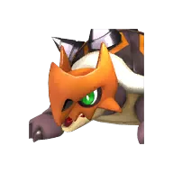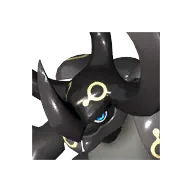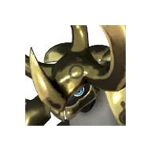
<a class="pmore" href="../../passivki/hard_skin/">Подробнее →</a>

Обычная<b>Тщеславный</b>

Скорость работы +10%Защита -10%

🧬 разведение

Передаётся детёнышу от родителя с этой пассивкой.

<a class="pmore" href="../../passivki/conceited/">Подробнее →</a>

Обычная<b>Убийца драконов</b>

<small class="efn">Снижение драконического урона 10%</small>

🧬 разведение

Передаётся детёнышу от родителя с этой пассивкой.

<a class="pmore" href="../../passivki/dragonkiller/">Подробнее →</a>

Обычная<b>Увеличение HP ур.1</b>

Макс. HP +10%

🧬 разведение

Передаётся детёнышу от родителя с этой пассивкой.

<a class="pmore" href="../../passivki/health_up_lv_1/">Подробнее →</a>

Обычная<b>Увеличение атаки Пала ур.1</b>

Атака +4%

🧬 разведение

Передаётся детёнышу от родителя с этой пассивкой.

<a class="pmore" href="../../passivki/pal_attack_up_lv_1/">Подробнее →</a>

Обычная<b>Увеличение атаки ур.1</b>

Атака +5%

🧬 разведение

Передаётся детёнышу от родителя с этой пассивкой.

<a class="pmore" href="../../passivki/attack_up_lv_1/">Подробнее →</a>

Обычная<b>Увеличение водного урона Палов ур. 1</b>

Урон водой +6%

🧬 разведение

Передаётся детёнышу от родителя с этой пассивкой.

<a class="pmore" href="../../passivki/pal_water_damage_enhancement_lv_1/">Подробнее →</a>

Обычная<b>Увеличение времени неуязвимости при уклонении</b>

Дольше неуязвимость при уклонении +20%

🧬 разведение

Передаётся детёнышу от родителя с этой пассивкой.

<a class="pmore" href="../../passivki/extended_dodge_invincibility/">Подробнее →</a>

Обычная<b>Увеличение грозового урона Палов ур.1</b>

Урон молнией +6%

🧬 разведение

Передаётся детёнышу от родителя с этой пассивкой.

<a class="pmore" href="../../passivki/pal_electric_damage_enhancement_lv_1/">Подробнее →</a>

Обычная<b>Увеличение драконьего урона Палов ур. 1</b>

Урон драконом +6%

🧬 разведение

Передаётся детёнышу от родителя с этой пассивкой.

<a class="pmore" href="../../passivki/pal_dragon_damage_enhancement_lv_1/">Подробнее →</a>

Обычная<b>Увеличение защиты Пала ур.1</b>

Защита +5%

🧬 разведение

Передаётся детёнышу от родителя с этой пассивкой.

<a class="pmore" href="../../passivki/pal_defense_up_lv_1/">Подробнее →</a>

Обычная<b>Увеличение защиты ур.1</b>

Защита +10%

🧬 разведение

Передаётся детёнышу от родителя с этой пассивкой.

<a class="pmore" href="../../passivki/defense_up_lv_1/">Подробнее →</a>

Обычная<b>Увеличение земного урона Палов ур. 1</b>

Урон землёй +6%

🧬 разведение

Передаётся детёнышу от родителя с этой пассивкой.

<a class="pmore" href="../../passivki/pal_ground_damage_enhancement_lv_1/">Подробнее →</a>

Обычная<b>Увеличение ледяного урона Палов ур.1</b>

Урон льдом +6%

🧬 разведение

Передаётся детёнышу от родителя с этой пассивкой.

<a class="pmore" href="../../passivki/pal_ice_damage_enhancement_lv_1/">Подробнее →</a>

Обычная<b>Увеличение макс. переносимого веса ур.1</b>

Переносимый вес +50 (игроку)

🧬 разведение

Передаётся детёнышу от родителя с этой пассивкой.

<a class="pmore" href="../../passivki/max_carrying_capacity_lv_1/">Подробнее →</a>

Обычная<b>Увеличение макс. переносимого веса ур.2</b>

Переносимый вес +150 (игроку)

🧬 разведение

Передаётся детёнышу от родителя с этой пассивкой.

<a class="pmore" href="../../passivki/max_carrying_capacity_lv_2/">Подробнее →</a>

Обычная<b>Увеличение нейтрального урона Палов ур. 1</b>

Урон нейтральной стихией +6%

🧬 разведение

Передаётся детёнышу от родителя с этой пассивкой.

<a class="pmore" href="../../passivki/pal_neutral_damage_enhancement_lv_1/">Подробнее →</a>

Обычная<b>Увеличение огненного урона Палов ур.1</b>

Урон огнём +6%

🧬 разведение

Передаётся детёнышу от родителя с этой пассивкой.

<a class="pmore" href="../../passivki/pal_fire_damage_enhancement_lv_1/">Подробнее →</a>

Обычная<b>Увеличение опыта Пала ур.1</b>

Опыт пала +30%

🧬 разведение

Передаётся детёнышу от родителя с этой пассивкой.

<a class="pmore" href="../../passivki/pal_exp_up_lv_1/">Подробнее →</a>

Обычная<b>Увеличение силы захвата +1</b>

Шанс поимки +1%

🧬 разведение

Передаётся детёнышу от родителя с этой пассивкой.

<a class="pmore" href="../../passivki/capture_strength_1/">Подробнее →</a>

Обычная<b>Увеличение силы захвата +2</b>

Шанс поимки +2%

🧬 разведение

Передаётся детёнышу от родителя с этой пассивкой.

<a class="pmore" href="../../passivki/capture_strength_2/">Подробнее →</a>

Обычная<b>Увеличение силы захвата +3</b>

Шанс поимки +3%

🧬 разведение

Передаётся детёнышу от родителя с этой пассивкой.

<a class="pmore" href="../../passivki/capture_strength_3/">Подробнее →</a>

Обычная<b>Увеличение силы захвата +4</b>

Шанс поимки +4%

🧬 разведение

Передаётся детёнышу от родителя с этой пассивкой.

<a class="pmore" href="../../passivki/capture_strength_4/">Подробнее →</a>

Обычная<b>Увеличение силы захвата +5</b>

Шанс поимки +5%

🧬 разведение

Передаётся детёнышу от родителя с этой пассивкой.

<a class="pmore" href="../../passivki/capture_strength_5/">Подробнее →</a>

Обычная<b>Увеличение силы захвата +6</b>

Шанс поимки +6%

🧬 разведение

Передаётся детёнышу от родителя с этой пассивкой.

<a class="pmore" href="../../passivki/capture_strength_6/">Подробнее →</a>

Обычная<b>Увеличение силы прыжка</b>

<small class="efn">Увеличение силы прыжка</small>

🧬 разведение

Передаётся детёнышу от родителя с этой пассивкой.

<a class="pmore" href="../../passivki/jump_power_boost/">Подробнее →</a>

Обычная<b>Увеличение травяного урона Палов ур.1</b>

Урон травой +6%

🧬 разведение

Передаётся детёнышу от родителя с этой пассивкой.

<a class="pmore" href="../../passivki/pal_grass_damage_enhancement_lv_1/">Подробнее →</a>

Обычная<b>Увеличение тёмного урона Палов ур. 1</b>

Урон тьмой +6%

🧬 разведение

Передаётся детёнышу от родителя с этой пассивкой.

<a class="pmore" href="../../passivki/pal_dark_damage_enhancement_lv_1/">Подробнее →</a>

Обычная<b>Ускоренная работа ур.1</b>

Скорость работы +10%

🧬 разведение

Передаётся детёнышу от родителя с этой пассивкой.

<a class="pmore" href="../../passivki/speedy_worker_lv_1/">Подробнее →</a>

Обычная<b>Ценная шкура</b>

Цена продажи предметов увеличена на +3%

🧬 разведение

Передаётся детёнышу от родителя с этой пассивкой.

🏥 операционный стол

Стоимость: 10 000 золота

<a class="pmore" href="../../passivki/fine_furs/">Подробнее →</a>

Обычная<b>Щедрая доля</b>

Количество предметов, выпадающих с этого Палла, +15%

🧬 разведение

Передаётся детёнышу от родителя с этой пассивкой.

<a class="pmore" href="../../passivki/sharing_is_caring/">Подробнее →</a>

Плохая<b>Мягкотелый</b>

Защита -10%

🧬 разведение

Передаётся детёнышу от родителя с этой пассивкой.

<a class="pmore" href="../../passivki/downtrodden/">Подробнее →</a>

Плохая<b>Невротик</b>

Показатель рассудка снижается быстрее +10%

🧬 разведение

Передаётся детёнышу от родителя с этой пассивкой.

<a class="pmore" href="../../passivki/unstable/">Подробнее →</a>

Плохая<b>Неприглядный</b>

Цена продажи предметов снижена на -10%

🧬 разведение

Передаётся детёнышу от родителя с этой пассивкой.

<a class="pmore" href="../../passivki/shabby/">Подробнее →</a>

Плохая<b>Неторопливый</b>

Увеличение времени перезарядки активных навыков на -15%

🧬 разведение

Передаётся детёнышу от родителя с этой пассивкой.

<a class="pmore" href="../../passivki/easygoing/">Подробнее →</a>

Плохая<b>Неуклюжий</b>

Скорость работы -10%

🧬 разведение

Передаётся детёнышу от родителя с этой пассивкой.

<a class="pmore" href="../../passivki/clumsy/">Подробнее →</a>

Плохая<b>Полуночник</b>

<small class="efn">Из-за того, что поздно ложится спать, часто дремлет днём.</small>

🧬 разведение

Передаётся детёнышу от родителя с этой пассивкой.

<a class="pmore" href="../../passivki/night_owl/">Подробнее →</a>

Плохая<b>Священная защита</b>

Защита на Якусиме +30%

🧬 разведение

Передаётся детёнышу от родителя с этой пассивкой.

<a class="pmore" href="../../passivki/hallowed_guard/">Подробнее →</a>

Плохая<b>Священная сила: ближний бой</b>

Урон с оружием ближнего боя Якусимы +20%

🧬 разведение

Передаётся детёнышу от родителя с этой пассивкой.

<a class="pmore" href="../../passivki/hallowed_power_close_range/">Подробнее →</a>

Плохая<b>Священная сила: дальний бой</b>

Урон с дальнобойным оружием Якусимы +20%

🧬 разведение

Передаётся детёнышу от родителя с этой пассивкой.

<a class="pmore" href="../../passivki/hallowed_power_ranged/">Подробнее →</a>

Плохая<b>Священная сила: магия</b>

Урон с магическим оружием Якусимы +20%

🧬 разведение

Передаётся детёнышу от родителя с этой пассивкой.

<a class="pmore" href="../../passivki/hallowed_power_magic/">Подробнее →</a>

Плохая<b>Священная сила: призыв</b>

Урон с оружием призыва Якусимы +20%

🧬 разведение

Передаётся детёнышу от родителя с этой пассивкой.

<a class="pmore" href="../../passivki/hallowed_power_summon/">Подробнее →</a>

Плохая<b>Сдерживание силы</b>

<small class="efn">Пацифист. Не может снизить HP цели ниже 1.</small>

🧬 разведение

Передаётся детёнышу от родителя с этой пассивкой.

🏥 операционный стол

Стоимость: 10 000 золота

<a class="pmore" href="../../passivki/mercy_hit/">Подробнее →</a>

Плохая<b>Трусливый</b>

Атака -10%

🐣 с рождения

Есть у 1 палов: Каттива

🧬 разведение

Передаётся детёнышу от родителя с этой пассивкой.

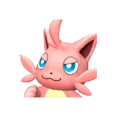
<a class="pmore" href="../../passivki/coward/">Подробнее →</a>

Плохая<b>Увеличение макс. переносимого веса ур.1</b>

Переносимый вес +50

🧬 разведение

Передаётся детёнышу от родителя с этой пассивкой.

<a class="pmore" href="../../passivki/max_carrying_capacity_lv_1/">Подробнее →</a>

Плохая<b>Увеличение макс. переносимого веса ур.2</b>

Переносимый вес +100

🧬 разведение

Передаётся детёнышу от родителя с этой пассивкой.

<a class="pmore" href="../../passivki/max_carrying_capacity_lv_2/">Подробнее →</a>

Плохая<b>Увеличение макс. переносимого веса ур.3</b>

Переносимый вес +200

🧬 разведение

Передаётся детёнышу от родителя с этой пассивкой.

<a class="pmore" href="../../passivki/max_carrying_capacity_lv_3/">Подробнее →</a>

Плохая<b>Увеличение макс. переносимого веса ур.4</b>

Переносимый вес +300

🧬 разведение

Передаётся детёнышу от родителя с этой пассивкой.

<a class="pmore" href="../../passivki/max_carrying_capacity_lv_4/">Подробнее →</a>

Плохая<b>Ускорение роста доверия у Палов в команде</b>

Рост доверия +50%

🧬 разведение

Передаётся детёнышу от родителя с этой пассивкой.

<a class="pmore" href="../../passivki/party_pal_trust_boost/">Подробнее →</a>

Плохая<b>Хикикомори</b>

Макс. выносливость -25% *Действует только для Палов, которых можно оседлать.

🧬 разведение

Передаётся детёнышу от родителя с этой пассивкой.

<a class="pmore" href="../../passivki/sickly/">Подробнее →</a>

Плохая<b>Чревоугодник</b>

Уровень сытости снижается быстрее +10%

🐣 с рождения

Есть у 1 палов: Релаксаурус

🧬 разведение

Передаётся детёнышу от родителя с этой пассивкой.

<a class="pmore" href="../../passivki/glutton/">Подробнее →</a>

Плохая<b>Бездонный желудок</b>

Уровень сытости снижается быстрее +15%

🧬 разведение

Передаётся детёнышу от родителя с этой пассивкой.

<a class="pmore" href="../../passivki/bottomless_stomach/">Подробнее →</a>

Плохая<b>Саморазрушение</b>

Показатель рассудка снижается быстрее +15%

🧬 разведение

Передаётся детёнышу от родителя с этой пассивкой.

<a class="pmore" href="../../passivki/destructive/">Подробнее →</a>

Очень плохая<b>Бегущий от проблем</b>

Атака -20%

🧬 разведение

Передаётся детёнышу от родителя с этой пассивкой.

<a class="pmore" href="../../passivki/pacifist/">Подробнее →</a>

Очень плохая<b>Халтурщик</b>

Скорость работы -30%

🧬 разведение

Передаётся детёнышу от родителя с этой пассивкой.

<a class="pmore" href="../../passivki/slacker/">Подробнее →</a>

Очень плохая<b>Хрупкие кости</b>

Защита -20%

🧬 разведение

Передаётся детёнышу от родителя с этой пассивкой.

<a class="pmore" href="../../passivki/brittle/">Подробнее →</a>

