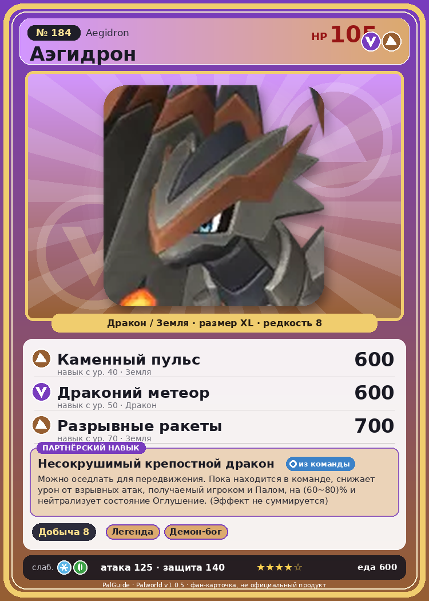

# #184 Аэгидрон (Aegidron)

{ width=360 }

| Поле | Значение |
|---|---|
| Стихия | Дракон, Земля |
| Слабость (кто бьёт сильнее) | Лёд, Трава |
| Редкость | 8 |
| Размер | XL |
| HP / Атака / Защита (база вида) | 105 / 125 / 140 |
| Сколько ест | 600 |
| Цена продажи | 4116 |
| Множитель поимки | ×1 |
| Скорость рывка верхом | 1100 |

## Работа на базе
- Добыча — ур. 8

## Партнёрский навык: Несокрушимый крепостной дракон
Можно оседлать для передвижения. Пока находится в команде, снижает урон от взрывных атак , получаемый игроком и Палом, на (60~80)% и нейтрализует состояние Оглушение . (Эффект не суммируется) Технологии 79 level value 1 DomeArmorDragon_PartnerSkill 100, 60 2 DomeArmorDragon_PartnerSkill 100, 65 3 DomeArmorDragon_PartnerSkill 100, 70 4 DomeArmorDragon_PartnerSkill 100, 75 5 DomeArmorDragon_PartnerSkill 100, 80

## Атаки по уровням
- ур. 1: Каменный залп (Земля, сила 80)
- ур. 7: Взрывная пушка (Дракон, сила 200)
- ур. 15: Камнепад (Земля, сила 300)
- ур. 22: Заряженный выстрел (Дракон, сила 400)
- ур. 30: Песчаные смерчи (Земля, сила 500)
- ур. 40: Каменный пульс (Земля, сила 600)
- ур. 50: Драконий метеор (Дракон, сила 600)
- ур. 70: Разрывные ракеты (Земля, сила 700)

## Где водится
- В дикой природе: нет/особый способ; точек появления днём: 0, ночью: 0
- Яйцо: Огромное яйцо дракона

## Дроп
- Термоядро — 1–2 шт., 100%
- Абсолютная душа Пала — 1 шт., 100%

**Дроп альфы:**
- Деталь древней цивилизации — 6–8 шт., 100%
- Ценный драконий самоцвет — 2–3 шт., 100%

## Разведение
- Ранг разведения (CombiRank): 30

## Лучшие пассивки по роли
- по обзору: Мастеровитый, Виртуоз, Трудоголик, Легенда
- боец: Легенда, Демон-бог, Хладнокровный, Бессмертие, Божественный дракон (вместо Бессмертия, если нет мутации)
- рабочий: Дьявольские руки, Виртуоз, Мастеровитый, Небожитель/Трудоголик
- ездовой: Божественная скорость, Легенда, Вечный двигатель, Небесное скольжение

## Чем хорош / чем плох
- ✅ Добыча 8 — лучший добытчик; очень высокая атака (125); крепкая защита (140); отличный рабочий (пригодность 8); можно оседлать
- ❌ Поздний; много ест (600)

> Давным-давно, когда средств связи было мало, иногда отправляли простые сигналы, мигая светом на внутренней стороне крыльев Аэгидрон .

См. также: [Стихии](../../2_mehaniki/stihii.md) · [Разведение](../../2_mehaniki/razvedenie.md) · [Все палы](README.md)
_Источник: paldb.cc v1.0.5_
