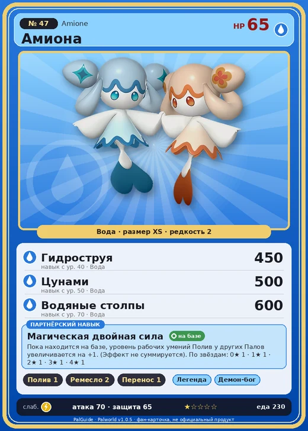

# Амиона

<canvas id="fx"></canvas>

№ 47 · Amione

Вода

Слабость: Молния

💧 Полив <b>1</b>🖐️ Ручная работа <b>2</b>📦 Транспортировка <b>1</b>

<b>Магическая двойная сила</b> 🏠 на базе

❤️ 65 · ⚔️ 70 · 🛡 65

| Поле | Значение |
|---|---|
| Стихия | Вода |
| Слабость (кто бьёт сильнее) | Молния |
| Редкость | 2 |
| Размер | XS |
| HP / Атака / Защита (база вида) | 65 / 70 / 65 |
| Сколько ест | 230 |
| Цена продажи | 421 |
| Множитель поимки | ×1 |
| Скорость рывка верхом | 600 |

=== "Обзор"

    #### Работа на базе
    - Полив — ур. 1
    - Ручная работа — ур. 2
    - Транспортировка — ур. 1

    #### Партнёрский навык: Магическая двойная сила
    Пока находится на базе, уровень рабочих умений Полив у других Палов увеличивается на +1. (Эффект не суммируется). По звёздам: 0★ 1 · 1★ 1 · 2★ 1 · 3★ 1 · 4★ 1

    #### Чем хорош / чем плох
    - ✅
    - ❌ слабая атака (70); мало здоровья (65)

    > Если одна половина исчезает, откуда ни возьмись появляется замена. И снова живут дружно, словно ничего не случилось. Для Амиона главное — жить в согласии.

    См. также: [Стихии](../../guide/06_stihii.md) · [Разведение](../../guide/07_razvedenie.md) · [Все палы](README.md)

=== "Атаки"

    #### Атаки по уровням
    - ур. 1: Акваджет (Вода, сила 40)
    - ур. 7: Пузырьковый выстрел (Вода, сила 80)
    - ур. 15: Полоса брызг (Вода, сила 160)
    - ур. 22: Гидроатака под давлением (Вода, сила 250)
    - ур. 30: Гидрорезак (Вода, сила 350)
    - ур. 40: Гидроструя (Вода, сила 450)
    - ур. 50: Цунами (Вода, сила 500)
    - ур. 70: Водяные столпы (Вода, сила 600)

=== "Где живёт"

    #### Где водится
    - В дикой природе: да; точек появления днём: 66, ночью: 66
    - Яйцо: Яйцо воды

=== "Дроп"

    #### Дроп
    - Жидкость водного Пала — 2 шт., 100%

    **Дроп альфы:**
    - Деталь древней цивилизации — 1–2 шт., 100%
    - Ценные внутренности — 2–3 шт., 100%

=== "Разведение"

    #### Разведение
    - Ранг разведения (CombiRank): 2520

=== "Пассивки"

    #### Лучшие пассивки по роли

    

⚔️ Боец

максимум урона и живучести в бою

<a class="psv r-4" data-psv="Легенда" href="../../../passivki/legend/">Легенда</a><a class="psv r-4" data-psv="Демон-бог" href="../../../passivki/demon_god/">Демон-бог</a><a class="psv r-3" data-psv="Владыка морей" href="../../../passivki/lord_of_the_sea/">Владыка морей</a><a class="psv r-3" data-psv="Хладнокровный" href="../../../passivki/serenity/">Хладнокровный</a>

    <small>Нажми на пассивку, чтобы узнать, что она даёт и где её взять.</small>

<a class="card-link" href="../jellroy/">← Джелрой</a><a class="card-link" href="../gloopie/">Глуппи →</a>

