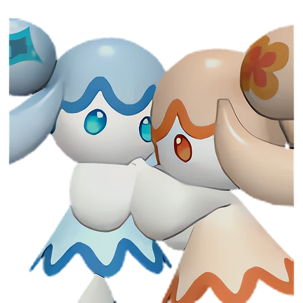

# Амиона

<canvas id="fx"></canvas>

№ 47 · Amione

Вода

Слабость: Молния <b class="mx">×1,5</b> <button class="hlp" data-tip="Множители перемножаются по обеим стихиям пала: ×1,5 за каждую стихию, которую атака бьёт, ×0,65 за каждую, которая её держит. Если одна стихия слаба, а другая устойчива (×1,5 × 0,65 ≈ ×0,98), слабости нет.">?</button>

Устойчив: Огонь <b class="mx">×0,65</b>

💧 Полив <b>1</b>🖐️ Ручная работа <b>2</b>📦 Транспортировка <b>1</b>

<b>Магическая двойная сила</b> 🏠 на базе

❤️ 65 · ⚔️ 70 · 🛡 65

Основное

💎Редкость <button class="hlp" data-tip="Чем выше число, тем реже встречается пал. 1–4 — обычные, 5–7 — редкие, 8+ — легендарные.">?</button><b>2</b>

📏Размер<b>XS</b>

💰Цена продажи <button class="hlp" data-tip="Сколько золота даст торговец за пала.">?</button><b>421</b>

Бой

🎯Множитель поимки <button class="hlp" data-tip="Насколько легче или труднее поймать: ×1 — обычно, меньше — сложнее.">?</button><b>×1</b>

🐎Скорость рывка верхом <button class="hlp" data-tip="Скорость, если сесть на пала и бежать рывком.">?</button><b>600</b>

Ферма и еда

🍖Сколько ест <button class="hlp" data-tip="Сколько сытости пал тратит — чем больше, тем больше еды нужно на базе.">?</button><b>230</b>

Разведение

🧬Сила разведения <button class="hlp" data-tip="Скрытое число игры: у детёныша оно примерно среднее от родителей. Чем меньше — тем «сильнее» пал.">?</button><b>2520</b>

=== "Обзор"

    #### Работа на базе
    - Полив — ур. 1
    - Ручная работа — ур. 2
    - Транспортировка — ур. 1

    #### Партнёрский навык: Магическая двойная сила
    Пока находится на базе, уровень рабочих умений Полив у других Палов увеличивается на +1. (Эффект не суммируется). По звёздам: 0★ 1 · 1★ 1 · 2★ 1 · 3★ 1 · 4★ 1

    #### Чем хорош / чем плох
    - ✅
    - ❌ слабая атака (70); мало здоровья (65)

    > Если одна половина исчезает, откуда ни возьмись появляется замена. И снова живут дружно, словно ничего не случилось. Для Амиона главное — жить в согласии.

    См. также: [Стихии](../../guide/06_stihii.md) · [Разведение](../../guide/07_razvedenie.md) · [Все палы](README.md)

=== "Атаки"

    #### Атаки по уровням
    - ур. 1: Акваджет (Вода, сила 40)
    - ур. 7: Пузырьковый выстрел (Вода, сила 80)
    - ур. 15: Полоса брызг (Вода, сила 160)
    - ур. 22: Гидроатака под давлением (Вода, сила 250)
    - ур. 30: Гидрорезак (Вода, сила 350)
    - ур. 40: Гидроструя (Вода, сила 450)
    - ур. 50: Цунами (Вода, сила 500)
    - ур. 70: Водяные столпы (Вода, сила 600)

=== "Где живёт"

    #### Где водится

    

<button data-k="d" class="on">☀️ День</button><button data-k="n">🌙 Ночь</button>

ур. 9–64<a class="btn hm-full" href="../../../map/?pal=ClioneTwins">Показать на большой карте</a>

Остров восходящих ветровСолнечный предел

🥚 Яйцо<b>Яйцо воды</b>

=== "Дроп"

    #### Дроп
    - Жидкость водного Пала — 2 шт., 100%

    **Дроп альфы:**
    - Деталь древней цивилизации — 1–2 шт., 100%
    - Ценные внутренности — 2–3 шт., 100%

=== "Разведение"

    #### Разведение
    - Ранг разведения (CombiRank): 2520

=== "Пассивки"

    #### Лучшие пассивки по роли

    

⚔️ Боец

максимум урона и живучести в бою

<a class="psv r-4" data-psv="Легенда" href="../../../passivki/legend/">Легенда</a><a class="psv r-4" data-psv="Демон-бог" href="../../../passivki/demon_god/">Демон-бог</a><a class="psv r-3" data-psv="Владыка морей" href="../../../passivki/lord_of_the_sea/">Владыка морей</a><a class="psv r-3" data-psv="Хладнокровный" href="../../../passivki/serenity/">Хладнокровный</a>

    <small>Нажми на пассивку, чтобы узнать, что она даёт и где её взять.</small>

<a class="card-link" href="../jellroy/">← Джелрой</a><a class="card-link" href="../gloopie/">Глуппи →</a>

