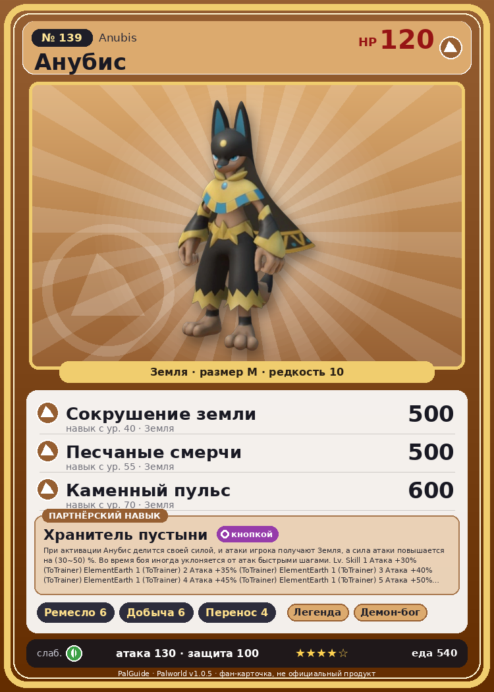

# #139 Анубис (Anubis)

{ width=360 }

| Поле | Значение |
|---|---|
| Стихия | Земля |
| Слабость (кто бьёт сильнее) | Трава |
| Редкость | 10 |
| Размер | M |
| HP / Атака / Защита (база вида) | 120 / 130 / 100 |
| Сколько ест | 540 |
| Цена продажи | 3217 |
| Множитель поимки | ×1 |
| Скорость рывка верхом | 1000 |

## Работа на базе
- Ручная работа — ур. 6
- Добыча — ур. 6
- Транспортировка — ур. 4

## Партнёрский навык: Хранитель пустыни
При активации Анубис делится своей силой, и атаки игрока получают Земля , а сила атаки повышается на (30~50) % . Во время боя иногда уклоняется от атак быстрыми шагами. Lv. Skill 1 Атака +30% (ToTrainer) ElementEarth 1 (ToTrainer) 2 Атака +35% (ToTrainer) ElementEarth 1 (ToTrainer) 3 Атака +40% (ToTrainer) ElementEarth 1 (ToTrainer) 4 Атака +45% (ToTrainer) ElementEarth 1 (ToTrainer) 5 Атака +50% (ToTrainer) ElementEarth 1 (ToTrainer)

## Атаки по уровням
- ур. 1: Каменный залп (Земля, сила 80)
- ур. 7: Силовая бомба (Нейтральный, сила 120)
- ур. 15: Песчаный вихрь (Земля, сила 200)
- ур. 22: Удар с разворота (Земля, сила 300)
- ур. 30: Мощный разряд (Земля, сила 400)
- ур. 40: Сокрушение земли (Земля, сила 500)
- ур. 50: Каменные копья (Земля, сила 400)
- ур. 55: Песчаные смерчи (Земля, сила 500)
- ур. 70: Каменный пульс (Земля, сила 600)

## Где водится
- В дикой природе: да; точек появления днём: 36, ночью: 36
- Яйцо: Огромное яйцо земли

## Дроп
- Кость — 3–5 шт., 100%
- Большая душа Пала — 1 шт., 100%
- Книга революционных технологий — 1 шт., 5%

**Дроп альфы:**
- Деталь древней цивилизации — 5–7 шт., 100%
- Ценные внутренности — 5–7 шт., 100%

## Разведение
- Ранг разведения (CombiRank): 480

## Лучшие пассивки по роли
- по обзору: Мастеровитый, Виртуоз, Трудоголик, Легенда
- боец: Легенда, Демон-бог, Хладнокровный, Бессмертие, Император земли (вместо Бессмертия, если нет мутации)
- рабочий: Дьявольские руки, Виртуоз, Мастеровитый, Небожитель/Трудоголик
- ездовой: Божественная скорость, Легенда, Вечный двигатель, Небесное скольжение

## Чем хорош / чем плох
- ✅ Классический крафтер (Ручная работа 6); сильный земляной урон ранней игры; очень высокая атака (130); много здоровья (120); отличный рабочий (пригодность 6); можно оседлать
- ❌ В 1.0 есть крафтеры лучше; много ест (540)

> Благодаря своему облику он некогда считался символом знатности. Для тех, кто ненавидел богатство и власть, он стал удобной мишенью. Со временем Анубис превратился в символ смерти.

См. также: [Стихии](../../2_mehaniki/stihii.md) · [Разведение](../../2_mehaniki/razvedenie.md) · [Все палы](README.md)
_Источник: paldb.cc v1.0.5_
