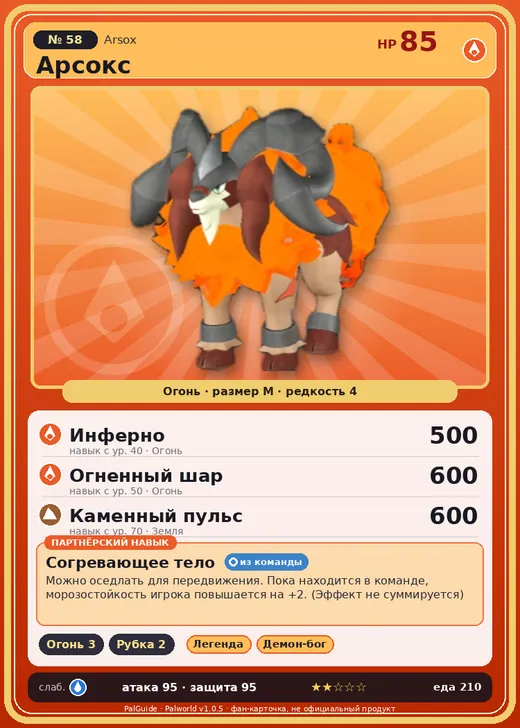

# Арсокс

<canvas id="fx"></canvas>

№ 58 · Arsox

Огонь

Слабость: Вода

🔥 Разжигание огня <b>3</b>🪓 Рубка деревьев <b>2</b>

<b>Согревающее тело</b> 🎒 из команды 🐎 верхом

❤️ 85 · ⚔️ 95 · 🛡 95

Основное

💎Редкость <button class="hlp" data-tip="Чем выше число, тем реже встречается пал. 1–4 — обычные, 5–7 — редкие, 8+ — легендарные.">?</button><b>4</b>

📏Размер<b>M</b>

💰Цена продажи <button class="hlp" data-tip="Сколько золота даст торговец за пала.">?</button><b>1176</b>

Бой

🎯Множитель поимки <button class="hlp" data-tip="Насколько легче или труднее поймать: ×1 — обычно, меньше — сложнее.">?</button><b>×1</b>

🐎Скорость рывка верхом <button class="hlp" data-tip="Скорость, если сесть на пала и бежать рывком.">?</button><b>1050</b>

Ферма и еда

🍖Сколько ест <button class="hlp" data-tip="Сколько сытости пал тратит — чем больше, тем больше еды нужно на базе.">?</button><b>210</b>

Разведение

🧬Сила разведения <button class="hlp" data-tip="Скрытое число игры: у детёныша оно примерно среднее от родителей. Чем меньше — тем «сильнее» пал.">?</button><b>2320</b>

=== "Обзор"

    #### Работа на базе
    - Разжигание огня — ур. 3
    - Рубка деревьев — ур. 2

    #### Партнёрский навык: Согревающее тело
    Можно оседлать для передвижения. Пока находится в команде, морозостойкость игрока повышается на +2. (Эффект не суммируется) Технологии 15.

    #### Чем хорош / чем плох
    - ✅ можно оседлать
    - ❌ явных минусов нет

    > В древние времена его постоянно преследовали плотоядные Палы. Гнев Арсокс , вопивших от несправедливости, превратился в палящее пламя и из поколения в поколение передавался дальше.

    См. также: [Стихии](../../guide/06_stihii.md) · [Разведение](../../guide/07_razvedenie.md) · [Все палы](README.md)

=== "Атаки"

    #### Атаки по уровням
    - ур. 1: Огненный выстрел (Огонь, сила 40)
    - ур. 7: Пылающий рог (Огонь, сила 80)
    - ур. 15: Расщеплённый огонь (Огонь, сила 80)
    - ур. 22: Огненная стрела (Огонь, сила 120)
    - ур. 30: Огненное дыхание (Огонь, сила 160)
    - ур. 40: Инферно (Огонь, сила 500)
    - ур. 50: Огненный шар (Огонь, сила 600)
    - ур. 70: Каменный пульс (Земля, сила 600)

=== "Где живёт"

    #### Где водится
    - В дикой природе: да; точек появления днём: 111, ночью: 111; уровни в первых точках: 20–22
    - Подземелья: Пещера Ущелья
    - Может продаваться у торговца/рекрутера
    - Яйцо: Раскалённое яйцо

=== "Дроп"

    #### Дроп
    - Рог — 1 шт., 100%
    - Огненный орган — 2–3 шт., 100%

    **Дроп альфы:**
    - Деталь древней цивилизации — 3–4 шт., 100%
    - Ценный мех — 3 шт., 100%

=== "Разведение"

    #### Разведение
    - Ранг разведения (CombiRank): 2320
    - Участвует в особых парах: Чиллет → Чиллет Игнис

=== "Пассивки"

    #### Лучшие пассивки по роли

    

⚔️ Боец

максимум урона и живучести в бою

<a class="psv r-4" data-psv="Легенда" href="../../../passivki/legend/">Легенда</a><a class="psv r-4" data-psv="Демон-бог" href="../../../passivki/demon_god/">Демон-бог</a><a class="psv r-3" data-psv="Император огня" href="../../../passivki/flame_emperor/">Император огня</a><a class="psv r-3" data-psv="Хладнокровный" href="../../../passivki/serenity/">Хладнокровный</a>

🛠 Рабочий

работает быстрее и меньше устаёт на базе

<a class="psv r-5" data-psv="Дьявольские руки" href="../../../passivki/demons_hand/">Дьявольские руки</a><a class="psv r-4" data-psv="Виртуоз" href="../../../passivki/remarkable_craftsmanship/">Виртуоз</a><a class="psv r-3" data-psv="Мастеровитый" href="../../../passivki/artisan/">Мастеровитый</a><a class="psv r-3" data-psv="Трудоголик" href="../../../passivki/workaholic/">Трудоголик</a>

🐎 Ездовой

быстрее бегает или летает с тобой верхом

<a class="psv r-4" data-psv="Божественная скорость" href="../../../passivki/swift/">Божественная скорость</a><a class="psv r-4" data-psv="Легенда" href="../../../passivki/legend/">Легенда</a><a class="psv r-4" data-psv="Вечный двигатель" href="../../../passivki/eternal_engine/">Вечный двигатель</a><a class="psv r-4" data-psv="Небесное скольжение" href="../../../passivki/sky_strider/">Небесное скольжение</a>

    <small>Нажми на пассивку, чтобы узнать, что она даёт и где её взять.</small>

<a class="card-link" href="../cawgnito/">← Когнито</a><a class="card-link" href="../muffly/">Маффли →</a>

