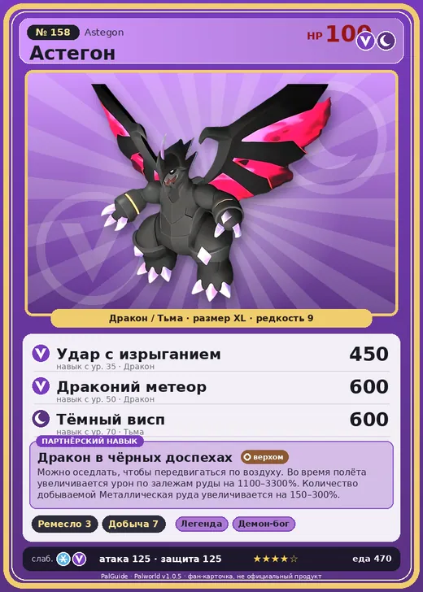

# Астегон

<canvas id="fx"></canvas>

№ 158 · Astegon

ДраконТьма

Слабость: ДраконЛёд

🖐️ Ручная работа <b>3</b>⛏️ Добыча <b>7</b>

<b>Дракон в чёрных доспехах</b> 🐎 верхом

❤️ 100 · ⚔️ 125 · 🛡 125

Основное

💎Редкость <button class="hlp" data-tip="Чем выше число, тем реже встречается пал. 1–4 — обычные, 5–7 — редкие, 8+ — легендарные.">?</button><b>9</b>

📏Размер<b>XL</b>

💰Цена продажи <button class="hlp" data-tip="Сколько золота даст торговец за пала.">?</button><b>3794</b>

Бой

🎯Множитель поимки <button class="hlp" data-tip="Насколько легче или труднее поймать: ×1 — обычно, меньше — сложнее.">?</button><b>×1</b>

🐎Скорость рывка верхом <button class="hlp" data-tip="Скорость, если сесть на пала и бежать рывком.">?</button><b>1100</b>

Ферма и еда

🍖Сколько ест <button class="hlp" data-tip="Сколько сытости пал тратит — чем больше, тем больше еды нужно на базе.">?</button><b>470</b>

Разведение

🧬Сила разведения <button class="hlp" data-tip="Скрытое число игры: у детёныша оно примерно среднее от родителей. Чем меньше — тем «сильнее» пал.">?</button><b>490</b>

=== "Обзор"

    #### Работа на базе
    - Ручная работа — ур. 3
    - Добыча — ур. 7

    #### Партнёрский навык: Дракон в чёрных доспехах
    Можно оседлать, чтобы передвигаться по воздуху. Во время полёта увеличивается урон по залежам руды на 1100–3300%. Количество добываемой Металлическая руда увеличивается на 150–300%. Технологии 39. По звёздам: 0★ 1100 · 1★ 1500 · 2★ 2000 · 3★ 2600 · 4★ 3300

    #### Чем хорош / чем плох
    - ✅ Добыча 7, летает; очень высокая атака (125); крепкая защита (125); отличный рабочий (пригодность 7); можно оседлать; летает (ездовой)
    - ❌ Медленнее Джетрагона

    > Дитя бездны, воплощение ярости. Перед этим зверем не смей стоять. Голосу зверя не смей внимать.

    См. также: [Стихии](../../guide/06_stihii.md) · [Разведение](../../guide/07_razvedenie.md) · [Все палы](README.md)

=== "Атаки"

    #### Атаки по уровням
    - ур. 1: Драконья пушка (Дракон, сила 40)
    - ур. 7: Духовное пламя (Тьма, сила 200)
    - ур. 15: Драконий взрыв (Дракон, сила 80)
    - ур. 22: Кошмарная сфера (Тьма, сила 300)
    - ур. 30: Дыхание дракона (Дракон, сила 160)
    - ур. 35: Удар с изрыганием (Дракон, сила 450)
    - ур. 40: Тёмный лазер (Тьма, сила 450)
    - ур. 50: Драконий метеор (Дракон, сила 600)
    - ур. 70: Тёмный висп (Тьма, сила 600)

=== "Где живёт"

    #### Где водится
    - В дикой природе: да; точек появления днём: 1, ночью: 1
    - Яйцо: Огромное яйцо дракона

=== "Дроп"

    #### Дроп
    - Сталепластик — 2–3 шт., 100%
    - Большая душа Пала — 1 шт., 100%

    **Дроп альфы:**
    - Деталь древней цивилизации — 5–7 шт., 100%
    - Ценный драконий самоцвет — 4–6 шт., 100%

=== "Разведение"

    #### Разведение
    - Ранг разведения (CombiRank): 490

=== "Пассивки"

    #### Лучшие пассивки по роли

    

⚔️ Боец

максимум урона и живучести в бою

<a class="psv r-4" data-psv="Легенда" href="../../../passivki/legend/">Легенда</a><a class="psv r-4" data-psv="Демон-бог" href="../../../passivki/demon_god/">Демон-бог</a><a class="psv r-3" data-psv="Божественный дракон" href="../../../passivki/divine_dragon/">Божественный дракон</a><a class="psv r-3" data-psv="Хладнокровный" href="../../../passivki/serenity/">Хладнокровный</a>

🛠 Рабочий

работает быстрее и меньше устаёт на базе

<a class="psv r-5" data-psv="Дьявольские руки" href="../../../passivki/demons_hand/">Дьявольские руки</a><a class="psv r-4" data-psv="Виртуоз" href="../../../passivki/remarkable_craftsmanship/">Виртуоз</a><a class="psv r-3" data-psv="Мастеровитый" href="../../../passivki/artisan/">Мастеровитый</a><a class="psv r-3" data-psv="Трудоголик" href="../../../passivki/workaholic/">Трудоголик</a>

🐎 Ездовой

быстрее бегает или летает с тобой верхом

<a class="psv r-4" data-psv="Божественная скорость" href="../../../passivki/swift/">Божественная скорость</a><a class="psv r-4" data-psv="Легенда" href="../../../passivki/legend/">Легенда</a><a class="psv r-4" data-psv="Вечный двигатель" href="../../../passivki/eternal_engine/">Вечный двигатель</a><a class="psv r-3" data-psv="Умелый бегун" href="../../../passivki/runner/">Умелый бегун</a>

    <small>Нажми на пассивку, чтобы узнать, что она даёт и где её взять.</small>

<a class="card-link" href="../celesdir_noct/">← Селесдир Нокт</a><a class="card-link" href="../knocklem/">Теранайт →</a>

