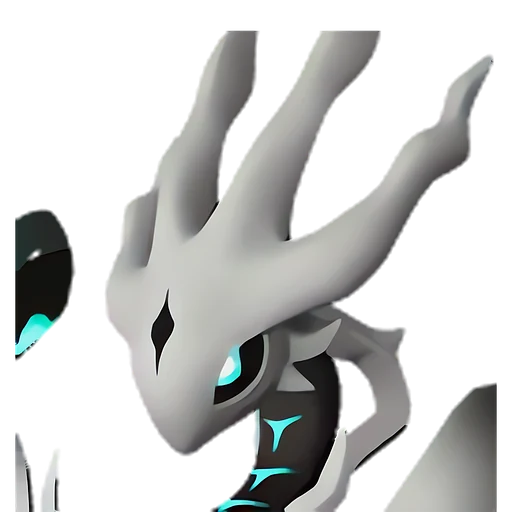

# Астралим

<canvas id="fx"></canvas>

№ 204 · Astralym

Слабость: — <button class="hlp" data-tip="Множители перемножаются по обеим стихиям пала: ×1,5 за каждую стихию, которую атака бьёт, ×0,65 за каждую, которая её держит. Если одна стихия слаба, а другая устойчива (×1,5 × 0,65 ≈ ×0,98), слабости нет.">?</button>

<b>-</b> 🐾 выпущен

❤️ 200 · ⚔️ 200 · 🛡 200

Основное

💎Редкость <button class="hlp" data-tip="Чем выше число, тем реже встречается пал. 1–4 — обычные, 5–7 — редкие, 8+ — легендарные.">?</button><b>10</b>

📏Размер<b>XL</b>

💰Цена продажи <button class="hlp" data-tip="Сколько золота даст торговец за пала.">?</button><b>10000</b>

Бой

🎯Множитель поимки <button class="hlp" data-tip="Насколько легче или труднее поймать: ×1 — обычно, меньше — сложнее.">?</button><b>×1</b>

Ферма и еда

🍖Сколько ест <button class="hlp" data-tip="Сколько сытости пал тратит — чем больше, тем больше еды нужно на базе.">?</button><b>600</b>

Разведение

🧬Сила разведения <button class="hlp" data-tip="Скрытое число игры: у детёныша оно примерно среднее от родителей. Чем меньше — тем «сильнее» пал.">?</button><b>10</b>

💞Особая пара <button class="hlp" data-tip="Этого пала можно вывести только от этой пары.">?</button><b>Астралим + Астралим</b>

=== "Обзор"

    #### Работа на базе
    - не работает

    #### Партнёрский навык: -
    Способности этого Пала ещё исследуются.

    #### Чем хорош / чем плох
    - ✅ очень высокая атака (200); много здоровья (200); крепкая защита (200)
    - ❌ много ест (600); не работает на базе; разводится только особой парой

    > То, во что превратился таинственный Пал, когда-то прибывший на остров Палпагос. Он стал катастрофой, принеся разрушения, и долгое время был заточен с помощью печати, впоследствии был повержен одним укротителем Палов.

    См. также: [Стихии](../../guide/06_stihii.md) · [Разведение](../../guide/07_razvedenie.md) · [Все палы](README.md)

=== "Атаки"

    #### Атаки по уровням
    - нет данных

=== "Где живёт"

    #### Где водится

    

<b>В дикой природе не встречается</b>Точек появления на открытой карте в данных игры нет — выводи разведением.

=== "Дроп"

    #### Дроп
    - Кожа — 1 шт., 100%
    - Качественное масло Пала — 1 шт., 100%

=== "Разведение"

    #### Разведение
    - Ранг разведения (CombiRank): 10
    - **Особая пара:** [Астралим](../../4_spravochniki/paly/astralym.md) + [Астралим](../../4_spravochniki/paly/astralym.md)
    - Участвует в особых парах: Астралим → Астралим; Астралим → Астралим

=== "Пассивки"

    #### Лучшие пассивки по роли

    

⚔️ Боец

максимум урона и живучести в бою

<a class="psv r-4" data-psv="Легенда" href="../../../passivki/legend/">Легенда</a><a class="psv r-4" data-psv="Демон-бог" href="../../../passivki/demon_god/">Демон-бог</a><a class="psv r-3" data-psv="Святое небо" href="../../../passivki/celestial_emperor/">Святое небо</a><a class="psv r-3" data-psv="Хладнокровный" href="../../../passivki/serenity/">Хладнокровный</a>

    <small>Нажми на пассивку, чтобы узнать, что она даёт и где её взять.</small>

<a class="card-link" href="../panthalus/">← Панталус</a><a class="card-link" href="../blue_slime/">Синий слизень →</a>

