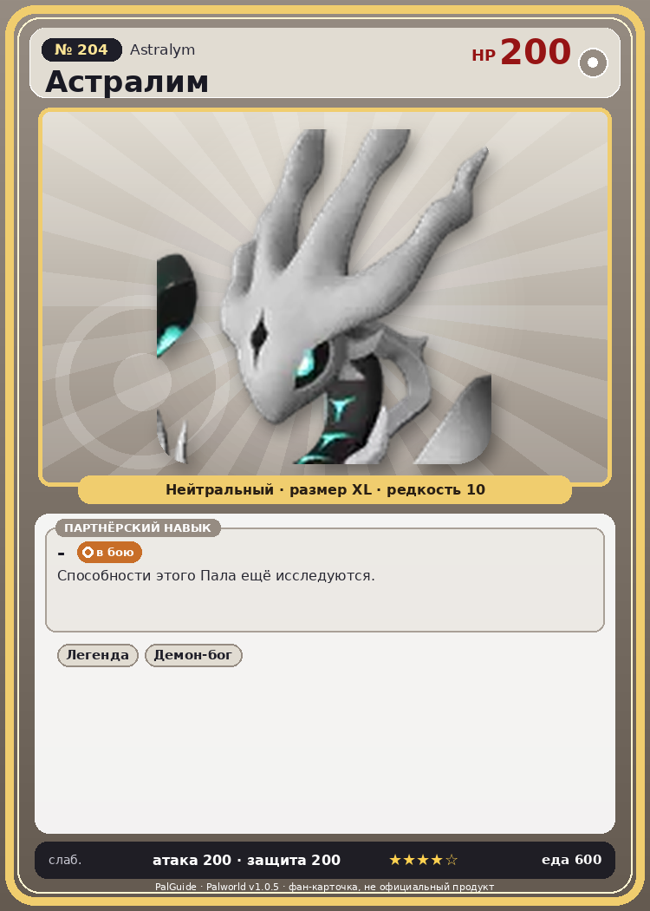

# #204 Астралим (Astralym)

{ width=360 }

| Поле | Значение |
|---|---|
| Стихия | — |
| Слабость (кто бьёт сильнее) | — |
| Редкость | 10 |
| Размер | XL |
| HP / Атака / Защита (база вида) | 200 / 200 / 200 |
| Сколько ест | 600 |
| Цена продажи | 10000 |
| Множитель поимки | ×1 |
| Скорость рывка верхом | — |

## Работа на базе
- не работает

## Партнёрский навык: -
Способности этого Пала ещё исследуются.

## Атаки по уровням
- нет данных

## Где водится
- В дикой природе: нет/особый способ; точек появления днём: 0, ночью: 0

## Дроп
- Кожа — 1 шт., 100%
- Качественное масло Пала — 1 шт., 100%

## Разведение
- Ранг разведения (CombiRank): 10
- **Особая пара:** [Астралим](../../4_spravochniki/paly/astralym.md) + [Астралим](../../4_spravochniki/paly/astralym.md)
- Участвует в особых парах: Астралим → Астралим; Астралим → Астралим

## Лучшие пассивки по роли
- боец: Легенда, Демон-бог, Хладнокровный, Бессмертие

## Чем хорош / чем плох
- ✅ очень высокая атака (200); много здоровья (200); крепкая защита (200)
- ❌ много ест (600); не работает на базе; разводится только особой парой

> То, во что превратился таинственный Пал, когда-то прибывший на остров Палпагос. Он стал катастрофой, принеся разрушения, и долгое время был заточен с помощью печати, впоследствии был повержен одним укротителем Палов.

См. также: [Стихии](../../2_mehaniki/stihii.md) · [Разведение](../../2_mehaniki/razvedenie.md) · [Все палы](README.md)
_Источник: paldb.cc v1.0.5_
