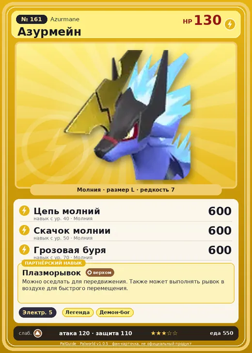

# #161 Азурмейн (Azurmane)

№ 161

Молния

Слабость: Земля

⚡ Генерация энергии <b>5</b>

<b>Плазморывок</b> 🐎 верхом

❤️ 130 · ⚔️ 120 · 🛡 110

| Поле | Значение |
|---|---|
| Стихия | Молния |
| Слабость (кто бьёт сильнее) | Земля |
| Редкость | 7 |
| Размер | L |
| HP / Атака / Защита (база вида) | 130 / 120 / 110 |
| Сколько ест | 550 |
| Цена продажи | 3079 |
| Множитель поимки | ×1 |
| Скорость рывка верхом | 1260 |

=== "Обзор"

    #### Работа на базе
    - Генерация энергии — ур. 5

    #### Партнёрский навык: Плазморывок
    Можно оседлать для передвижения. Также может выполнять рывок в воздухе для быстрого перемещения. Технологии 58.

    #### Чем хорош / чем плох
    - ✅ очень высокая атака (120); много здоровья (130); отличный рабочий (пригодность 5); можно оседлать
    - ❌ много ест (550)

    > Считалось, что он, как и Юнивольт , связан с богом грома. После того как вера в Юнивольт пришла в упадок, именно Азурмейн стали считать истинным посланником божества. Но со временем и его постигла та же участь — тягловой лошади.

    См. также: [Стихии](../../guide/06_stihii.md) · [Разведение](../../guide/07_razvedenie.md) · [Все палы](README.md)

=== "Атаки"

    #### Атаки по уровням
    - ур. 1: Искровой выстрел (Молния, сила 50)
    - ур. 7: Шоковая волна (Молния, сила 80)
    - ур. 15: Грозовая линия (Молния, сила 160)
    - ур. 22: Тройной разряд (Молния, сила 250)
    - ур. 30: Вездесущая гроза (Молния, сила 500)
    - ур. 40: Цепь молний (Молния, сила 600)
    - ур. 45: Молниеносный рывок (Молния, сила 500)
    - ур. 50: Скачок молнии (Молния, сила 600)
    - ур. 70: Грозовая буря (Молния, сила 600)

=== "Где живёт"

    #### Где водится
    - В дикой природе: да; точек появления днём: 113, ночью: 113; уровни в первых точках: 63–66
    - Яйцо: Большое яйцо молнии

=== "Дроп"

    #### Дроп
    - Электрический орган — 2–3 шт., 100%

    **Дроп альфы:**
    - Деталь древней цивилизации — 7–8 шт., 100%
    - % Ценный мех — 2–3 шт., 100%

=== "Разведение"

    #### Разведение
    - Ранг разведения (CombiRank): 420
    - Участвует в особых парах: Фенглоп → Фенглоп Лакс

=== "Пассивки"

    #### Лучшие пассивки по роли

    

⚔️ Боец

максимум урона и живучести в бою

<a class="psv r-4" data-psv="Легенда" href="../../../passivki/legend/">Легенда</a><a class="psv r-4" data-psv="Демон-бог" href="../../../passivki/demon_god/">Демон-бог</a><a class="psv r-3" data-psv="Император молнии" href="../../../passivki/lord_of_lightning/">Император молнии</a><a class="psv r-3" data-psv="Хладнокровный" href="../../../passivki/serenity/">Хладнокровный</a>

🛠 Рабочий

работает быстрее и меньше устаёт на базе

<a class="psv r-5" data-psv="Дьявольские руки" href="../../../passivki/demons_hand/">Дьявольские руки</a><a class="psv r-4" data-psv="Виртуоз" href="../../../passivki/remarkable_craftsmanship/">Виртуоз</a><a class="psv r-3" data-psv="Мастеровитый" href="../../../passivki/artisan/">Мастеровитый</a><a class="psv r-3" data-psv="Трудоголик" href="../../../passivki/workaholic/">Трудоголик</a>

🐎 Ездовой

быстрее бегает или летает с тобой верхом

<a class="psv r-4" data-psv="Божественная скорость" href="../../../passivki/swift/">Божественная скорость</a><a class="psv r-4" data-psv="Легенда" href="../../../passivki/legend/">Легенда</a><a class="psv r-4" data-psv="Вечный двигатель" href="../../../passivki/eternal_engine/">Вечный двигатель</a><a class="psv r-4" data-psv="Небесное скольжение" href="../../../passivki/sky_strider/">Небесное скольжение</a>

    <small>Нажми на пассивку, чтобы узнать, что она даёт и где её взять.</small>

<a class="card-link" href="../silvegis/">← Силвегис</a><a class="card-link" href="../valentail/">Валентейл →</a>

