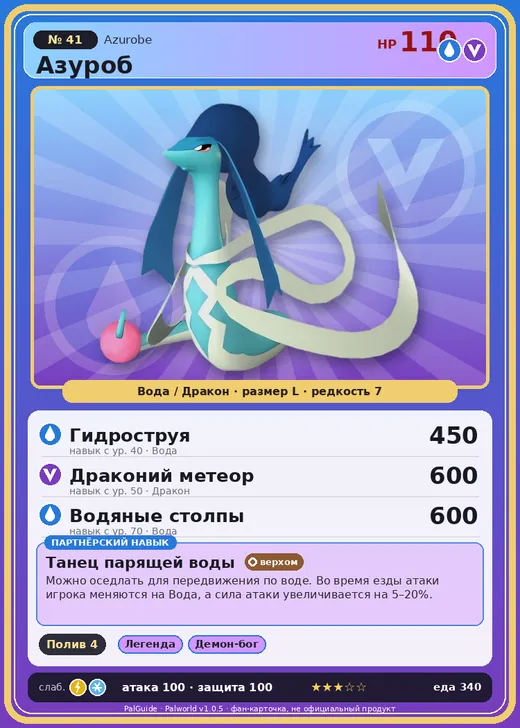

# #41 Азуроб (Azurobe)

№ 41

ВодаДракон

Слабость: ЛёдМолния

💧 Полив <b>4</b>

<b>Танец парящей воды</b> 🐎 верхом

❤️ 110 · ⚔️ 100 · 🛡 100

| Поле | Значение |
|---|---|
| Стихия | Вода, Дракон |
| Слабость (кто бьёт сильнее) | Лёд, Молния |
| Редкость | 7 |
| Размер | L |
| HP / Атака / Защита (база вида) | 110 / 100 / 100 |
| Сколько ест | 340 |
| Цена продажи | 1831 |
| Множитель поимки | ×1 |
| Скорость рывка верхом | 900 |

## Работа на базе
- Полив — ур. 4

## Партнёрский навык: Танец парящей воды
Можно оседлать для передвижения по воде. Во время езды атаки игрока меняются на Вода , а сила атаки увеличивается на (5~20)% . Технологии 24 level value 1 GiveAWater_Ride 1 GiveElement_TrainerATK_UP_PartnerSkill_Ride 5 Пробуждение : 2 GiveAWater_Ride 1 GiveElement_TrainerATK_UP_PartnerSkill_Ride 7 SwimSpeed_up_PartnerSkill_1 10 Пробуждение : (Скорость передвижения по воде: +10% ) 3 GiveAWater_Ride 1 GiveElement_TrainerATK_UP_PartnerSkill_Ride 10 SwimSpeed_up_PartnerSkill_2 14 Пробуждение : (Скорость передвижения по воде: +14% ) 4 GiveAWater_Ride 1 GiveElement_TrainerATK_UP_PartnerSkill_Ride 14 SwimSpeed_up_PartnerSkill_3 18 Пробуждение : (Скорость передвижения по воде: +18% ) 5 GiveAWater_Ride 1 GiveElement_TrainerATK_UP_PartnerSkill_Ride 20 SwimSpeed_up_PartnerSkill_4 25 Пробуждение : (Скорость передвижения по воде: +25% )

## Атаки по уровням
- ур. 1: Водяной выстрел (Вода, сила 50)
- ур. 7: Драконья пушка (Дракон, сила 40)
- ур. 15: Пузырьковый выстрел (Вода, сила 80)
- ур. 22: Драконий взрыв (Дракон, сила 80)
- ур. 30: Дыхание дракона (Дракон, сила 160)
- ур. 40: Гидроструя (Вода, сила 450)
- ур. 50: Драконий метеор (Дракон, сила 600)
- ур. 70: Водяные столпы (Вода, сила 600)

## Где водится
- В дикой природе: да; точек появления днём: 200, ночью: 200; уровни в первых точках: 10–20
- Яйцо: Большое яйцо воды

## Дроп
- Ткань — 1–3 шт., 100%
- Жидкость водного Пала — 2–4 шт., 100%

**Дроп альфы:**
- Деталь древней цивилизации — 5–6 шт., 100%
- Ценный драконий самоцвет — 5–6 шт., 100%

## Разведение
- Ранг разведения (CombiRank): 1830
- Участвует в особых парах: Фростплюм → Азуроб Крист

## Лучшие пассивки по роли
- боец: Легенда, Демон-бог, Хладнокровный, Бессмертие, Владыка морей (вместо Бессмертия, если нет мутации)
- рабочий: Дьявольские руки, Виртуоз, Мастеровитый, Небожитель/Трудоголик
- ездовой: Божественная скорость, Легенда, Вечный двигатель, Небесное скольжение

## Чем хорош / чем плох
- ✅ хорошая атака (100); можно оседлать
- ❌ явных минусов нет

> Его белый пояс темнеет при контакте с нечистой водой — так можно выявить наличие яда. В прошлом из-за этого его массово отлавливали, поэтому он до сих пор не питает симпатии к людям.

См. также: [Стихии](../../guide/06_stihii.md) · [Разведение](../../guide/07_razvedenie.md) · [Все палы](README.md)
