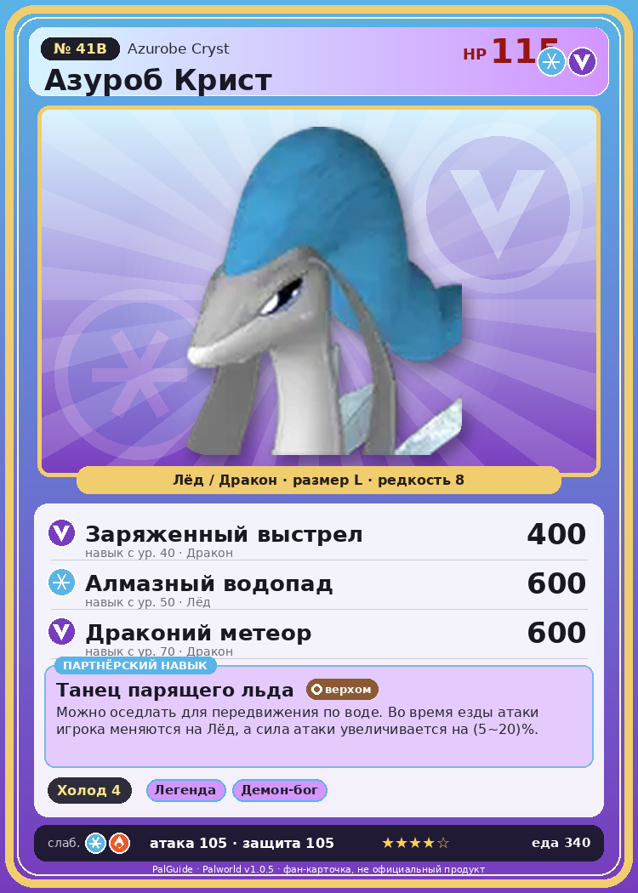

# #41B Азуроб Крист (Azurobe Cryst)

{ width=360 }

| Поле | Значение |
|---|---|
| Стихия | Лёд, Дракон |
| Слабость (кто бьёт сильнее) | Лёд, Огонь |
| Редкость | 8 |
| Размер | L |
| HP / Атака / Защита (база вида) | 115 / 105 / 105 |
| Сколько ест | 340 |
| Цена продажи | 2109 |
| Множитель поимки | ×1 |
| Скорость рывка верхом | 900 |

## Работа на базе
- Охлаждение — ур. 4

## Партнёрский навык: Танец парящего льда
Можно оседлать для передвижения по воде. Во время езды атаки игрока меняются на Лёд , а сила атаки увеличивается на (5~20)% . Технологии 27 level value 1 GiveAIce_Ride 1 GiveElement_TrainerATK_UP_PartnerSkill_Ride 5 Пробуждение : 2 GiveAIce_Ride 1 GiveElement_TrainerATK_UP_PartnerSkill_Ride 7 SwimSpeed_up_PartnerSkill_1 10 Пробуждение : (Скорость передвижения по воде: +10% ) 3 GiveAIce_Ride 1 GiveElement_TrainerATK_UP_PartnerSkill_Ride 10 SwimSpeed_up_PartnerSkill_2 14 Пробуждение : (Скорость передвижения по воде: +14% ) 4 GiveAIce_Ride 1 GiveElement_TrainerATK_UP_PartnerSkill_Ride 14 SwimSpeed_up_PartnerSkill_3 18 Пробуждение : (Скорость передвижения по воде: +18% ) 5 GiveAIce_Ride 1 GiveElement_TrainerATK_UP_PartnerSkill_Ride 20 SwimSpeed_up_PartnerSkill_4 25 Пробуждение : (Скорость передвижения по воде: +25% )

## Атаки по уровням
- ур. 1: Ледяная ракета (Лёд, сила 40)
- ур. 7: Драконий взрыв (Дракон, сила 80)
- ур. 15: Айсберг (Лёд, сила 120)
- ур. 22: Дыхание дракона (Дракон, сила 160)
- ур. 30: Ледяное дыхание (Лёд, сила 160)
- ур. 40: Заряженный выстрел (Дракон, сила 400)
- ур. 50: Алмазный водопад (Лёд, сила 600)
- ур. 70: Драконий метеор (Дракон, сила 600)

## Где водится
- В дикой природе: да; точек появления днём: 259, ночью: 259
- Яйцо: Огромное яйцо льда

## Дроп
- Ткань — 1–3 шт., 100%
- Жидкость водного Пала — 1–2 шт., 100%
- Ледяной орган — 1–3 шт., 100%

**Дроп альфы:**
- Деталь древней цивилизации — 5–6 шт., 100%
- Ценный драконий самоцвет — 2–3 шт., 100%

## Разведение
- Ранг разведения (CombiRank): 1220
- **Особая пара:** [Азуроб](../../4_spravochniki/paly/azurobe.md) + [Фростплюм](../../4_spravochniki/paly/frostplume.md)

## Лучшие пассивки по роли
- боец: Легенда, Демон-бог, Хладнокровный, Бессмертие, Император льда (вместо Бессмертия, если нет мутации)
- рабочий: Дьявольские руки, Виртуоз, Мастеровитый, Небожитель/Трудоголик
- ездовой: Божественная скорость, Легенда, Вечный двигатель, Небесное скольжение

## Чем хорош / чем плох
- ✅ хорошая атака (105); можно оседлать
- ❌ разводится только особой парой

> Его белый пояс непрерывно поглощает тепло из окружающей среды. Удивительно, но его температура при этом остаётся неизменной. Из-за этого необычного свойства его в прошлом массово отлавливали, и даже сейчас он не питает симпатии к человеку.

См. также: [Стихии](../../2_mehaniki/stihii.md) · [Разведение](../../2_mehaniki/razvedenie.md) · [Все палы](README.md)
_Источник: paldb.cc v1.0.5_
