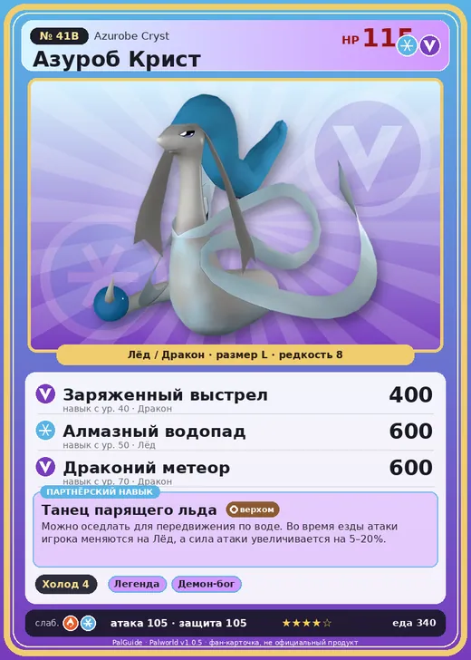

# Азуроб Крист

<canvas id="fx"></canvas>

№ 41B · Azurobe Cryst

ЛёдДракон

Слабость: ЛёдОгонь

❄️ Охлаждение <b>4</b>

<b>Танец парящего льда</b> 🐎 верхом

❤️ 115 · ⚔️ 105 · 🛡 105

| Поле | Значение |
|---|---|
| Стихия | Лёд, Дракон |
| Слабость (кто бьёт сильнее) | Лёд, Огонь |
| Редкость | 8 |
| Размер | L |
| HP / Атака / Защита (база вида) | 115 / 105 / 105 |
| Сколько ест | 340 |
| Цена продажи | 2109 |
| Множитель поимки | ×1 |
| Скорость рывка верхом | 900 |

=== "Обзор"

    #### Работа на базе
    - Охлаждение — ур. 4

    #### Партнёрский навык: Танец парящего льда
    Можно оседлать для передвижения по воде. Во время езды атаки игрока меняются на Лёд, а сила атаки увеличивается на 5–20%. Технологии 27.

    #### Чем хорош / чем плох
    - ✅ хорошая атака (105); можно оседлать
    - ❌ разводится только особой парой

    > Его белый пояс непрерывно поглощает тепло из окружающей среды. Удивительно, но его температура при этом остаётся неизменной. Из-за этого необычного свойства его в прошлом массово отлавливали, и даже сейчас он не питает симпатии к человеку.

    См. также: [Стихии](../../guide/06_stihii.md) · [Разведение](../../guide/07_razvedenie.md) · [Все палы](README.md)

=== "Атаки"

    #### Атаки по уровням
    - ур. 1: Ледяная ракета (Лёд, сила 40)
    - ур. 7: Драконий взрыв (Дракон, сила 80)
    - ур. 15: Айсберг (Лёд, сила 120)
    - ур. 22: Дыхание дракона (Дракон, сила 160)
    - ур. 30: Ледяное дыхание (Лёд, сила 160)
    - ур. 40: Заряженный выстрел (Дракон, сила 400)
    - ур. 50: Алмазный водопад (Лёд, сила 600)
    - ур. 70: Драконий метеор (Дракон, сила 600)

=== "Где живёт"

    #### Где водится
    - В дикой природе: да; точек появления днём: 259, ночью: 259
    - Яйцо: Огромное яйцо льда

=== "Дроп"

    #### Дроп
    - Ткань — 1–3 шт., 100%
    - Жидкость водного Пала — 1–2 шт., 100%
    - Ледяной орган — 1–3 шт., 100%

    **Дроп альфы:**
    - Деталь древней цивилизации — 5–6 шт., 100%
    - Ценный драконий самоцвет — 2–3 шт., 100%

=== "Разведение"

    #### Разведение
    - Ранг разведения (CombiRank): 1220
    - **Особая пара:** [Азуроб](../../4_spravochniki/paly/azurobe.md) + [Фростплюм](../../4_spravochniki/paly/frostplume.md)

=== "Пассивки"

    #### Лучшие пассивки по роли

    

⚔️ Боец

максимум урона и живучести в бою

<a class="psv r-4" data-psv="Легенда" href="../../../passivki/legend/">Легенда</a><a class="psv r-4" data-psv="Демон-бог" href="../../../passivki/demon_god/">Демон-бог</a><a class="psv r-3" data-psv="Император льда" href="../../../passivki/ice_emperor/">Император льда</a><a class="psv r-3" data-psv="Хладнокровный" href="../../../passivki/serenity/">Хладнокровный</a>

🛠 Рабочий

работает быстрее и меньше устаёт на базе

<a class="psv r-5" data-psv="Дьявольские руки" href="../../../passivki/demons_hand/">Дьявольские руки</a><a class="psv r-4" data-psv="Виртуоз" href="../../../passivki/remarkable_craftsmanship/">Виртуоз</a><a class="psv r-3" data-psv="Мастеровитый" href="../../../passivki/artisan/">Мастеровитый</a><a class="psv r-3" data-psv="Трудоголик" href="../../../passivki/workaholic/">Трудоголик</a>

🐎 Ездовой

быстрее бегает или летает с тобой верхом

<a class="psv r-4" data-psv="Божественная скорость" href="../../../passivki/swift/">Божественная скорость</a><a class="psv r-4" data-psv="Легенда" href="../../../passivki/legend/">Легенда</a><a class="psv r-4" data-psv="Вечный двигатель" href="../../../passivki/eternal_engine/">Вечный двигатель</a><a class="psv r-4" data-psv="Небесное скольжение" href="../../../passivki/sky_strider/">Небесное скольжение</a>

    <small>Нажми на пассивку, чтобы узнать, что она даёт и где её взять.</small>

<a class="card-link" href="../azurobe/">← Азуроб</a><a class="card-link" href="../sparkit/">Спаркит →</a>

