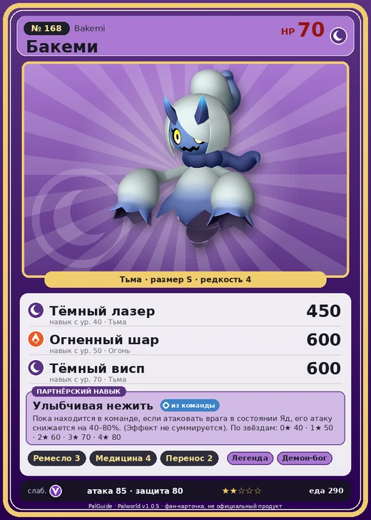

# #168 Бакеми (Bakemi)

№ 168

Тьма

Слабость: Дракон

🖐️ Ручная работа <b>3</b>💊 Фармацевтика <b>4</b>📦 Транспортировка <b>2</b>

<b>Улыбчивая нежить</b> 🎒 из команды

❤️ 70 · ⚔️ 85 · 🛡 80

| Поле | Значение |
|---|---|
| Стихия | Тьма |
| Слабость (кто бьёт сильнее) | Дракон |
| Редкость | 4 |
| Размер | S |
| HP / Атака / Защита (база вида) | 70 / 85 / 80 |
| Сколько ест | 290 |
| Цена продажи | 1625 |
| Множитель поимки | ×1 |
| Скорость рывка верхом | 600 |

=== "Обзор"

    #### Работа на базе
    - Ручная работа — ур. 3
    - Фармацевтика — ур. 4
    - Транспортировка — ур. 2

    #### Партнёрский навык: Улыбчивая нежить
    Пока находится в команде, если атаковать врага в состоянии Яд, его атаку снижается на 40–80%. (Эффект не суммируется). По звёздам: 0★ 40 · 1★ 50 · 2★ 60 · 3★ 70 · 4★ 80

    #### Чем хорош / чем плох
    - ✅
    - ❌ явных минусов нет

    > Живёт ради того, чтобы пугать, но совсем не страшный. Однако все лишь делают вид, что пугаются его милоты, и в итоге Бакеми стал вестником улыбок.

    См. также: [Стихии](../../guide/06_stihii.md) · [Разведение](../../guide/07_razvedenie.md) · [Все палы](README.md)

=== "Атаки"

    #### Атаки по уровням
    - ур. 1: Тёмный шар (Тьма, сила 50)
    - ур. 7: Теневой взрыв (Тьма, сила 80)
    - ур. 15: Духовное пламя (Тьма, сила 200)
    - ур. 22: Кошмарная сфера (Тьма, сила 300)
    - ур. 30: Апокалипсис (Тьма, сила 400)
    - ур. 40: Тёмный лазер (Тьма, сила 450)
    - ур. 50: Огненный шар (Огонь, сила 600)
    - ур. 70: Тёмный висп (Тьма, сила 600)

=== "Где живёт"

    #### Где водится
    - В дикой природе: да; точек появления днём: 37, ночью: 115
    - Яйцо: Яйцо тьмы

=== "Дроп"

    #### Дроп
    - Ткань — 1–2 шт., 100%
    - Рог — 2 шт., 100%
    - Маленькая душа Пала — 1 шт., 100%

    **Дроп альфы:**
    - Деталь древней цивилизации — 1–2 шт., 100%
    - Ценные внутренности — 2–3 шт., 100%

=== "Разведение"

    #### Разведение
    - Ранг разведения (CombiRank): 1540

=== "Пассивки"

    #### Лучшие пассивки по роли

    

⚔️ Боец

максимум урона и живучести в бою

<a class="psv r-4" data-psv="Легенда" href="../../../passivki/legend/">Легенда</a><a class="psv r-4" data-psv="Демон-бог" href="../../../passivki/demon_god/">Демон-бог</a><a class="psv r-3" data-psv="Король тьмы" href="../../../passivki/lord_of_the_underworld/">Король тьмы</a><a class="psv r-3" data-psv="Хладнокровный" href="../../../passivki/serenity/">Хладнокровный</a>

🛠 Рабочий

работает быстрее и меньше устаёт на базе

<a class="psv r-5" data-psv="Дьявольские руки" href="../../../passivki/demons_hand/">Дьявольские руки</a><a class="psv r-4" data-psv="Виртуоз" href="../../../passivki/remarkable_craftsmanship/">Виртуоз</a><a class="psv r-3" data-psv="Мастеровитый" href="../../../passivki/artisan/">Мастеровитый</a><a class="psv r-3" data-psv="Трудоголик" href="../../../passivki/workaholic/">Трудоголик</a>

    <small>Нажми на пассивку, чтобы узнать, что она даёт и где её взять.</small>

<a class="card-link" href="../slowatt/">← Слоуватт</a><a class="card-link" href="../solmora/">Солмора →</a>

