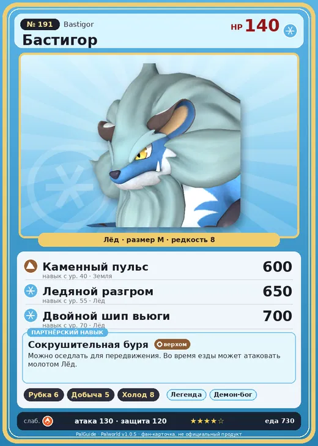

# #191 Бастигор (Bastigor)

№ 191

Лёд

Слабость: Огонь

🪓 Рубка деревьев <b>6</b>⛏️ Добыча <b>5</b>❄️ Охлаждение <b>8</b>

<b>Сокрушительная буря</b> 🐎 верхом

❤️ 140 · ⚔️ 130 · 🛡 120

| Поле | Значение |
|---|---|
| Стихия | Лёд |
| Слабость (кто бьёт сильнее) | Огонь |
| Редкость | 8 |
| Размер | M |
| HP / Атака / Защита (база вида) | 140 / 130 / 120 |
| Сколько ест | 730 |
| Цена продажи | 4425 |
| Множитель поимки | ×1 |
| Скорость рывка верхом | 1100 |

=== "Обзор"

    #### Работа на базе
    - Рубка деревьев — ур. 6
    - Добыча — ур. 5
    - Охлаждение — ур. 8

    #### Партнёрский навык: Сокрушительная буря
    Можно оседлать для передвижения. Во время езды может атаковать молотом Лёд . Технологии 73 level value 1 MainValue 100 Пробуждение : 2 MainValue 120 Пробуждение : (Увеличение урона: Небольшое ) 3 MainValue 140 Пробуждение : (Увеличение урона: Среднее ) 4 MainValue 160 Пробуждение : (Увеличение урона: Большое ) 5 MainValue 200 Пробуждение : (Увеличение урона: Очень большое )

    #### Чем хорош / чем плох
    - ✅ Охлаждение 8, лёд; очень высокая атака (130); много здоровья (140); крепкая защита (120); отличный рабочий (пригодность 8); можно оседлать
    - ❌ Слаб к огню; много ест (730); разводится только особой парой

    > При виде чего-то круглого Бастигор испытывает непреодолимое желание ударить. Самое сложное для него после самого факта существования — это слепить снеговика.

    См. также: [Стихии](../../guide/06_stihii.md) · [Разведение](../../guide/07_razvedenie.md) · [Все палы](README.md)

=== "Атаки"

    #### Атаки по уровням
    - ур. 1: Камнемёт (Земля, сила 120)
    - ур. 7: Айсберг (Лёд, сила 120)
    - ур. 15: Ледяное дыхание (Лёд, сила 160)
    - ур. 22: Яростный ледяной коготь (Лёд, сила 300)
    - ур. 30: Камнепад (Земля, сила 300)
    - ур. 40: Каменный пульс (Земля, сила 600)
    - ур. 50: Алмазный водопад (Лёд, сила 600)
    - ур. 55: Ледяной разгром (Лёд, сила 650)
    - ур. 70: Двойной шип вьюги (Лёд, сила 700)

=== "Где живёт"

    #### Где водится
    - В дикой природе: нет/особый способ; точек появления днём: 0, ночью: 0
    - Яйцо: Огромное яйцо льда

=== "Дроп"

    #### Дроп
    - Кожа — 2–3 шт., 100%
    - Ледяной орган — 2–5 шт., 100%

    **Дроп альфы:**
    - Деталь древней цивилизации — 4–6 шт., 100%
    - Ценный коготь — 2–3 шт., 100%

=== "Разведение"

    #### Разведение
    - Ранг разведения (CombiRank): 50
    - **Особая пара:** [Бастигор](../../4_spravochniki/paly/bastigor.md) + [Бастигор](../../4_spravochniki/paly/bastigor.md)
    - Участвует в особых парах: Бастигор → Бастигор; Бастигор → Бастигор

=== "Пассивки"

    #### Лучшие пассивки по роли
    - по обзору: Легенда, Демон-бог, Император льда, Мастеровитый
    - боец: Легенда, Демон-бог, Хладнокровный, Бессмертие, Император льда (вместо Бессмертия, если нет мутации)
    - рабочий: Дьявольские руки, Виртуоз, Мастеровитый, Небожитель/Трудоголик
    - ездовой: Божественная скорость, Легенда, Вечный двигатель, Небесное скольжение

<a class="card-link" href="../selyne/">← Селена</a><a class="card-link" href="../shaolong/">Шаолонг →</a>

