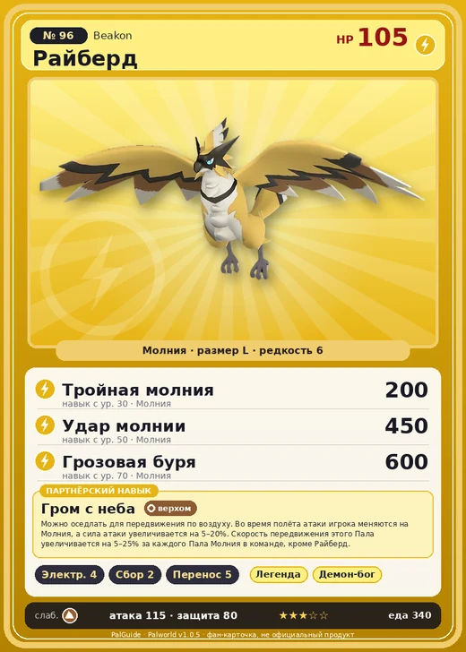

# Райберд

<canvas id="fx"></canvas>

№ 96 · Beakon

Молния

Слабость: Земля

⚡ Генерация энергии <b>4</b>🌾 Сбор <b>2</b>📦 Транспортировка <b>5</b>

<b>Гром с неба</b> 🐾 выпущен 🐎 верхом

❤️ 105 · ⚔️ 115 · 🛡 80

| Поле | Значение |
|---|---|
| Стихия | Молния |
| Слабость (кто бьёт сильнее) | Земля |
| Редкость | 6 |
| Размер | L |
| HP / Атака / Защита (база вида) | 105 / 115 / 80 |
| Сколько ест | 340 |
| Цена продажи | 1934 |
| Множитель поимки | ×1 |
| Скорость рывка верхом | 1200 |

=== "Обзор"

    #### Работа на базе
    - Генерация энергии — ур. 4
    - Сбор — ур. 2
    - Транспортировка — ур. 5

    #### Партнёрский навык: Гром с неба
    Можно оседлать для передвижения по воздуху. Во время полёта атаки игрока меняются на Молния, а сила атаки увеличивается на 5–20%. Скорость передвижения этого Пала увеличивается на 5–25% за каждого Пала Молния в команде, кроме Райберд. Технологии 29.

    #### Чем хорош / чем плох
    - ✅ Быстрый летающий маунт средней игры; хорошая атака (115); отличный рабочий (пригодность 5); можно оседлать; летает (ездовой)
    - ❌ Слабоват в бою на эндгейме

    > Можно подумать, что он — близкий сородич Рагнахавк , но на самом деле между ними нет никакой связи. Он стремительно пикирует вниз и пронзает врага острым клювом — словно удар молнии.

    См. также: [Стихии](../../guide/06_stihii.md) · [Разведение](../../guide/07_razvedenie.md) · [Все палы](README.md)

=== "Атаки"

    #### Атаки по уровням
    - ур. 1: Воздушная пушка (Нейтральный, сила 40)
    - ур. 7: Искровой выстрел (Молния, сила 50)
    - ур. 15: Шоковая волна (Молния, сила 80)
    - ур. 22: Грозовая линия (Молния, сила 160)
    - ур. 26: Пикирующая молния (Молния, сила 180)
    - ур. 30: Тройная молния (Молния, сила 200)
    - ур. 40: Песчаный вихрь (Земля, сила 200)
    - ур. 50: Удар молнии (Молния, сила 450)
    - ур. 70: Грозовая буря (Молния, сила 600)

=== "Где живёт"

    #### Где водится
    - В дикой природе: да; точек появления днём: 505, ночью: 505; уровни в первых точках: 30–34
    - Подземелья: Пещера Песчаных Дюн
    - Может продаваться у торговца/рекрутера
    - Яйцо: Большое яйцо молнии

=== "Дроп"

    #### Дроп
    - Электрический орган — 1–2 шт., 100%

    **Дроп альфы:**
    - Деталь древней цивилизации — 5–6 шт., 100%
    - Ценное перо — 5–6 шт., 100%

=== "Разведение"

    #### Разведение
    - Ранг разведения (CombiRank): 1690
    - Участвует в особых парах: Хэлзефир → Хэлзефир Лакс; Фростплюм → Райберд Крист

=== "Пассивки"

    #### Лучшие пассивки по роли

    

⚔️ Боец

максимум урона и живучести в бою

<a class="psv r-4" data-psv="Легенда" href="../../../passivki/legend/">Легенда</a><a class="psv r-4" data-psv="Демон-бог" href="../../../passivki/demon_god/">Демон-бог</a><a class="psv r-3" data-psv="Император молнии" href="../../../passivki/lord_of_lightning/">Император молнии</a><a class="psv r-3" data-psv="Хладнокровный" href="../../../passivki/serenity/">Хладнокровный</a>

🛠 Рабочий

работает быстрее и меньше устаёт на базе

<a class="psv r-5" data-psv="Дьявольские руки" href="../../../passivki/demons_hand/">Дьявольские руки</a><a class="psv r-4" data-psv="Виртуоз" href="../../../passivki/remarkable_craftsmanship/">Виртуоз</a><a class="psv r-3" data-psv="Мастеровитый" href="../../../passivki/artisan/">Мастеровитый</a><a class="psv r-3" data-psv="Трудоголик" href="../../../passivki/workaholic/">Трудоголик</a>

🐎 Ездовой

быстрее бегает или летает с тобой верхом

<a class="psv r-4" data-psv="Божественная скорость" href="../../../passivki/swift/">Божественная скорость</a><a class="psv r-4" data-psv="Легенда" href="../../../passivki/legend/">Легенда</a><a class="psv r-4" data-psv="Вечный двигатель" href="../../../passivki/eternal_engine/">Вечный двигатель</a><a class="psv r-3" data-psv="Умелый бегун" href="../../../passivki/runner/">Умелый бегун</a>

    <small>Нажми на пассивку, чтобы узнать, что она даёт и где её взять.</small>

<a class="card-link" href="../foxcicle/">← Фоксайкл</a><a class="card-link" href="../beakon_cryst/">Райберд Крист →</a>

