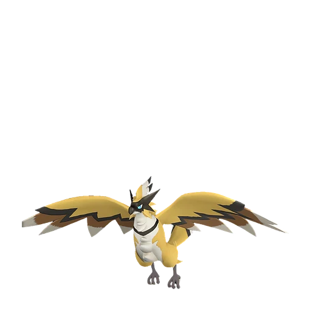

# Райберд

<canvas id="fx"></canvas>

№ 96

Молния

Слабость: Земля <b class="mx">×1,5</b> <button class="hlp" data-tip="Множители перемножаются по обеим стихиям: ×1,5 за стихию, которую атака бьёт, ×0,65 за ту, что её держит.">?</button>

Устойчив: Вода <b class="mx">×0,65</b>

⚡ Генерация энергии <b>4</b>🌾 Сбор <b>2</b>📦 Транспортировка <b>5</b>

<b>Гром с неба</b> 🐾 Когда пал выпущен🐎 Верхом

❤️ 105 · ⚔️ 115 · 🛡 80

Основное

💎Редкость <button class="hlp" data-tip="Чем выше число, тем реже встречается пал. 1–4 — обычные, 5–7 — редкие, 8+ — легендарные.">?</button><b>6</b>

📏Размер<b>L</b>

💰Цена продажи <button class="hlp" data-tip="Сколько золота даст торговец за пала.">?</button><b>1934</b>

Бой

🎯Множитель поимки <button class="hlp" data-tip="Насколько легче или труднее поймать: ×1 — обычно, меньше — сложнее.">?</button><b>×1</b>

🐎Скорость рывка верхом <button class="hlp" data-tip="Скорость, если сесть на пала и бежать рывком.">?</button><b>1200</b>

Ферма и еда

🍖Сколько ест <button class="hlp" data-tip="Сколько сытости пал тратит — чем больше, тем больше еды нужно на базе.">?</button><b>340</b>

Разведение

🧬Сила разведения <button class="hlp" data-tip="Скрытое число игры: у детёныша оно примерно среднее от родителей. Чем меньше — тем «сильнее» пал.">?</button><b>1690</b>

=== "Обзор"

    #### Работа на базе

    
<a class="wbar" href="../../../2_mehaniki/rabota/?w=electricity&lv=4">⚡ Генерация энергии<i style="--v:40%"></i><b>4</b></a><a class="wbar" href="../../../2_mehaniki/rabota/?w=gathering&lv=2">🧺 Сбор<i style="--v:20%"></i><b>2</b></a><a class="wbar" href="../../../2_mehaniki/rabota/?w=transporting&lv=5">📦 Транспортировка<i style="--v:50%"></i><b>5</b></a><a class="wb-more" href="../../../2_mehaniki/rabota/">Что значат уровни работы →</a>

    #### Партнёрский навык: Гром с неба
    Можно оседлать для передвижения по воздуху. Во время полёта атаки игрока меняются на Молния, а сила атаки увеличивается на 5–20%. Скорость передвижения этого Пала увеличивается на 5–25% за каждого Пала Молния в команде, кроме Райберд. Технологии 29.

    #### Чем хорош / чем плох
    - ✅ Быстрый летающий маунт средней игры; хорошая атака (115); отличный рабочий (пригодность 5); можно оседлать; летает (ездовой)
    - ❌ Слабоват в бою на эндгейме

    > Можно подумать, что он — близкий сородич Рагнахавк, но на самом деле между ними нет никакой связи. Он стремительно пикирует вниз и пронзает врага острым клювом — словно удар молнии.

    См. также: [Стихии](../../guide/06_stihii.md) · [Разведение](../../guide/07_razvedenie.md) · [Все палы](README.md)

=== "Атаки"

    #### Атаки по уровням
    - ур. 1: Воздушная пушка (Нейтральный, сила 40)
    - ур. 7: Искровой выстрел (Молния, сила 50)
    - ур. 15: Шоковая волна (Молния, сила 80)
    - ур. 22: Грозовая линия (Молния, сила 160)
    - ур. 26: Пикирующая молния (Молния, сила 180)
    - ур. 30: Тройная молния (Молния, сила 200)
    - ур. 40: Песчаный вихрь (Земля, сила 200)
    - ур. 50: Удар молнии (Молния, сила 450)
    - ур. 70: Грозовая буря (Молния, сила 600)

=== "Где живёт"

    #### Где водится

    

<button data-k="d" class="on">☀️ День</button><button data-k="n">🌙 Ночь</button>

<button data-w=p class=on>Палпагос</button><button data-w=t>Мировое древо</button>

ур. 30–80<a class="btn hm-full" href="../../../map/?pal=ThunderBird">Показать на большой карте</a>

Иссохшие дюныЗелёный ручейШрамы войныЛедяная гора

🕳 Подземелье<b>Пещера Песчаных Дюн</b>

🥚 Яйцо<b>Большое яйцо молнии</b>

🛒 Торговец<b>Продаётся у торговца палами</b>

=== "Дроп"

    #### Дроп
    - Электрический орган — 1–2 шт., 100%

    **Дроп альфы:**
    - Деталь древней цивилизации — 5–6 шт., 100%
    - Ценное перо — 5–6 шт., 100%

=== "Разведение"

    #### Разведение
    - Ранг разведения: 1690
    - Участвует в особых парах: Хэлзефир → Хэлзефир Лакс; Фростплюм → Райберд Крист

=== "Пассивки"

    #### Лучшие пассивки по роли

    

⚔️ Боец

максимум урона и живучести в бою

<a class="psv r-4" data-psv="Легенда" href="../../../passivki/legend/">Легенда</a><a class="psv r-4" data-psv="Демон-бог" href="../../../passivki/demon_god/">Демон-бог</a><a class="psv r-3" data-psv="Император молнии" href="../../../passivki/lord_of_lightning/">Император молнии</a><a class="psv r-3" data-psv="Хладнокровный" href="../../../passivki/serenity/">Хладнокровный</a>

🛠 Рабочий

работает быстрее и меньше устаёт на базе

<a class="psv r-5" data-psv="Дьявольские руки" href="../../../passivki/demons_hand/">Дьявольские руки</a><a class="psv r-4" data-psv="Виртуоз" href="../../../passivki/remarkable_craftsmanship/">Виртуоз</a><a class="psv r-3" data-psv="Мастеровитый" href="../../../passivki/artisan/">Мастеровитый</a><a class="psv r-3" data-psv="Трудоголик" href="../../../passivki/workaholic/">Трудоголик</a>

🐎 Ездовой

быстрее бегает или летает с тобой верхом

<a class="psv r-4" data-psv="Божественная скорость" href="../../../passivki/swift/">Божественная скорость</a><a class="psv r-4" data-psv="Легенда" href="../../../passivki/legend/">Легенда</a><a class="psv r-4" data-psv="Вечный двигатель" href="../../../passivki/eternal_engine/">Вечный двигатель</a><a class="psv r-3" data-psv="Умелый бегун" href="../../../passivki/runner/">Умелый бегун</a>

    <small>Нажми на пассивку, чтобы узнать, что она даёт и где её взять.</small>

<a class="card-link" href="../foxcicle/">← Фоксайкл</a><a class="card-link" href="../beakon_cryst/">Райберд Крист →</a>

