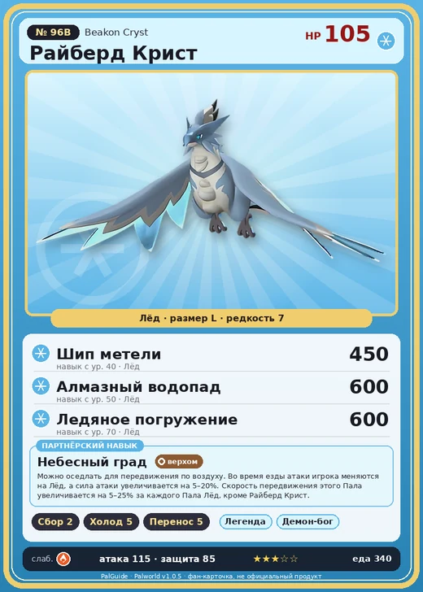

# #96B Райберд Крист (Beakon Cryst)

№ 96B

Лёд

Слабость: Огонь

🌾 Сбор <b>2</b>❄️ Охлаждение <b>5</b>📦 Транспортировка <b>5</b>

<b>Небесный град</b> 🐾 выпущен 🐎 верхом

❤️ 105 · ⚔️ 115 · 🛡 85

| Поле | Значение |
|---|---|
| Стихия | Лёд |
| Слабость (кто бьёт сильнее) | Огонь |
| Редкость | 7 |
| Размер | L |
| HP / Атака / Защита (база вида) | 105 / 115 / 85 |
| Сколько ест | 340 |
| Цена продажи | 2227 |
| Множитель поимки | ×1 |
| Скорость рывка верхом | 1200 |

=== "Обзор"

    #### Работа на базе
    - Сбор — ур. 2
    - Охлаждение — ур. 5
    - Транспортировка — ур. 5

    #### Партнёрский навык: Небесный град
    Можно оседлать для передвижения по воздуху. Во время езды атаки игрока меняются на Лёд, а сила атаки увеличивается на 5–20%. Скорость передвижения этого Пала увеличивается на 5–25% за каждого Пала Лёд, кроме Райберд Крист. Технологии 71.

    #### Чем хорош / чем плох
    - ✅ хорошая атака (115); отличный рабочий (пригодность 5); можно оседлать; летает (ездовой)
    - ❌ разводится только особой парой

    > Приспособлен к жизни в холодных регионах и способен выдерживать мороз, даже при тонком телосложении. Его пикирующие атаки обладают поразительной мощью — словно огромная сосулька падает с неба.

    См. также: [Стихии](../../guide/06_stihii.md) · [Разведение](../../guide/07_razvedenie.md) · [Все палы](README.md)

=== "Атаки"

    #### Атаки по уровням
    - ур. 1: Ледяная ракета (Лёд, сила 40)
    - ур. 7: Айсберг (Лёд, сила 120)
    - ур. 15: Ледяное дыхание (Лёд, сила 160)
    - ур. 22: Ледяные пули (Лёд, сила 250)
    - ур. 30: Ледяной след (Лёд, сила 300)
    - ур. 40: Шип метели (Лёд, сила 450)
    - ур. 50: Алмазный водопад (Лёд, сила 600)
    - ур. 70: Ледяное погружение (Лёд, сила 600)

=== "Где живёт"

    #### Где водится
    - В дикой природе: нет/особый способ; точек появления днём: 0, ночью: 0
    - Яйцо: Большое яйцо льда

=== "Дроп"

    #### Дроп
    - Ледяной орган — 1–2 шт., 100%

    **Дроп альфы:**
    - Деталь древней цивилизации — 5–6 шт., 100%
    - Ценное перо — 2–3 шт., 100%

=== "Разведение"

    #### Разведение
    - Ранг разведения (CombiRank): 580
    - **Особая пара:** [Райберд](../../4_spravochniki/paly/beakon.md) + [Фростплюм](../../4_spravochniki/paly/frostplume.md)

=== "Пассивки"

    #### Лучшие пассивки по роли

    

⚔️ Боец

максимум урона и живучести в бою

<a class="psv r-4" data-psv="Легенда" href="../../../passivki/legend/">Легенда</a><a class="psv r-4" data-psv="Демон-бог" href="../../../passivki/demon_god/">Демон-бог</a><a class="psv r-3" data-psv="Император льда" href="../../../passivki/ice_emperor/">Император льда</a><a class="psv r-3" data-psv="Хладнокровный" href="../../../passivki/serenity/">Хладнокровный</a>

🛠 Рабочий

работает быстрее и меньше устаёт на базе

<a class="psv r-5" data-psv="Дьявольские руки" href="../../../passivki/demons_hand/">Дьявольские руки</a><a class="psv r-4" data-psv="Виртуоз" href="../../../passivki/remarkable_craftsmanship/">Виртуоз</a><a class="psv r-3" data-psv="Мастеровитый" href="../../../passivki/artisan/">Мастеровитый</a><a class="psv r-3" data-psv="Трудоголик" href="../../../passivki/workaholic/">Трудоголик</a>

🐎 Ездовой

быстрее бегает или летает с тобой верхом

<a class="psv r-4" data-psv="Божественная скорость" href="../../../passivki/swift/">Божественная скорость</a><a class="psv r-4" data-psv="Легенда" href="../../../passivki/legend/">Легенда</a><a class="psv r-4" data-psv="Вечный двигатель" href="../../../passivki/eternal_engine/">Вечный двигатель</a><a class="psv r-3" data-psv="Умелый бегун" href="../../../passivki/runner/">Умелый бегун</a>

    <small>Нажми на пассивку, чтобы узнать, что она даёт и где её взять.</small>

<a class="card-link" href="../beakon/">← Райберд</a><a class="card-link" href="../ghangler/">Ганглер →</a>

