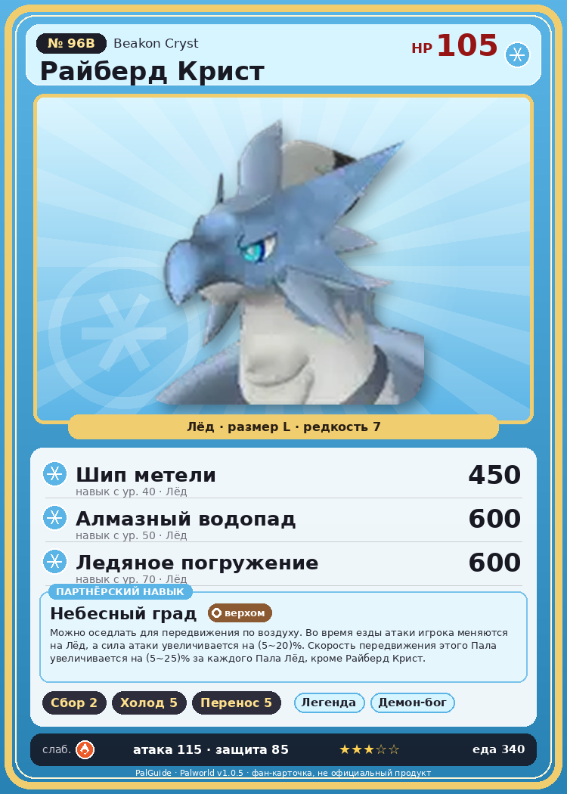

# #96B Райберд Крист (Beakon Cryst)

{ width=360 }

| Поле | Значение |
|---|---|
| Стихия | Лёд |
| Слабость (кто бьёт сильнее) | Огонь |
| Редкость | 7 |
| Размер | L |
| HP / Атака / Защита (база вида) | 105 / 115 / 85 |
| Сколько ест | 340 |
| Цена продажи | 2227 |
| Множитель поимки | ×1 |
| Скорость рывка верхом | 1200 |

## Работа на базе
- Сбор — ур. 2
- Охлаждение — ур. 5
- Транспортировка — ур. 5

## Партнёрский навык: Небесный град
Можно оседлать для передвижения по воздуху. Во время езды атаки игрока меняются на Лёд , а сила атаки увеличивается на (5~20)% . Скорость передвижения этого Пала увеличивается на (5~25)% за каждого Пала Лёд , кроме Райберд Крист . Технологии 71 level value 1 MoveSpeed_PartnerSkill_SpecificElement 5 GiveAIce_Ride 1 GiveElement_TrainerATK_UP_PartnerSkill_Ride 5 2 MoveSpeed_PartnerSkill_SpecificElement 9 GiveAIce_Ride 1 GiveElement_TrainerATK_UP_PartnerSkill_Ride 7 3 MoveSpeed_PartnerSkill_SpecificElement 13 GiveAIce_Ride 1 GiveElement_TrainerATK_UP_PartnerSkill_Ride 10 4 MoveSpeed_PartnerSkill_SpecificElement 18 GiveAIce_Ride 1 GiveElement_TrainerATK_UP_PartnerSkill_Ride 14 5 MoveSpeed_PartnerSkill_SpecificElement 25 GiveAIce_Ride 1 GiveElement_TrainerATK_UP_PartnerSkill_Ride 20

## Атаки по уровням
- ур. 1: Ледяная ракета (Лёд, сила 40)
- ур. 7: Айсберг (Лёд, сила 120)
- ур. 15: Ледяное дыхание (Лёд, сила 160)
- ур. 22: Ледяные пули (Лёд, сила 250)
- ур. 30: Ледяной след (Лёд, сила 300)
- ур. 40: Шип метели (Лёд, сила 450)
- ур. 50: Алмазный водопад (Лёд, сила 600)
- ур. 70: Ледяное погружение (Лёд, сила 600)

## Где водится
- В дикой природе: нет/особый способ; точек появления днём: 0, ночью: 0
- Яйцо: Большое яйцо льда

## Дроп
- Ледяной орган — 1–2 шт., 100%

**Дроп альфы:**
- Деталь древней цивилизации — 5–6 шт., 100%
- Ценное перо — 2–3 шт., 100%

## Разведение
- Ранг разведения (CombiRank): 580
- **Особая пара:** [Райберд](../../4_spravochniki/paly/beakon.md) + [Фростплюм](../../4_spravochniki/paly/frostplume.md)

## Лучшие пассивки по роли
- боец: Легенда, Демон-бог, Хладнокровный, Бессмертие, Император льда (вместо Бессмертия, если нет мутации)
- рабочий: Дьявольские руки, Виртуоз, Мастеровитый, Небожитель/Трудоголик
- ездовой: Божественная скорость, Легенда, Вечный двигатель, Небесное скольжение

## Чем хорош / чем плох
- ✅ хорошая атака (115); отличный рабочий (пригодность 5); можно оседлать; летает (ездовой)
- ❌ разводится только особой парой

> Приспособлен к жизни в холодных регионах и способен выдерживать мороз, даже при тонком телосложении. Его пикирующие атаки обладают поразительной мощью — словно огромная сосулька падает с неба.

См. также: [Стихии](../../2_mehaniki/stihii.md) · [Разведение](../../2_mehaniki/razvedenie.md) · [Все палы](README.md)
_Источник: paldb.cc v1.0.5_
