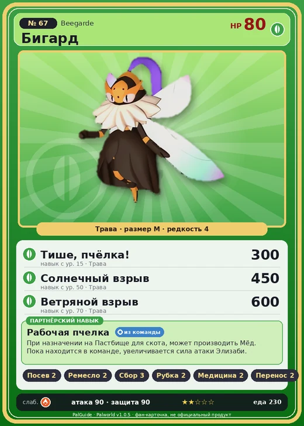

# #67 Бигард (Beegarde)

#67 · Beegarde

Трава

Слабость: Огонь

🌱 Посев семян <b>2</b>🖐️ Ручная работа <b>2</b>🌾 Сбор <b>3</b>🪓 Рубка деревьев <b>2</b>💊 Фармацевтика <b>2</b>📦 Транспортировка <b>2</b>🐑 Фермерство <b>3</b>

<b>Рабочая пчелка</b> 🎒 из команды 🏠 на базе

❤️ 80 · ⚔️ 90 · 🛡 90

| Поле | Значение |
|---|---|
| Стихия | Трава |
| Слабость (кто бьёт сильнее) | Огонь |
| Редкость | 4 |
| Размер | M |
| HP / Атака / Защита (база вида) | 80 / 90 / 90 |
| Сколько ест | 230 |
| Цена продажи | 1166 |
| Множитель поимки | ×1 |
| Скорость рывка верхом | 550 |

## Работа на базе
- Посев семян — ур. 2
- Ручная работа — ур. 2
- Сбор — ур. 3
- Рубка деревьев — ур. 2
- Фармацевтика — ур. 2
- Транспортировка — ур. 2
- Фермерство — ур. 3

## Партнёрский навык: Рабочая пчелка
При назначении на Пастбище для скота , может производить Мёд . Пока находится в команде, увеличивается сила атаки Элизаби .

## Атаки по уровням
- ур. 1: Воздушная пушка (Нейтральный, сила 40)
- ур. 7: Ветряной клинок (Трава, сила 40)
- ур. 11: Жалящее копьё (Трава, сила 120)
- ур. 15: Тише, пчёлка! (Трава, сила 300)
- ур. 22: Ядовитый выстрел (Тьма, сила 30)
- ур. 30: Кислотный дождь (Вода, сила 120)
- ур. 40: Травяной торнадо (Трава, сила 200)
- ур. 50: Солнечный взрыв (Трава, сила 450)
- ур. 70: Ветряной взрыв (Трава, сила 600)

## Где водится
- В дикой природе: да; точек появления днём: 44, ночью: 44; уровни в первых точках: 28–33
- Подземелья: Пещера Горного Потока
- Может продаваться у торговца/рекрутера
- Яйцо: Яйцо свежей листвы

## Дроп
- Мёд — 1–2 шт., 100%

**Дроп альфы:**
- Деталь древней цивилизации — 2–4 шт., 100%
- Ценное перо — 2–4 шт., 100%

## Разведение
- Ранг разведения (CombiRank): 2350

## Лучшие пассивки по роли
- по обзору: Мастеровитый
- боец: Легенда, Демон-бог, Хладнокровный, Бессмертие, Король духов (вместо Бессмертия, если нет мутации)
- рабочий: Дьявольские руки, Виртуоз, Мастеровитый, Небожитель/Трудоголик
- ездовой: Божественная скорость, Легенда, Вечный двигатель, Небесное скольжение

## Чем хорош / чем плох
- ✅ Мёд, фермерство 3; можно оседлать
- ❌ явных минусов нет

> Верный слуга, присягнувший королеве Элизаби . Без колебаний расправляется с теми, кто посмеет причинить ей вред. Он защитит её даже ценою собственной жизни.

См. также: [Стихии](../../guide/06_stihii.md) · [Разведение](../../guide/07_razvedenie.md) · [Все палы](README.md)
