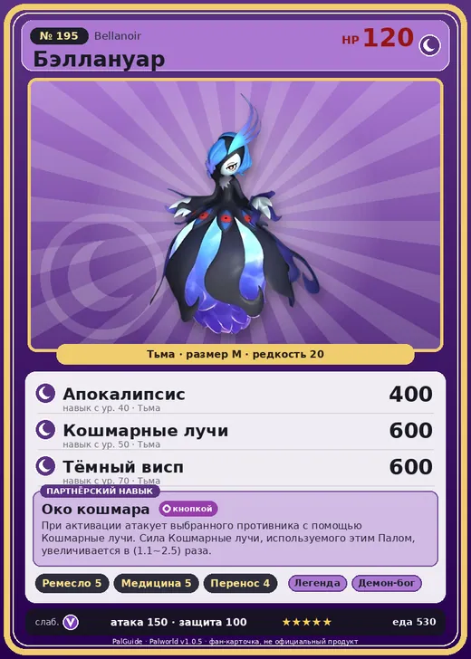

# #195 Бэллануар (Bellanoir)

#195 · Bellanoir

Тьма

Слабость: Дракон

🖐️ Ручная работа <b>5</b>💊 Фармацевтика <b>5</b>📦 Транспортировка <b>4</b>

<b>Око кошмара</b> 🔘 кнопкой

❤️ 120 · ⚔️ 150 · 🛡 100

| Поле | Значение |
|---|---|
| Стихия | Тьма |
| Слабость (кто бьёт сильнее) | Дракон |
| Редкость | 20 |
| Размер | M |
| HP / Атака / Защита (база вида) | 120 / 150 / 100 |
| Сколько ест | 530 |
| Цена продажи | 3667 |
| Множитель поимки | ×1 |
| Скорость рывка верхом | 800 |

## Работа на базе
- Ручная работа — ур. 5
- Фармацевтика — ур. 5
- Транспортировка — ур. 4

## Партнёрский навык: Око кошмара
При активации атакует выбранного противника с помощью Кошмарные лучи . Сила Кошмарные лучи , используемого этим Палом, увеличивается в (1.1~2.5) раза . level value 1 MainValue 1.1 2 MainValue 1.3 3 MainValue 1.6 4 MainValue 2 5 MainValue 2.5

## Атаки по уровням
- ур. 1: Тёмная пушка (Тьма, сила 70)
- ур. 7: Распространение тьмы (Тьма, сила 60)
- ур. 15: Стрелы тьмы (Тьма, сила 120)
- ур. 22: Духовное пламя (Тьма, сила 200)
- ур. 30: Кошмарная сфера (Тьма, сила 300)
- ур. 40: Апокалипсис (Тьма, сила 400)
- ур. 50: Кошмарные лучи (Тьма, сила 600)
- ур. 70: Тёмный висп (Тьма, сила 600)

## Где водится
- В дикой природе: нет/особый способ; точек появления днём: 0, ночью: 0
- Яйцо: Огромное яйцо тьмы

## Дроп
- Осколок тьмы — 2–3 шт., 100%

**Дроп альфы:**
- Деталь древней цивилизации — 4–6 шт., 100%
- Ценные внутренности — 2–3 шт., 100%

## Разведение
- Ранг разведения (CombiRank): 620
- **Особая пара:** [Бэллануар](../../4_spravochniki/paly/bellanoir.md) + [Бэллануар Либеро](../../4_spravochniki/paly/bellanoir_libero.md)
- Участвует в особых парах: Бэллануар Либеро → Бэллануар

## Лучшие пассивки по роли
- по обзору: Легенда, Демон-бог, Хладнокровный, Король тьмы
- боец: Легенда, Демон-бог, Хладнокровный, Бессмертие, Король тьмы (вместо Бессмертия, если нет мутации)
- рабочий: Дьявольские руки, Виртуоз, Мастеровитый, Небожитель/Трудоголик
- ездовой: Божественная скорость, Легенда, Вечный двигатель, Небесное скольжение

## Чем хорош / чем плох
- ✅ Сильный тёмный боец; очень высокая атака (150); много здоровья (120); отличный рабочий (пригодность 5); можно оседлать
- ❌ Слабее Либеро; много ест (530); разводится только особой парой

> Она не существовала — лишь молча взирала на мир. Но со временем ей захотелось, чтобы взирали на неё. Сгусток желаний, враждебных внешнему миру, был определён как Безумная Леди.

См. также: [Стихии](../../guide/06_stihii.md) · [Разведение](../../guide/07_razvedenie.md) · [Все палы](README.md)
