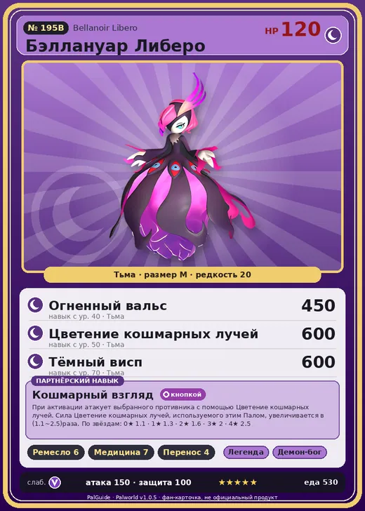

# Бэллануар Либеро

<canvas id="fx"></canvas>

№ 195B

Тьма

Слабость: Дракон <b class="mx">×1,5</b> <button class="hlp" data-tip="Множители перемножаются по обеим стихиям: ×1,5 за стихию, которую атака бьёт, ×0,65 за ту, что её держит.">?</button>

Устойчив: Нейтральный <b class="mx">×0,65</b>

🖐️ Ручная работа <b>6</b>💊 Фармацевтика <b>7</b>📦 Транспортировка <b>4</b>

<b>Кошмарный взгляд</b> 🔘 Включается кнопкой

❤️ 120 · ⚔️ 150 · 🛡 100

Основное

💎Редкость <button class="hlp" data-tip="Чем выше число, тем реже встречается пал. 1–4 — обычные, 5–7 — редкие, 8+ — легендарные.">?</button><b>20</b>

📏Размер<b>M</b>

💰Цена продажи <button class="hlp" data-tip="Сколько золота даст торговец за пала.">?</button><b>3997</b>

Бой

🎯Множитель поимки <button class="hlp" data-tip="Насколько легче или труднее поймать: ×1 — обычно, меньше — сложнее.">?</button><b>×1</b>

🐎Скорость рывка верхом <button class="hlp" data-tip="Скорость, если сесть на пала и бежать рывком.">?</button><b>800</b>

Ферма и еда

🍖Сколько ест <button class="hlp" data-tip="Сколько сытости пал тратит — чем больше, тем больше еды нужно на базе.">?</button><b>530</b>

Разведение

🧬Сила разведения <button class="hlp" data-tip="Скрытое число игры: у детёныша оно примерно среднее от родителей. Чем меньше — тем «сильнее» пал.">?</button><b>130</b>

💞Особая пара <button class="hlp" data-tip="Этого пала можно вывести только от этой пары.">?</button><b>Бэллануар Либеро + Бэллануар Либеро</b>

=== "Обзор"

    #### Работа на базе

    
<a class="wbar" href="../../../2_mehaniki/rabota/?w=handiwork&lv=6">✋ Ручная работа<i style="--v:60%"></i><b>6</b></a><a class="wbar" href="../../../2_mehaniki/rabota/?w=medicine&lv=7">💊 Фармацевтика<i style="--v:70%"></i><b>7</b></a><a class="wbar" href="../../../2_mehaniki/rabota/?w=transporting&lv=4">📦 Транспортировка<i style="--v:40%"></i><b>4</b></a><a class="wb-more" href="../../../2_mehaniki/rabota/">Что значат уровни работы →</a>

    #### Партнёрский навык: Кошмарный взгляд
    При активации атакует выбранного противника с помощью Цветение кошмарных лучей. Сила Цветение кошмарных лучей, используемого этим Палом, увеличивается в (1.1~2.5)раза. По звёздам: 0★ 1.1 · 1★ 1.3 · 2★ 1.6 · 3★ 2 · 4★ 2.5

    #### Чем хорош / чем плох
    - ✅ Один из сильнейших тёмных бойцов; очень высокая атака (150); много здоровья (120); отличный рабочий (пригодность 7)
    - ❌ Только через рейд; слаб к драконам; много ест (530); разводится только особой парой

    > Освобождённое желание так и не утихло. Я хочу лишь себя — ту, что смотрит на меня. Сестры, взиравшие с враждой на внешний мир, были наконец загнаны в межмирье — и лишь тогда закрыли глаза.

    См. также: [Стихии](../../guide/06_stihii.md) · [Разведение](../../guide/07_razvedenie.md) · [Все палы](README.md)

=== "Атаки"

    #### Атаки по уровням
    - ур. 1: Тёмная пушка (Тьма, сила 70)
    - ур. 7: Распространение тьмы (Тьма, сила 60)
    - ур. 15: Стрелы тьмы (Тьма, сила 120)
    - ур. 22: Кошмарная сфера (Тьма, сила 300)
    - ур. 30: Апокалипсис (Тьма, сила 400)
    - ур. 40: Огненный вальс (Тьма, сила 450)
    - ур. 50: Цветение кошмарных лучей (Тьма, сила 600)
    - ур. 70: Тёмный висп (Тьма, сила 600)

=== "Где живёт"

    #### Где водится

    

<b>В дикой природе не встречается</b>Точек появления на открытой карте в данных игры нет — ищи в подземельях, яйцах или выводи разведением.

🥚 Яйцо<b>Огромное яйцо тьмы</b>

=== "Дроп"

    #### Дроп
    - Осколок тьмы — 2–3 шт., 100%
    - Качественное снадобье восстановления — 1–2 шт., 100%

    **Дроп альфы:**

    - Деталь древней цивилизации — 4–6 шт., 100%
    - Ценные внутренности — 2–3 шт., 100%

=== "Разведение"

    #### Разведение
    - Ранг разведения: 130
    - **Особая пара:** [Бэллануар Либеро](../../4_spravochniki/paly/bellanoir_libero.md) + [Бэллануар Либеро](../../4_spravochniki/paly/bellanoir_libero.md)
    - Участвует в особых парах: [Бэллануар](bellanoir.md) → [Бэллануар](bellanoir.md); Бэллануар Либеро → Бэллануар Либеро; Бэллануар Либеро → Бэллануар Либеро

=== "Пассивки"

    #### Лучшие пассивки по роли

    

⚔️ Боец

максимум урона и живучести в бою

<a class="psv r-4" data-psv="Легенда" href="../../../passivki/legend/">Легенда</a><a class="psv r-4" data-psv="Демон-бог" href="../../../passivki/demon_god/">Демон-бог</a><a class="psv r-3" data-psv="Король тьмы" href="../../../passivki/lord_of_the_underworld/">Король тьмы</a><a class="psv r-3" data-psv="Хладнокровный" href="../../../passivki/serenity/">Хладнокровный</a>

🛠 Рабочий

работает быстрее и меньше устаёт на базе

<a class="psv r-5" data-psv="Дьявольские руки" href="../../../passivki/demons_hand/">Дьявольские руки</a><a class="psv r-4" data-psv="Виртуоз" href="../../../passivki/remarkable_craftsmanship/">Виртуоз</a><a class="psv r-3" data-psv="Мастеровитый" href="../../../passivki/artisan/">Мастеровитый</a><a class="psv r-3" data-psv="Трудоголик" href="../../../passivki/workaholic/">Трудоголик</a>

    <small>Нажми на пассивку, чтобы узнать, что она даёт и где её взять.</small>

<a class="card-link" href="../bellanoir/">← Бэллануар</a><a class="card-link" href="../xenolord/">Зенолорд →</a>

