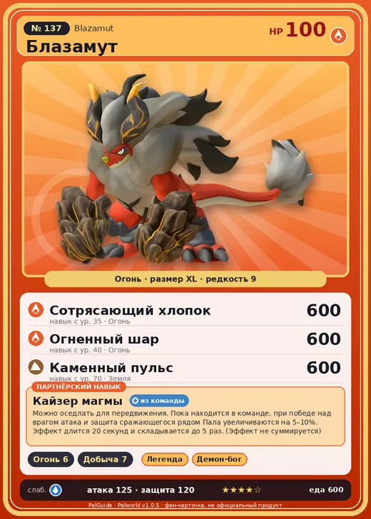

# #137 Блазамут (Blazamut)

№ 137

Огонь

Слабость: Вода

🔥 Разжигание огня <b>6</b>⛏️ Добыча <b>7</b>

<b>Кайзер магмы</b> 🎒 из команды 🐎 верхом

❤️ 100 · ⚔️ 125 · 🛡 120

| Поле | Значение |
|---|---|
| Стихия | Огонь |
| Слабость (кто бьёт сильнее) | Вода |
| Редкость | 9 |
| Размер | XL |
| HP / Атака / Защита (база вида) | 100 / 125 / 120 |
| Сколько ест | 600 |
| Цена продажи | 3470 |
| Множитель поимки | ×1 |
| Скорость рывка верхом | 1200 |

## Работа на базе
- Разжигание огня — ур. 6
- Добыча — ур. 7

## Партнёрский навык: Кайзер магмы
Можно оседлать для передвижения. Пока находится в команде, при победе над врагом атака и защита сражающегося рядом Пала увеличиваются на (5~10)% . Эффект длится 20 секунд и складывается до 5 раз. (Эффект не суммируется) Технологии 46 level value 1 KingBahamut_PartnerSkill_v2 5 2 KingBahamut_PartnerSkill_v2 6 3 KingBahamut_PartnerSkill_v2 7 4 KingBahamut_PartnerSkill_v2 8 5 KingBahamut_PartnerSkill_v2 10

## Атаки по уровням
- ур. 1: Силовой выстрел (Нейтральный, сила 80)
- ур. 7: Огненный выстрел (Огонь, сила 40)
- ур. 15: Каменный залп (Земля, сила 80)
- ур. 22: Огненное дыхание (Огонь, сила 160)
- ур. 30: Инферно (Огонь, сила 500)
- ур. 35: Сотрясающий хлопок (Огонь, сила 600)
- ур. 40: Огненный шар (Огонь, сила 600)
- ур. 50: Каменные копья (Земля, сила 400)
- ур. 70: Каменный пульс (Земля, сила 600)

## Где водится
- В дикой природе: да; точек появления днём: 17, ночью: 17; уровни в первых точках: 46–50
- Яйцо: Огромное раскалённое яйцо

## Дроп
- Уголь — 10 шт., 100%
- Огненный орган — 10 шт., 100%

**Дроп альфы:**
- Деталь древней цивилизации — 5–7 шт., 100%
- Ценный коготь — 5–7 шт., 100%

## Разведение
- Ранг разведения (CombiRank): 410

## Лучшие пассивки по роли
- по обзору: Легенда, Демон-бог, Хладнокровный, Император огня
- боец: Легенда, Демон-бог, Хладнокровный, Бессмертие, Император огня (вместо Бессмертия, если нет мутации)
- рабочий: Дьявольские руки, Виртуоз, Мастеровитый, Небожитель/Трудоголик
- ездовой: Божественная скорость, Легенда, Вечный двигатель, Небесное скольжение

## Чем хорош / чем плох
- ✅ Сильный огонь; хорош в добыче и огне; очень высокая атака (125); крепкая защита (120); отличный рабочий (пригодность 7); можно оседлать
- ❌ Медленный; много ест (600)

> Согласно легенде, Блазамут появляется во время извержения вулкана. Существовала даже загадочная группа, которая утверждала, что наша земля — это спина гигантского Пала.

См. также: [Стихии](../../guide/06_stihii.md) · [Разведение](../../guide/07_razvedenie.md) · [Все палы](README.md)
