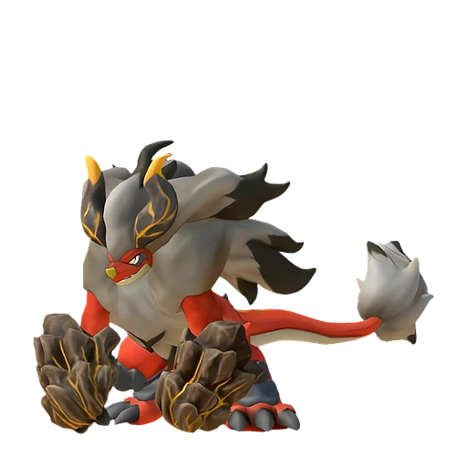

# Блазамут

<canvas id="fx"></canvas>

№ 137 · Blazamut

Огонь

Слабость: Вода <b class="mx">×1,5</b> <button class="hlp" data-tip="Множители перемножаются по обеим стихиям пала: ×1,5 за каждую стихию, которую атака бьёт, ×0,65 за каждую, которая её держит. Если одна стихия слаба, а другая устойчива (×1,5 × 0,65 ≈ ×0,98), слабости нет.">?</button>

Устойчив: Трава <b class="mx">×0,65</b>Лёд <b class="mx">×0,65</b>

🔥 Разжигание огня <b>6</b>⛏️ Добыча <b>7</b>

<b>Кайзер магмы</b> 🎒 из команды 🐎 верхом

❤️ 100 · ⚔️ 125 · 🛡 120

Основное

💎Редкость <button class="hlp" data-tip="Чем выше число, тем реже встречается пал. 1–4 — обычные, 5–7 — редкие, 8+ — легендарные.">?</button><b>9</b>

📏Размер<b>XL</b>

💰Цена продажи <button class="hlp" data-tip="Сколько золота даст торговец за пала.">?</button><b>3470</b>

Бой

🎯Множитель поимки <button class="hlp" data-tip="Насколько легче или труднее поймать: ×1 — обычно, меньше — сложнее.">?</button><b>×1</b>

🐎Скорость рывка верхом <button class="hlp" data-tip="Скорость, если сесть на пала и бежать рывком.">?</button><b>1200</b>

Ферма и еда

🍖Сколько ест <button class="hlp" data-tip="Сколько сытости пал тратит — чем больше, тем больше еды нужно на базе.">?</button><b>600</b>

Разведение

🧬Сила разведения <button class="hlp" data-tip="Скрытое число игры: у детёныша оно примерно среднее от родителей. Чем меньше — тем «сильнее» пал.">?</button><b>410</b>

=== "Обзор"

    #### Работа на базе
    - Разжигание огня — ур. 6
    - Добыча — ур. 7

    #### Партнёрский навык: Кайзер магмы
    Можно оседлать для передвижения. Пока находится в команде, при победе над врагом атака и защита сражающегося рядом Пала увеличиваются на 5–10%. Эффект длится 20 секунд и складывается до 5 раз. (Эффект не суммируется) Технологии 46. По звёздам: 0★ 5 · 1★ 6 · 2★ 7 · 3★ 8 · 4★ 10

    #### Чем хорош / чем плох
    - ✅ Сильный огонь; хорош в добыче и огне; очень высокая атака (125); крепкая защита (120); отличный рабочий (пригодность 7); можно оседлать
    - ❌ Медленный; много ест (600)

    > Согласно легенде, Блазамут появляется во время извержения вулкана. Существовала даже загадочная группа, которая утверждала, что наша земля — это спина гигантского Пала.

    См. также: [Стихии](../../guide/06_stihii.md) · [Разведение](../../guide/07_razvedenie.md) · [Все палы](README.md)

=== "Атаки"

    #### Атаки по уровням
    - ур. 1: Силовой выстрел (Нейтральный, сила 80)
    - ур. 7: Огненный выстрел (Огонь, сила 40)
    - ур. 15: Каменный залп (Земля, сила 80)
    - ур. 22: Огненное дыхание (Огонь, сила 160)
    - ур. 30: Инферно (Огонь, сила 500)
    - ур. 35: Сотрясающий хлопок (Огонь, сила 600)
    - ур. 40: Огненный шар (Огонь, сила 600)
    - ур. 50: Каменные копья (Земля, сила 400)
    - ур. 70: Каменный пульс (Земля, сила 600)

=== "Где живёт"

    #### Где водится

    

<button data-k="d" class="on">☀️ День</button><button data-k="n">🌙 Ночь</button>

<button data-w=p class=on>Палпагос</button><button data-w=t>Мировое древо</button>

ур. 46–80<a class="btn hm-full" href="../../../map/?pal=KingBahamut">Показать на большой карте</a>

Остров Огненных жил

🥚 Яйцо<b>Огромное раскалённое яйцо</b>

=== "Дроп"

    #### Дроп
    - Уголь — 10 шт., 100%
    - Огненный орган — 10 шт., 100%

    **Дроп альфы:**
    - Деталь древней цивилизации — 5–7 шт., 100%
    - Ценный коготь — 5–7 шт., 100%

=== "Разведение"

    #### Разведение
    - Ранг разведения (CombiRank): 410

=== "Пассивки"

    #### Лучшие пассивки по роли

    

⚔️ Боец

максимум урона и живучести в бою

<a class="psv r-4" data-psv="Легенда" href="../../../passivki/legend/">Легенда</a><a class="psv r-4" data-psv="Демон-бог" href="../../../passivki/demon_god/">Демон-бог</a><a class="psv r-3" data-psv="Император огня" href="../../../passivki/flame_emperor/">Император огня</a><a class="psv r-3" data-psv="Хладнокровный" href="../../../passivki/serenity/">Хладнокровный</a>

🛠 Рабочий

работает быстрее и меньше устаёт на базе

<a class="psv r-5" data-psv="Дьявольские руки" href="../../../passivki/demons_hand/">Дьявольские руки</a><a class="psv r-4" data-psv="Виртуоз" href="../../../passivki/remarkable_craftsmanship/">Виртуоз</a><a class="psv r-3" data-psv="Мастеровитый" href="../../../passivki/artisan/">Мастеровитый</a><a class="psv r-3" data-psv="Трудоголик" href="../../../passivki/workaholic/">Трудоголик</a>

🐎 Ездовой

быстрее бегает или летает с тобой верхом

<a class="psv r-4" data-psv="Божественная скорость" href="../../../passivki/swift/">Божественная скорость</a><a class="psv r-4" data-psv="Легенда" href="../../../passivki/legend/">Легенда</a><a class="psv r-4" data-psv="Вечный двигатель" href="../../../passivki/eternal_engine/">Вечный двигатель</a><a class="psv r-4" data-psv="Небесное скольжение" href="../../../passivki/sky_strider/">Небесное скольжение</a>

    <small>Нажми на пассивку, чтобы узнать, что она даёт и где её взять.</small>

<a class="card-link" href="../carnibora/">← Карнибора</a><a class="card-link" href="../blazamut_ryu/">Блазамут Рю →</a>

