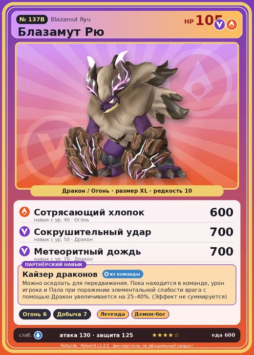

# Блазамут Рю

<canvas id="fx"></canvas>

№ 137B

ДраконОгонь

Слабость: Вода <b class="mx">×1,5</b> <button class="hlp" data-tip="Множители перемножаются по обеим стихиям: ×1,5 за стихию, которую атака бьёт, ×0,65 за ту, что её держит. Вода: 1 × 1,5 = ×1,5.">?</button>

Устойчив: Трава <b class="mx">×0,65</b>Тьма <b class="mx">×0,65</b>

🔥 Разжигание огня <b>6</b>⛏️ Добыча <b>7</b>

<b>Кайзер драконов</b> 🎒 Работает из команды🐎 Верхом

❤️ 105 · ⚔️ 130 · 🛡 125

Основное

💎Редкость <button class="hlp" data-tip="Чем выше число, тем реже встречается пал. 1–4 — обычные, 5–7 — редкие, 8+ — легендарные.">?</button><b>10</b>

📏Размер<b>XL</b>

💰Цена продажи <button class="hlp" data-tip="Сколько золота даст торговец за пала.">?</button><b>3651</b>

Бой

🎯Множитель поимки <button class="hlp" data-tip="Насколько легче или труднее поймать: ×1 — обычно, меньше — сложнее.">?</button><b>×1</b>

🐎Скорость рывка верхом <button class="hlp" data-tip="Скорость, если сесть на пала и бежать рывком.">?</button><b>1200</b>

Ферма и еда

🍖Сколько ест <button class="hlp" data-tip="Сколько сытости пал тратит — чем больше, тем больше еды нужно на базе.">?</button><b>600</b>

Разведение

🧬Сила разведения <button class="hlp" data-tip="Скрытое число игры: у детёныша оно примерно среднее от родителей. Чем меньше — тем «сильнее» пал.">?</button><b>100</b>

💞Особая пара <button class="hlp" data-tip="Этого пала можно вывести только от этой пары.">?</button><b>Блазамут Рю + Блазамут Рю</b>

=== "Обзор"

    #### Работа на базе

    
<a class="wbar" href="../../../2_mehaniki/rabota/?w=kindling&lv=6">🔥 Разжигание огня<i style="--v:60%"></i><b>6</b></a><a class="wbar" href="../../../2_mehaniki/rabota/?w=mining&lv=7">⛏️ Добыча<i style="--v:70%"></i><b>7</b></a><a class="wb-more" href="../../../2_mehaniki/rabota/">Что значат уровни работы →</a>

    #### Партнёрский навык: Кайзер драконов
    Можно оседлать для передвижения. Пока находится в команде, урон игрока и Пала при поражении элементальной слабости врага с помощью Дракон увеличивается на 25–40%. (Эффект не суммируется) Технологии 55. По звёздам: 0★ 25 · 1★ 27 · 2★ 30 · 3★ 34 · 4★ 40

    #### Чем хорош / чем плох
    - ✅ Огонь+дракон, огромный урон; очень высокая атака (130); крепкая защита (125); отличный рабочий (пригодность 7); можно оседлать
    - ❌ Рейд ур. 55; много ест (600); разводится только особой парой

    > Давно, в глубинах земли, он появился на свет. Его неукротимый пыл сжигал всё без жалости, не стихая, пока не опалил весь остров. Именно так его прозвали — |Вечное пламя|.

    См. также: [Стихии](../../guide/06_stihii.md) · [Разведение](../../guide/07_razvedenie.md) · [Все палы](README.md)

=== "Атаки"

    #### Атаки по уровням
    - ур. 1: Драконий взрыв (Дракон, сила 80)
    - ур. 7: Огненное дыхание (Огонь, сила 160)
    - ур. 15: Огненная стена (Огонь, сила 250)
    - ур. 22: Комета (Дракон, сила 180)
    - ур. 30: Режущий луч (Дракон, сила 350)
    - ур. 40: Сотрясающий хлопок (Огонь, сила 600)
    - ур. 50: Сокрушительный удар (Дракон, сила 700)
    - ур. 70: Метеоритный дождь (Дракон, сила 700)

=== "Где живёт"

    #### Где водится

    

<b>В дикой природе не встречается</b>Точек появления на открытой карте в данных игры нет — ищи в подземельях, яйцах или выводи разведением.

🥚 Яйцо<b>Огромное яйцо дракона</b>

=== "Дроп"

    #### Дроп
    - Уголь — 10 шт., 100%
    - Средняя душа Пала — 1 шт., 5%

    **Дроп альфы:**
    - Деталь древней цивилизации — 2–3 шт., 100%
    - Ценный коготь — 6–8 шт., 100%

=== "Разведение"

    #### Разведение
    - Ранг разведения: 100
    - **Особая пара:** [Блазамут Рю](../../4_spravochniki/paly/blazamut_ryu.md) + [Блазамут Рю](../../4_spravochniki/paly/blazamut_ryu.md)
    - Участвует в особых парах: Блазамут Рю → Блазамут Рю; Блазамут Рю → Блазамут Рю

=== "Пассивки"

    #### Лучшие пассивки по роли

    

⚔️ Боец

максимум урона и живучести в бою

<a class="psv r-4" data-psv="Легенда" href="../../../passivki/legend/">Легенда</a><a class="psv r-4" data-psv="Демон-бог" href="../../../passivki/demon_god/">Демон-бог</a><a class="psv r-3" data-psv="Божественный дракон" href="../../../passivki/divine_dragon/">Божественный дракон</a><a class="psv r-3" data-psv="Хладнокровный" href="../../../passivki/serenity/">Хладнокровный</a>

🛠 Рабочий

работает быстрее и меньше устаёт на базе

<a class="psv r-5" data-psv="Дьявольские руки" href="../../../passivki/demons_hand/">Дьявольские руки</a><a class="psv r-4" data-psv="Виртуоз" href="../../../passivki/remarkable_craftsmanship/">Виртуоз</a><a class="psv r-3" data-psv="Мастеровитый" href="../../../passivki/artisan/">Мастеровитый</a><a class="psv r-3" data-psv="Трудоголик" href="../../../passivki/workaholic/">Трудоголик</a>

🐎 Ездовой

быстрее бегает или летает с тобой верхом

<a class="psv r-4" data-psv="Божественная скорость" href="../../../passivki/swift/">Божественная скорость</a><a class="psv r-4" data-psv="Легенда" href="../../../passivki/legend/">Легенда</a><a class="psv r-4" data-psv="Вечный двигатель" href="../../../passivki/eternal_engine/">Вечный двигатель</a><a class="psv r-4" data-psv="Небесное скольжение" href="../../../passivki/sky_strider/">Небесное скольжение</a>

    <small>Нажми на пассивку, чтобы узнать, что она даёт и где её взять.</small>

<a class="card-link" href="../blazamut/">← Блазамут</a><a class="card-link" href="../dualith/">Дуалит →</a>

