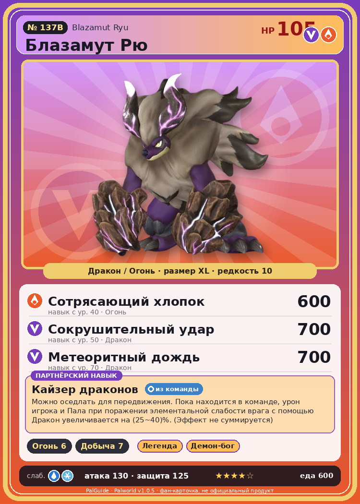

# #137B Блазамут Рю (Blazamut Ryu)

{ width=360 }

| Поле | Значение |
|---|---|
| Стихия | Дракон, Огонь |
| Слабость (кто бьёт сильнее) | Вода, Лёд |
| Редкость | 10 |
| Размер | XL |
| HP / Атака / Защита (база вида) | 105 / 130 / 125 |
| Сколько ест | 600 |
| Цена продажи | 3651 |
| Множитель поимки | ×1 |
| Скорость рывка верхом | 1200 |

## Работа на базе
- Разжигание огня — ур. 6
- Добыча — ур. 7

## Партнёрский навык: Кайзер драконов
Можно оседлать для передвижения. Пока находится в команде, урон игрока и Пала при поражении элементальной слабости врага с помощью Дракон увеличивается на (25~40)% . (Эффект не суммируется) Технологии 55 level value 1 ElementBoostWeakness_Dragon_PartnerSkill 25 2 ElementBoostWeakness_Dragon_PartnerSkill 27 3 ElementBoostWeakness_Dragon_PartnerSkill 30 4 ElementBoostWeakness_Dragon_PartnerSkill 34 5 ElementBoostWeakness_Dragon_PartnerSkill 40

## Атаки по уровням
- ур. 1: Драконий взрыв (Дракон, сила 80)
- ур. 7: Огненное дыхание (Огонь, сила 160)
- ур. 15: Огненная стена (Огонь, сила 250)
- ур. 22: Комета (Дракон, сила 180)
- ур. 30: Режущий луч (Дракон, сила 350)
- ур. 40: Сотрясающий хлопок (Огонь, сила 600)
- ур. 50: Сокрушительный удар (Дракон, сила 700)
- ур. 70: Метеоритный дождь (Дракон, сила 700)

## Где водится
- В дикой природе: нет/особый способ; точек появления днём: 0, ночью: 0
- Яйцо: Огромное яйцо дракона

## Дроп
- Уголь — 10 шт., 100%
- Средняя душа Пала — 1 шт., 5%

**Дроп альфы:**
- Деталь древней цивилизации — 2–3 шт., 100%
- Ценный коготь — 6–8 шт., 100%

## Разведение
- Ранг разведения (CombiRank): 100
- **Особая пара:** [Блазамут Рю](../../4_spravochniki/paly/blazamut_ryu.md) + [Блазамут Рю](../../4_spravochniki/paly/blazamut_ryu.md)
- Участвует в особых парах: Блазамут Рю → Блазамут Рю; Блазамут Рю → Блазамут Рю

## Лучшие пассивки по роли
- по обзору: Легенда, Демон-бог, Хладнокровный, Император огня
- боец: Легенда, Демон-бог, Хладнокровный, Бессмертие, Божественный дракон (вместо Бессмертия, если нет мутации)
- рабочий: Дьявольские руки, Виртуоз, Мастеровитый, Небожитель/Трудоголик
- ездовой: Божественная скорость, Легенда, Вечный двигатель, Небесное скольжение

## Чем хорош / чем плох
- ✅ Огонь+дракон, огромный урон; очень высокая атака (130); крепкая защита (125); отличный рабочий (пригодность 7); можно оседлать
- ❌ Рейд ур. 55; много ест (600); разводится только особой парой

> Давно, в глубинах земли, он появился на свет. Его неукротимый пыл сжигал всё без жалости, не стихая, пока не опалил весь остров. Именно так его прозвали — |Вечное пламя|.

См. также: [Стихии](../../2_mehaniki/stihii.md) · [Разведение](../../2_mehaniki/razvedenie.md) · [Все палы](README.md)
_Источник: paldb.cc v1.0.5_
