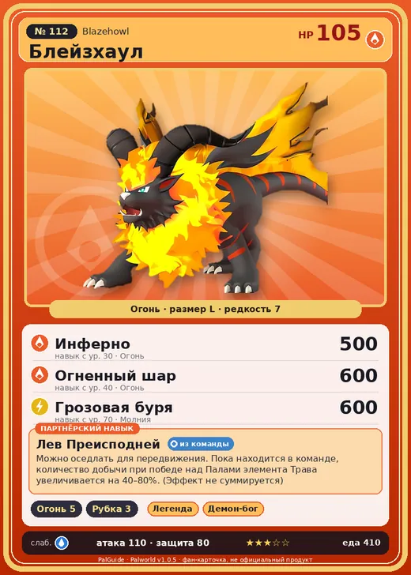

# Блейзхаул

<canvas id="fx"></canvas>

№ 112

Огонь

Слабость: Вода <b class="mx">×1,5</b> <button class="hlp" data-tip="Множители перемножаются по обеим стихиям: ×1,5 за стихию, которую атака бьёт, ×0,65 за ту, что её держит.">?</button>

Устойчив: Трава <b class="mx">×0,65</b>Лёд <b class="mx">×0,65</b>

🔥 Разжигание огня <b>5</b>🪓 Рубка деревьев <b>3</b>

<b>Лев Преисподней</b> 🎒 Работает из команды🐎 Верхом

❤️ 105 · ⚔️ 110 · 🛡 80

Основное

💎Редкость <button class="hlp" data-tip="Чем выше число, тем реже встречается пал. 1–4 — обычные, 5–7 — редкие, 8+ — легендарные.">?</button><b>7</b>

📏Размер<b>L</b>

💰Цена продажи <button class="hlp" data-tip="Сколько золота даст торговец за пала.">?</button><b>1794</b>

Бой

🎯Множитель поимки <button class="hlp" data-tip="Насколько легче или труднее поймать: ×1 — обычно, меньше — сложнее.">?</button><b>×1</b>

🐎Скорость рывка верхом <button class="hlp" data-tip="Скорость, если сесть на пала и бежать рывком.">?</button><b>1200</b>

Ферма и еда

🍖Сколько ест <button class="hlp" data-tip="Сколько сытости пал тратит — чем больше, тем больше еды нужно на базе.">?</button><b>410</b>

Разведение

🧬Сила разведения <button class="hlp" data-tip="Скрытое число игры: у детёныша оно примерно среднее от родителей. Чем меньше — тем «сильнее» пал.">?</button><b>1360</b>

=== "Обзор"

    #### Работа на базе

    
🔥 Разжигание огня<i style="--v:50%"></i><b>5</b>🪓 Рубка деревьев<i style="--v:30%"></i><b>3</b>

    #### Партнёрский навык: Лев Преисподней
    Можно оседлать для передвижения. Пока находится в команде, количество добычи при победе над Палами элемента Трава увеличивается на 40–80%. (Эффект не суммируется) Технологии 33.

    #### Чем хорош / чем плох
    - ✅ хорошая атака (110); отличный рабочий (пригодность 5); можно оседлать
    - ❌ явных минусов нет

    > Предпочитает сырое мясо, но всегда питается жареным. Он не осознает, что служащие ему оружием раскаленные когти прожаривают всю его добычу.

    См. также: [Стихии](../../guide/06_stihii.md) · [Разведение](../../guide/07_razvedenie.md) · [Все палы](README.md)

=== "Атаки"

    #### Атаки по уровням
    - ур. 1: Огненный выстрел (Огонь, сила 40)
    - ур. 7: Силовой выстрел (Нейтральный, сила 80)
    - ур. 15: Огненная стрела (Огонь, сила 120)
    - ур. 22: Огненное дыхание (Огонь, сила 160)
    - ур. 30: Инферно (Огонь, сила 500)
    - ур. 35: Вулканический клык (Огонь, сила 400)
    - ур. 40: Огненный шар (Огонь, сила 600)
    - ур. 50: Палобласт (Нейтральный, сила 450)
    - ур. 70: Грозовая буря (Молния, сила 600)

=== "Где живёт"

    #### Где водится

    

<button data-k="d" class="on">☀️ День</button><button data-k="n">🌙 Ночь</button>

<button data-w=p class=on>Палпагос</button><button data-w=t>Мировое древо</button>

ур. 35–80<a class="btn hm-full" href="../../../map/?pal=Manticore">Показать на большой карте</a>

Обсидиановый вулканТлеющее лавовое платоВыжженный холм

🕳 Подземелье<b>Пещера Вулкана</b>

🥚 Яйцо<b>Большое раскалённое яйцо</b>

🛒 Торговец<b>Продаётся у торговца палами</b>

=== "Дроп"

    #### Дроп
    - Огненный орган — 3–5 шт., 100%

    **Дроп альфы:**

    - Деталь древней цивилизации — 4–5 шт., 100%
    - Ценный коготь — 4–5 шт., 100%

=== "Разведение"

    #### Разведение
    - Ранг разведения: 1360
    - Участвует в особых парах: [Фелбэт](felbat.md) → [Блейзхаул Нокт](blazehowl_noct.md); [Йормунтайд](jormuntide.md) → [Йормунтайд Игнис](jormuntide_ignis.md)

=== "Пассивки"

    #### Лучшие пассивки по роли

    

⚔️ Боец

максимум урона и живучести в бою

<a class="psv r-4" data-psv="Легенда" href="../../../passivki/legend/">Легенда</a><a class="psv r-4" data-psv="Демон-бог" href="../../../passivki/demon_god/">Демон-бог</a><a class="psv r-3" data-psv="Император огня" href="../../../passivki/flame_emperor/">Император огня</a><a class="psv r-3" data-psv="Хладнокровный" href="../../../passivki/serenity/">Хладнокровный</a>

🛠 Рабочий

работает быстрее и меньше устаёт на базе

<a class="psv r-5" data-psv="Дьявольские руки" href="../../../passivki/demons_hand/">Дьявольские руки</a><a class="psv r-4" data-psv="Виртуоз" href="../../../passivki/remarkable_craftsmanship/">Виртуоз</a><a class="psv r-3" data-psv="Мастеровитый" href="../../../passivki/artisan/">Мастеровитый</a><a class="psv r-3" data-psv="Трудоголик" href="../../../passivki/workaholic/">Трудоголик</a>

🐎 Ездовой

быстрее бегает или летает с тобой верхом

<a class="psv r-4" data-psv="Божественная скорость" href="../../../passivki/swift/">Божественная скорость</a><a class="psv r-4" data-psv="Легенда" href="../../../passivki/legend/">Легенда</a><a class="psv r-4" data-psv="Вечный двигатель" href="../../../passivki/eternal_engine/">Вечный двигатель</a><a class="psv r-4" data-psv="Небесное скольжение" href="../../../passivki/sky_strider/">Небесное скольжение</a>

    <small>Нажми на пассивку, чтобы узнать, что она даёт и где её взять.</small>

<a class="card-link" href="../kitsun_noct/">← Кицун Нокт</a><a class="card-link" href="../blazehowl_noct/">Блейзхаул Нокт →</a>

