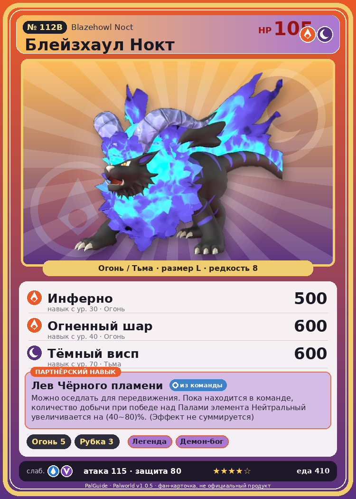

# #112B Блейзхаул Нокт (Blazehowl Noct)

{ width=360 }

| Поле | Значение |
|---|---|
| Стихия | Огонь, Тьма |
| Слабость (кто бьёт сильнее) | Вода, Дракон |
| Редкость | 8 |
| Размер | L |
| HP / Атака / Защита (база вида) | 105 / 115 / 80 |
| Сколько ест | 410 |
| Цена продажи | 1882 |
| Множитель поимки | ×1 |
| Скорость рывка верхом | 1200 |

## Работа на базе
- Разжигание огня — ур. 5
- Рубка деревьев — ур. 3

## Партнёрский навык: Лев Чёрного пламени
Можно оседлать для передвижения. Пока находится в команде, количество добычи при победе над Палами элемента Нейтральный увеличивается на (40~80)% . (Эффект не суммируется) Технологии 35 level value 1 ElementAddDrop_Normal_1_PAL 40, 40 2 ElementAddDrop_Normal_2_PAL 50, 50 3 ElementAddDrop_Normal_3_PAL 60, 60 4 ElementAddDrop_Normal_4_PAL 70, 70 5 ElementAddDrop_Normal_5_PAL 80, 80

## Атаки по уровням
- ур. 1: Теневой взрыв (Тьма, сила 80)
- ур. 7: Огненная стрела (Огонь, сила 120)
- ур. 15: Огненное дыхание (Огонь, сила 160)
- ур. 22: Духовное пламя (Тьма, сила 200)
- ур. 30: Инферно (Огонь, сила 500)
- ур. 35: Вулканический клык (Огонь, сила 400)
- ур. 40: Огненный шар (Огонь, сила 600)
- ур. 50: Тёмный лазер (Тьма, сила 450)
- ур. 70: Тёмный висп (Тьма, сила 600)

## Где водится
- В дикой природе: да; точек появления днём: 148, ночью: 550; уровни в первых точках: 35–39
- Подземелья: Пещера Вулкана
- Яйцо: Огромное раскалённое яйцо

## Дроп
- Огненный орган — 2–4 шт., 100%

**Дроп альфы:**
- Деталь древней цивилизации — 4–6 шт., 100%
- Ценный коготь — 4–6 шт., 100%

## Разведение
- Ранг разведения (CombiRank): 1270
- **Особая пара:** [Блейзхаул](../../4_spravochniki/paly/blazehowl.md) + [Фелбэт](../../4_spravochniki/paly/felbat.md)

## Лучшие пассивки по роли
- боец: Легенда, Демон-бог, Хладнокровный, Бессмертие, Император огня (вместо Бессмертия, если нет мутации)
- рабочий: Дьявольские руки, Виртуоз, Мастеровитый, Небожитель/Трудоголик
- ездовой: Божественная скорость, Легенда, Вечный двигатель, Небесное скольжение

## Чем хорош / чем плох
- ✅ хорошая атака (115); отличный рабочий (пригодность 5); можно оседлать
- ❌ разводится только особой парой

> Предпочитает обычное мясо, но всегда питается проклятым. Он не осознаёт, что служащие ему оружием тёмные когти накладывают проклятие на всю его добычу.

См. также: [Стихии](../../2_mehaniki/stihii.md) · [Разведение](../../2_mehaniki/razvedenie.md) · [Все палы](README.md)
_Источник: paldb.cc v1.0.5_
