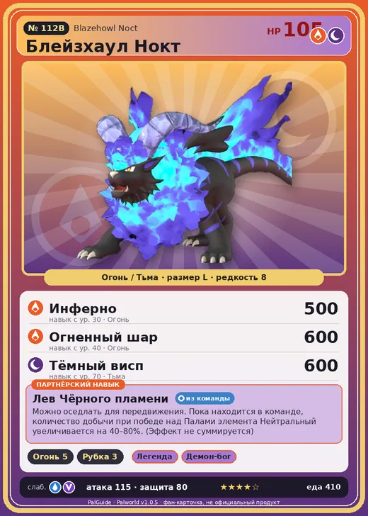

# Блейзхаул Нокт

<canvas id="fx"></canvas>

№ 112B · Blazehowl Noct

ОгоньТьма

Слабость: ВодаДракон

🔥 Разжигание огня <b>5</b>🪓 Рубка деревьев <b>3</b>

<b>Лев Чёрного пламени</b> 🎒 из команды 🐎 верхом

❤️ 105 · ⚔️ 115 · 🛡 80

| Поле | Значение |
|---|---|
| Стихия | Огонь, Тьма |
| Слабость (кто бьёт сильнее) | Вода, Дракон |
| Редкость | 8 |
| Размер | L |
| HP / Атака / Защита (база вида) | 105 / 115 / 80 |
| Сколько ест | 410 |
| Цена продажи | 1882 |
| Множитель поимки | ×1 |
| Скорость рывка верхом | 1200 |

=== "Обзор"

    #### Работа на базе
    - Разжигание огня — ур. 5
    - Рубка деревьев — ур. 3

    #### Партнёрский навык: Лев Чёрного пламени
    Можно оседлать для передвижения. Пока находится в команде, количество добычи при победе над Палами элемента Нейтральный увеличивается на 40–80%. (Эффект не суммируется) Технологии 35.

    #### Чем хорош / чем плох
    - ✅ хорошая атака (115); отличный рабочий (пригодность 5); можно оседлать
    - ❌ разводится только особой парой

    > Предпочитает обычное мясо, но всегда питается проклятым. Он не осознаёт, что служащие ему оружием тёмные когти накладывают проклятие на всю его добычу.

    См. также: [Стихии](../../guide/06_stihii.md) · [Разведение](../../guide/07_razvedenie.md) · [Все палы](README.md)

=== "Атаки"

    #### Атаки по уровням
    - ур. 1: Теневой взрыв (Тьма, сила 80)
    - ур. 7: Огненная стрела (Огонь, сила 120)
    - ур. 15: Огненное дыхание (Огонь, сила 160)
    - ур. 22: Духовное пламя (Тьма, сила 200)
    - ур. 30: Инферно (Огонь, сила 500)
    - ур. 35: Вулканический клык (Огонь, сила 400)
    - ур. 40: Огненный шар (Огонь, сила 600)
    - ур. 50: Тёмный лазер (Тьма, сила 450)
    - ур. 70: Тёмный висп (Тьма, сила 600)

=== "Где живёт"

    #### Где водится
    - В дикой природе: да; точек появления днём: 148, ночью: 550; уровни в первых точках: 35–39
    - Подземелья: Пещера Вулкана
    - Яйцо: Огромное раскалённое яйцо

=== "Дроп"

    #### Дроп
    - Огненный орган — 2–4 шт., 100%

    **Дроп альфы:**
    - Деталь древней цивилизации — 4–6 шт., 100%
    - Ценный коготь — 4–6 шт., 100%

=== "Разведение"

    #### Разведение
    - Ранг разведения (CombiRank): 1270
    - **Особая пара:** [Блейзхаул](../../4_spravochniki/paly/blazehowl.md) + [Фелбэт](../../4_spravochniki/paly/felbat.md)

=== "Пассивки"

    #### Лучшие пассивки по роли

    

⚔️ Боец

максимум урона и живучести в бою

<a class="psv r-4" data-psv="Легенда" href="../../../passivki/legend/">Легенда</a><a class="psv r-4" data-psv="Демон-бог" href="../../../passivki/demon_god/">Демон-бог</a><a class="psv r-3" data-psv="Император огня" href="../../../passivki/flame_emperor/">Император огня</a><a class="psv r-3" data-psv="Хладнокровный" href="../../../passivki/serenity/">Хладнокровный</a>

🛠 Рабочий

работает быстрее и меньше устаёт на базе

<a class="psv r-5" data-psv="Дьявольские руки" href="../../../passivki/demons_hand/">Дьявольские руки</a><a class="psv r-4" data-psv="Виртуоз" href="../../../passivki/remarkable_craftsmanship/">Виртуоз</a><a class="psv r-3" data-psv="Мастеровитый" href="../../../passivki/artisan/">Мастеровитый</a><a class="psv r-3" data-psv="Трудоголик" href="../../../passivki/workaholic/">Трудоголик</a>

🐎 Ездовой

быстрее бегает или летает с тобой верхом

<a class="psv r-4" data-psv="Божественная скорость" href="../../../passivki/swift/">Божественная скорость</a><a class="psv r-4" data-psv="Легенда" href="../../../passivki/legend/">Легенда</a><a class="psv r-4" data-psv="Вечный двигатель" href="../../../passivki/eternal_engine/">Вечный двигатель</a><a class="psv r-4" data-psv="Небесное скольжение" href="../../../passivki/sky_strider/">Небесное скольжение</a>

    <small>Нажми на пассивку, чтобы узнать, что она даёт и где её взять.</small>

<a class="card-link" href="../blazehowl/">← Блейзхаул</a><a class="card-link" href="../warsect/">Ворсект →</a>

