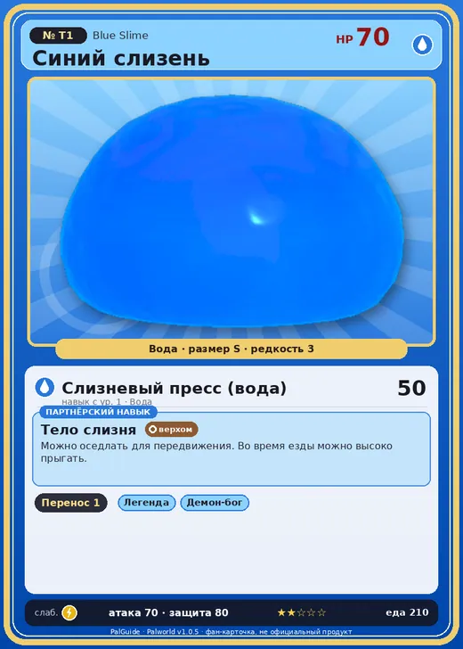

# Синий слизень

<canvas id="fx"></canvas>

№ T1 · Blue Slime

Вода

Слабость: Молния

📦 Транспортировка <b>1</b>

<b>Тело слизня</b> 🐎 верхом

❤️ 70 · ⚔️ 70 · 🛡 80

Основное

💎Редкость <button class="hlp" data-tip="Чем выше число, тем реже встречается пал. 1–4 — обычные, 5–7 — редкие, 8+ — легендарные.">?</button><b>3</b>

📏Размер<b>S</b>

💰Цена продажи <button class="hlp" data-tip="Сколько золота даст торговец за пала.">?</button><b>600</b>

🤝Коллаборация<b>Terraria (остров Якусима) (нет в Палпедии)</b>

Бой

🎯Множитель поимки <button class="hlp" data-tip="Насколько легче или труднее поймать: ×1 — обычно, меньше — сложнее.">?</button><b>×1</b>

🐎Скорость рывка верхом <button class="hlp" data-tip="Скорость, если сесть на пала и бежать рывком.">?</button><b>450</b>

Ферма и еда

🍖Сколько ест <button class="hlp" data-tip="Сколько сытости пал тратит — чем больше, тем больше еды нужно на базе.">?</button><b>210</b>

Разведение

🧬Сила разведения <button class="hlp" data-tip="Скрытое число игры: у детёныша оно примерно среднее от родителей. Чем меньше — тем «сильнее» пал.">?</button><b>3100</b>

=== "Обзор"

    #### Работа на базе
    - Транспортировка — ур. 1

    #### Партнёрский навык: Тело слизня
    Можно оседлать для передвижения. Во время езды можно высоко прыгать.

    #### Чем хорош / чем плох
    - ✅ можно оседлать
    - ❌ слабая атака (70)

    > [Коллаборация с Terraria] Монстр из другого мира. Похоже, здесь его можно приручить.

    См. также: [Стихии](../../guide/06_stihii.md) · [Разведение](../../guide/07_razvedenie.md) · [Все палы](README.md)

=== "Атаки"

    #### Атаки по уровням
    - ур. 1: Слизневый пресс (вода) (Вода, сила 50)

=== "Где живёт"

    #### Где водится
    - В дикой природе: да; точек появления днём: ?, ночью: ?
    - Яйцо: Яйцо воды

=== "Дроп"

    #### Дроп
    - Святой слиток — 1 шт., 100%

=== "Разведение"

    #### Разведение
    - Ранг разведения (CombiRank): 3100

=== "Пассивки"

    #### Лучшие пассивки по роли

    

⚔️ Боец

максимум урона и живучести в бою

<a class="psv r-4" data-psv="Легенда" href="../../../passivki/legend/">Легенда</a><a class="psv r-4" data-psv="Демон-бог" href="../../../passivki/demon_god/">Демон-бог</a><a class="psv r-3" data-psv="Владыка морей" href="../../../passivki/lord_of_the_sea/">Владыка морей</a><a class="psv r-3" data-psv="Хладнокровный" href="../../../passivki/serenity/">Хладнокровный</a>

🐎 Ездовой

быстрее бегает или летает с тобой верхом

<a class="psv r-4" data-psv="Божественная скорость" href="../../../passivki/swift/">Божественная скорость</a><a class="psv r-4" data-psv="Легенда" href="../../../passivki/legend/">Легенда</a><a class="psv r-4" data-psv="Вечный двигатель" href="../../../passivki/eternal_engine/">Вечный двигатель</a><a class="psv r-4" data-psv="Небесное скольжение" href="../../../passivki/sky_strider/">Небесное скольжение</a>

    <small>Нажми на пассивку, чтобы узнать, что она даёт и где её взять.</small>

<a class="card-link" href="../astralym/">← Астралим</a><a class="card-link" href="../rainbow_slime/">Радужный слизень →</a>

