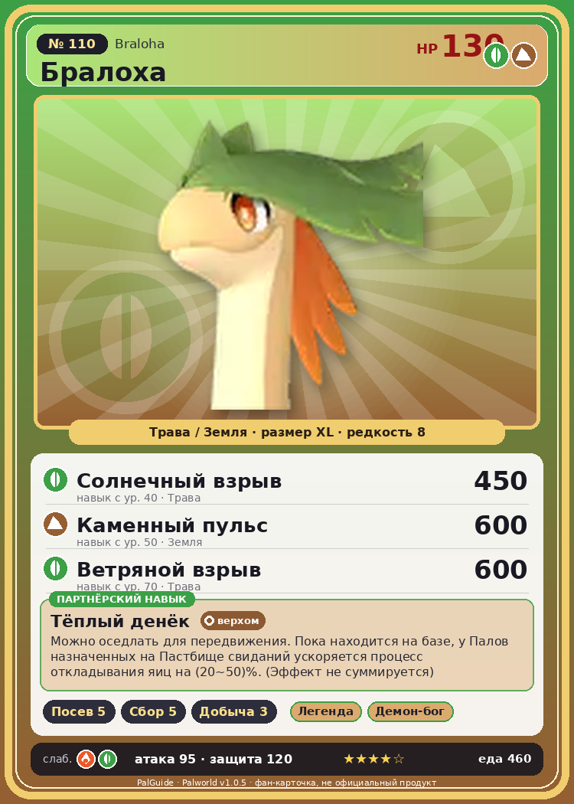

# #110 Бралоха (Braloha)

{ width=360 }

| Поле | Значение |
|---|---|
| Стихия | Трава, Земля |
| Слабость (кто бьёт сильнее) | Огонь, Трава |
| Редкость | 8 |
| Размер | XL |
| HP / Атака / Защита (база вида) | 130 / 95 / 120 |
| Сколько ест | 460 |
| Цена продажи | 2862 |
| Множитель поимки | ×1 |
| Скорость рывка верхом | 1020 |

## Работа на базе
- Посев семян — ур. 5
- Сбор — ур. 5
- Добыча — ур. 3

## Партнёрский навык: Тёплый денёк
Можно оседлать для передвижения. Пока находится на базе, у Палов назначенных на Пастбище свиданий ускоряется процесс откладывания яиц на (20~50)% . (Эффект не суммируется) Технологии 36 level value 1 Plesiosaur_PartnerSkill 20 2 Plesiosaur_PartnerSkill 26 3 Plesiosaur_PartnerSkill 32 4 Plesiosaur_PartnerSkill 38 5 Plesiosaur_PartnerSkill 50

## Атаки по уровням
- ур. 1: Грязевой выстрел (Земля, сила 40)
- ур. 7: Семенная мина (Трава, сила 120)
- ур. 15: Травяной торнадо (Трава, сила 200)
- ур. 22: Терновые лозы (Трава, сила 250)
- ур. 30: Длинное дыхание (Трава, сила 400)
- ур. 40: Солнечный взрыв (Трава, сила 450)
- ур. 50: Каменный пульс (Земля, сила 600)
- ур. 70: Ветряной взрыв (Трава, сила 600)

## Где водится
- В дикой природе: да; точек появления днём: 248, ночью: 248; уровни в первых точках: 33–35
- Подземелья: Пещера Цветущей Сакуры
- Яйцо: Огромное яйцо свежей листвы

## Дроп
- Кожа — 1 шт., 100%
- Красная ягода — 1–2 шт., 60%
- Семена латука — 1–2 шт., 50%
- Семена помидоров — 1 шт., 50%

**Дроп альфы:**
- Деталь древней цивилизации — 2–3 шт., 100%
- Ценный драконий самоцвет — 2–3 шт., 100%

## Разведение
- Ранг разведения (CombiRank): 1030

## Лучшие пассивки по роли
- боец: Легенда, Демон-бог, Хладнокровный, Бессмертие, Король духов (вместо Бессмертия, если нет мутации)
- рабочий: Дьявольские руки, Виртуоз, Мастеровитый, Небожитель/Трудоголик
- ездовой: Божественная скорость, Легенда, Вечный двигатель, Небесное скольжение

## Чем хорош / чем плох
- ✅ много здоровья (130); крепкая защита (120); отличный рабочий (пригодность 5); можно оседлать
- ❌ явных минусов нет

> Пыльца, смешанная с его дыханием, — это настоящее чудо. Она может опылить любое растение. Для Палов-растений он — весьма... неоднозначная фигура.

См. также: [Стихии](../../2_mehaniki/stihii.md) · [Разведение](../../2_mehaniki/razvedenie.md) · [Все палы](README.md)
_Источник: paldb.cc v1.0.5_
