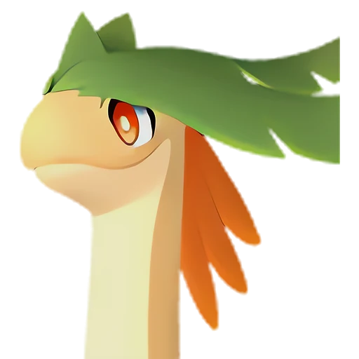

# Бралоха

<canvas id="fx"></canvas>

№ 110 · Braloha

ТраваЗемля

Слабость: Огонь <b class="mx">×1,5</b>Трава <b class="mx">×1,5</b> <button class="hlp" data-tip="Множители перемножаются по обеим стихиям пала: ×1,5 за каждую стихию, которую атака бьёт, ×0,65 за каждую, которая её держит. Если одна стихия слаба, а другая устойчива (×1,5 × 0,65 ≈ ×0,98), слабости нет.">?</button>

Устойчив: Молния <b class="mx">×0,65</b>Земля <b class="mx">×0,65</b>

🌱 Посев семян <b>5</b>🌾 Сбор <b>5</b>⛏️ Добыча <b>3</b>

<b>Тёплый денёк</b> 🐎 верхом 🏠 на базе

❤️ 130 · ⚔️ 95 · 🛡 120

Основное

💎Редкость <button class="hlp" data-tip="Чем выше число, тем реже встречается пал. 1–4 — обычные, 5–7 — редкие, 8+ — легендарные.">?</button><b>8</b>

📏Размер<b>XL</b>

💰Цена продажи <button class="hlp" data-tip="Сколько золота даст торговец за пала.">?</button><b>2862</b>

Бой

🎯Множитель поимки <button class="hlp" data-tip="Насколько легче или труднее поймать: ×1 — обычно, меньше — сложнее.">?</button><b>×1</b>

🐎Скорость рывка верхом <button class="hlp" data-tip="Скорость, если сесть на пала и бежать рывком.">?</button><b>1020</b>

Ферма и еда

🍖Сколько ест <button class="hlp" data-tip="Сколько сытости пал тратит — чем больше, тем больше еды нужно на базе.">?</button><b>460</b>

Разведение

🧬Сила разведения <button class="hlp" data-tip="Скрытое число игры: у детёныша оно примерно среднее от родителей. Чем меньше — тем «сильнее» пал.">?</button><b>1030</b>

=== "Обзор"

    #### Работа на базе
    - Посев семян — ур. 5
    - Сбор — ур. 5
    - Добыча — ур. 3

    #### Партнёрский навык: Тёплый денёк
    Можно оседлать для передвижения. Пока находится на базе, у Палов назначенных на Пастбище свиданий ускоряется процесс откладывания яиц на 20–50%. (Эффект не суммируется) Технологии 36. По звёздам: 0★ 20 · 1★ 26 · 2★ 32 · 3★ 38 · 4★ 50

    #### Чем хорош / чем плох
    - ✅ много здоровья (130); крепкая защита (120); отличный рабочий (пригодность 5); можно оседлать
    - ❌ явных минусов нет

    > Пыльца, смешанная с его дыханием, — это настоящее чудо. Она может опылить любое растение. Для Палов-растений он — весьма... неоднозначная фигура.

    См. также: [Стихии](../../guide/06_stihii.md) · [Разведение](../../guide/07_razvedenie.md) · [Все палы](README.md)

=== "Атаки"

    #### Атаки по уровням
    - ур. 1: Грязевой выстрел (Земля, сила 40)
    - ур. 7: Семенная мина (Трава, сила 120)
    - ур. 15: Травяной торнадо (Трава, сила 200)
    - ур. 22: Терновые лозы (Трава, сила 250)
    - ур. 30: Длинное дыхание (Трава, сила 400)
    - ур. 40: Солнечный взрыв (Трава, сила 450)
    - ур. 50: Каменный пульс (Земля, сила 600)
    - ур. 70: Ветряной взрыв (Трава, сила 600)

=== "Где живёт"

    #### Где водится

    

<button data-k="d" class="on">☀️ День</button><button data-k="n">🌙 Ночь</button>

<button data-w=p class=on>Палпагос</button><button data-w=t>Мировое древо</button>

ур. 33–80<a class="btn hm-full" href="../../../map/?pal=Plesiosaur">Показать на большой карте</a>

Архипелаг Морских ВетровКричащий островОстров безмолвияИссохшие дюны

🕳 Подземелье<b>Пещера Цветущей Сакуры</b>

🥚 Яйцо<b>Огромное яйцо свежей листвы</b>

=== "Дроп"

    #### Дроп
    - Кожа — 1 шт., 100%
    - Красная ягода — 1–2 шт., 60%
    - Семена латука — 1–2 шт., 50%
    - Семена помидоров — 1 шт., 50%

    **Дроп альфы:**
    - Деталь древней цивилизации — 2–3 шт., 100%
    - Ценный драконий самоцвет — 2–3 шт., 100%

=== "Разведение"

    #### Разведение
    - Ранг разведения (CombiRank): 1030

=== "Пассивки"

    #### Лучшие пассивки по роли

    

⚔️ Боец

максимум урона и живучести в бою

<a class="psv r-4" data-psv="Легенда" href="../../../passivki/legend/">Легенда</a><a class="psv r-4" data-psv="Демон-бог" href="../../../passivki/demon_god/">Демон-бог</a><a class="psv r-3" data-psv="Король духов" href="../../../passivki/spirit_emperor/">Король духов</a><a class="psv r-3" data-psv="Хладнокровный" href="../../../passivki/serenity/">Хладнокровный</a>

🛠 Рабочий

работает быстрее и меньше устаёт на базе

<a class="psv r-5" data-psv="Дьявольские руки" href="../../../passivki/demons_hand/">Дьявольские руки</a><a class="psv r-4" data-psv="Виртуоз" href="../../../passivki/remarkable_craftsmanship/">Виртуоз</a><a class="psv r-3" data-psv="Мастеровитый" href="../../../passivki/artisan/">Мастеровитый</a><a class="psv r-3" data-psv="Трудоголик" href="../../../passivki/workaholic/">Трудоголик</a>

🐎 Ездовой

быстрее бегает или летает с тобой верхом

<a class="psv r-4" data-psv="Божественная скорость" href="../../../passivki/swift/">Божественная скорость</a><a class="psv r-4" data-psv="Легенда" href="../../../passivki/legend/">Легенда</a><a class="psv r-4" data-psv="Вечный двигатель" href="../../../passivki/eternal_engine/">Вечный двигатель</a><a class="psv r-4" data-psv="Небесное скольжение" href="../../../passivki/sky_strider/">Небесное скольжение</a>

    <small>Нажми на пассивку, чтобы узнать, что она даёт и где её взять.</small>

<a class="card-link" href="../dumud_gild/">← Думад Гилд</a><a class="card-link" href="../kitsun/">Кицун →</a>

