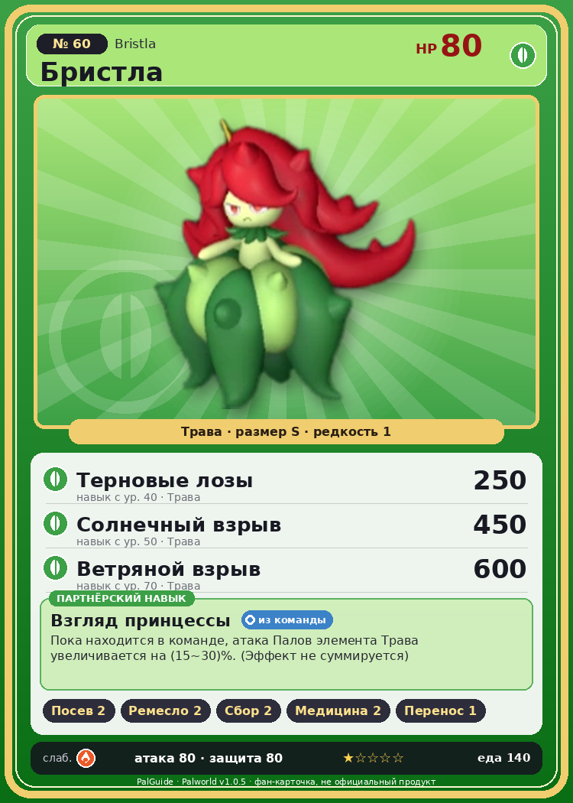

# #60 Бристла (Bristla)

{ width=360 }

| Поле | Значение |
|---|---|
| Стихия | Трава |
| Слабость (кто бьёт сильнее) | Огонь |
| Редкость | 1 |
| Размер | S |
| HP / Атака / Защита (база вида) | 80 / 80 / 80 |
| Сколько ест | 140 |
| Цена продажи | 756 |
| Множитель поимки | ×1 |
| Скорость рывка верхом | 550 |

## Работа на базе
- Посев семян — ур. 2
- Ручная работа — ур. 2
- Сбор — ур. 2
- Фармацевтика — ур. 2
- Транспортировка — ур. 1

## Партнёрский навык: Взгляд принцессы
Пока находится в команде, атака Палов элемента Трава увеличивается на (15~30)% . (Эффект не суммируется) level value 1 AttackUp_Leaf_PartnerSkill 15 2 AttackUp_Leaf_PartnerSkill 17 3 AttackUp_Leaf_PartnerSkill 20 4 AttackUp_Leaf_PartnerSkill 24 5 AttackUp_Leaf_PartnerSkill 30

## Атаки по уровням
- ур. 1: Ветряной клинок (Трава, сила 40)
- ур. 7: Семенной пулемёт (Трава, сила 80)
- ур. 15: Ледяная ракета (Лёд, сила 40)
- ур. 22: Травяной торнадо (Трава, сила 200)
- ур. 30: Айсберг (Лёд, сила 120)
- ур. 40: Терновые лозы (Трава, сила 250)
- ур. 50: Солнечный взрыв (Трава, сила 450)
- ур. 70: Ветряной взрыв (Трава, сила 600)

## Где водится
- В дикой природе: да; точек появления днём: 249, ночью: 249; уровни в первых точках: 16–18
- Подземелья: Пещера Горного Потока
- Яйцо: Яйцо свежей листвы

## Дроп
- Семена помидоров — 1–2 шт., 100%
- Красивый цветок — 1 шт., 50%

**Дроп альфы:**
- Деталь древней цивилизации — 2–4 шт., 100%
- Ценные внутренности — 2–4 шт., 100%

## Разведение
- Ранг разведения (CombiRank): 2690
- Участвует в особых парах: Риббани → Риббани Ботан

## Лучшие пассивки по роли
- боец: Легенда, Демон-бог, Хладнокровный, Бессмертие, Король духов (вместо Бессмертия, если нет мутации)
- ездовой: Божественная скорость, Легенда, Вечный двигатель, Небесное скольжение

## Чем хорош / чем плох
- ✅ можно оседлать
- ❌ явных минусов нет

> Шипы ядовиты — даже один укол может быть опасен. С Синнамос он в хороших отношениях — и только когда делится с ним нектаром, на его лице появляется улыбка.

См. также: [Стихии](../../2_mehaniki/stihii.md) · [Разведение](../../2_mehaniki/razvedenie.md) · [Все палы](README.md)
_Источник: paldb.cc v1.0.5_
