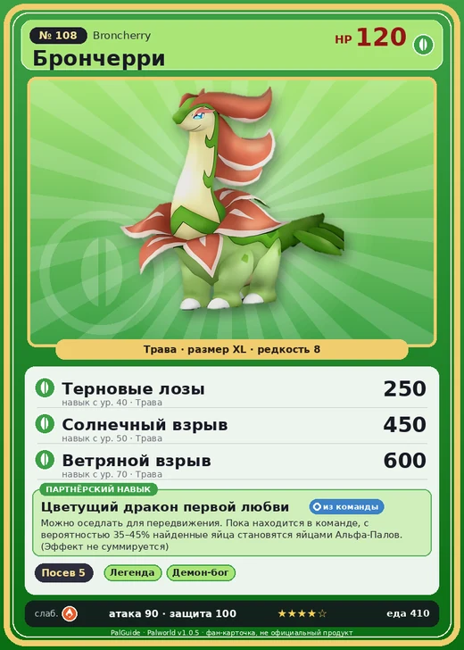

# #108 Брончерри (Broncherry)

№ 108

Трава

Слабость: Огонь

🌱 Посев семян <b>5</b>

<b>Цветущий дракон первой любви</b> 🎒 из команды 🐎 верхом

❤️ 120 · ⚔️ 90 · 🛡 100

| Поле | Значение |
|---|---|
| Стихия | Трава |
| Слабость (кто бьёт сильнее) | Огонь |
| Редкость | 8 |
| Размер | XL |
| HP / Атака / Защита (база вида) | 120 / 90 / 100 |
| Сколько ест | 410 |
| Цена продажи | 2014 |
| Множитель поимки | ×1 |
| Скорость рывка верхом | 1020 |

=== "Обзор"

    #### Работа на базе
    - Посев семян — ур. 5

    #### Партнёрский навык: Цветущий дракон первой любви
    Можно оседлать для передвижения. Пока находится в команде, с вероятностью (35~45)% найденные яйца становятся яйцами Альфа-Палов. (Эффект не суммируется) Технологии 33 level value 1 EggAlphaConversion_SakuraSaurus 35 2 EggAlphaConversion_SakuraSaurus 37 3 EggAlphaConversion_SakuraSaurus 39 4 EggAlphaConversion_SakuraSaurus 41 5 EggAlphaConversion_SakuraSaurus 45

    #### Чем хорош / чем плох
    - ✅ много здоровья (120); отличный рабочий (пригодность 5); можно оседлать
    - ❌ явных минусов нет

    > Запах этого Пала существенно меняется до и после спаривания. После того как он находит партнёра, его аромат считается приятным и называется |ароматом первой любви|.

    См. также: [Стихии](../../guide/06_stihii.md) · [Разведение](../../guide/07_razvedenie.md) · [Все палы](README.md)

=== "Атаки"

    #### Атаки по уровням
    - ур. 1: Ветряной клинок (Трава, сила 40)
    - ур. 7: Грязевой выстрел (Земля, сила 40)
    - ур. 15: Таран телом (Трава, сила 120)
    - ур. 22: Семенная мина (Трава, сила 120)
    - ур. 30: Травяной торнадо (Трава, сила 200)
    - ур. 40: Терновые лозы (Трава, сила 250)
    - ур. 50: Солнечный взрыв (Трава, сила 450)
    - ур. 70: Ветряной взрыв (Трава, сила 600)

=== "Где живёт"

    #### Где водится
    - В дикой природе: да; точек появления днём: 483, ночью: 483; уровни в первых точках: 33–35
    - Яйцо: Огромное яйцо свежей листвы

=== "Дроп"

    #### Дроп
    - Мясо Брончерри — 2 шт., 100%
    - Семена лука — 1–2 шт., 100%

    **Дроп альфы:**
    - Деталь древней цивилизации — 3–5 шт., 100%
    - Ценный драконий самоцвет — 3–5 шт., 100%

=== "Разведение"

    #### Разведение
    - Ранг разведения (CombiRank): 1380
    - Участвует в особых парах: Камоноске → Брончерри Аква

=== "Пассивки"

    #### Лучшие пассивки по роли
    - боец: Легенда, Демон-бог, Хладнокровный, Бессмертие, Король духов (вместо Бессмертия, если нет мутации)
    - рабочий: Дьявольские руки, Виртуоз, Мастеровитый, Небожитель/Трудоголик
    - ездовой: Божественная скорость, Легенда, Вечный двигатель, Небесное скольжение

<a class="card-link" href="../digtoise/">← Дигтос</a><a class="card-link" href="../broncherry_aqua/">Брончерри Аква →</a>

