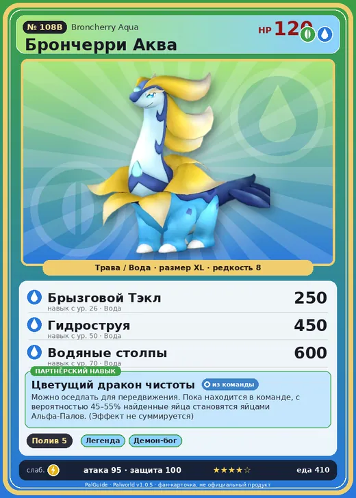

# Брончерри Аква

<canvas id="fx"></canvas>

№ 108B · Broncherry Aqua

ТраваВода

Слабость: МолнияОгонь

💧 Полив <b>5</b>

<b>Цветущий дракон чистоты</b> 🎒 из команды 🐎 верхом

❤️ 120 · ⚔️ 95 · 🛡 100

Основное

💎Редкость <button class="hlp" data-tip="Чем выше число, тем реже встречается пал. 1–4 — обычные, 5–7 — редкие, 8+ — легендарные.">?</button><b>8</b>

📏Размер<b>XL</b>

💰Цена продажи <button class="hlp" data-tip="Сколько золота даст торговец за пала.">?</button><b>2259</b>

Бой

🎯Множитель поимки <button class="hlp" data-tip="Насколько легче или труднее поймать: ×1 — обычно, меньше — сложнее.">?</button><b>×1</b>

🐎Скорость рывка верхом <button class="hlp" data-tip="Скорость, если сесть на пала и бежать рывком.">?</button><b>1020</b>

Ферма и еда

🍖Сколько ест <button class="hlp" data-tip="Сколько сытости пал тратит — чем больше, тем больше еды нужно на базе.">?</button><b>410</b>

Разведение

🧬Сила разведения <button class="hlp" data-tip="Скрытое число игры: у детёныша оно примерно среднее от родителей. Чем меньше — тем «сильнее» пал.">?</button><b>1080</b>

💞Особая пара <button class="hlp" data-tip="Этого пала можно вывести только от этой пары.">?</button><b>Брончерри + Камоноске</b>

=== "Обзор"

    #### Работа на базе
    - Полив — ур. 5

    #### Партнёрский навык: Цветущий дракон чистоты
    Можно оседлать для передвижения. Пока находится в команде, с вероятностью 45–55% найденные яйца становятся яйцами Альфа-Палов. (Эффект не суммируется) Технологии 44. По звёздам: 0★ 45 · 1★ 47 · 2★ 49 · 3★ 51 · 4★ 55

    #### Чем хорош / чем плох
    - ✅ много здоровья (120); отличный рабочий (пригодность 5); можно оседлать
    - ❌ разводится только особой парой

    > Запах этого Пала существенно меняется до и после спаривания. До того как он находит партнёра, его аромат считается особенно приятным и имеет название |аромат невинности|.

    См. также: [Стихии](../../guide/06_stihii.md) · [Разведение](../../guide/07_razvedenie.md) · [Все палы](README.md)

=== "Атаки"

    #### Атаки по уровням
    - ур. 1: Водяной выстрел (Вода, сила 50)
    - ур. 7: Пузырьковый выстрел (Вода, сила 80)
    - ур. 15: Таран телом (Трава, сила 120)
    - ур. 22: Семенная мина (Трава, сила 120)
    - ур. 26: Брызговой Тэкл (Вода, сила 250)
    - ур. 30: Терновые лозы (Трава, сила 250)
    - ур. 40: Водяная бомба (Вода, сила 200)
    - ур. 50: Гидроструя (Вода, сила 450)
    - ур. 70: Водяные столпы (Вода, сила 600)

=== "Где живёт"

    #### Где водится
    - В дикой природе: да; точек появления днём: 7, ночью: 7; уровни в первых точках: 51–55
    - Яйцо: Огромное яйцо свежей листвы

=== "Дроп"

    #### Дроп
    - Мясо Брончерри — 2 шт., 100%
    - Семена лука — 1–2 шт., 100%

    **Дроп альфы:**
    - Деталь древней цивилизации — 3–5 шт., 100%
    - Ценный драконий самоцвет — 3–5 шт., 100%

=== "Разведение"

    #### Разведение
    - Ранг разведения (CombiRank): 1080
    - **Особая пара:** [Брончерри](../../4_spravochniki/paly/broncherry.md) + [Камоноске](../../4_spravochniki/paly/fuack.md)

=== "Пассивки"

    #### Лучшие пассивки по роли

    

⚔️ Боец

максимум урона и живучести в бою

<a class="psv r-4" data-psv="Легенда" href="../../../passivki/legend/">Легенда</a><a class="psv r-4" data-psv="Демон-бог" href="../../../passivki/demon_god/">Демон-бог</a><a class="psv r-3" data-psv="Король духов" href="../../../passivki/spirit_emperor/">Король духов</a><a class="psv r-3" data-psv="Хладнокровный" href="../../../passivki/serenity/">Хладнокровный</a>

🛠 Рабочий

работает быстрее и меньше устаёт на базе

<a class="psv r-5" data-psv="Дьявольские руки" href="../../../passivki/demons_hand/">Дьявольские руки</a><a class="psv r-4" data-psv="Виртуоз" href="../../../passivki/remarkable_craftsmanship/">Виртуоз</a><a class="psv r-3" data-psv="Мастеровитый" href="../../../passivki/artisan/">Мастеровитый</a><a class="psv r-3" data-psv="Трудоголик" href="../../../passivki/workaholic/">Трудоголик</a>

🐎 Ездовой

быстрее бегает или летает с тобой верхом

<a class="psv r-4" data-psv="Божественная скорость" href="../../../passivki/swift/">Божественная скорость</a><a class="psv r-4" data-psv="Легенда" href="../../../passivki/legend/">Легенда</a><a class="psv r-4" data-psv="Вечный двигатель" href="../../../passivki/eternal_engine/">Вечный двигатель</a><a class="psv r-4" data-psv="Небесное скольжение" href="../../../passivki/sky_strider/">Небесное скольжение</a>

    <small>Нажми на пассивку, чтобы узнать, что она даёт и где её взять.</small>

<a class="card-link" href="../broncherry/">← Брончерри</a><a class="card-link" href="../dumud/">Думад →</a>

