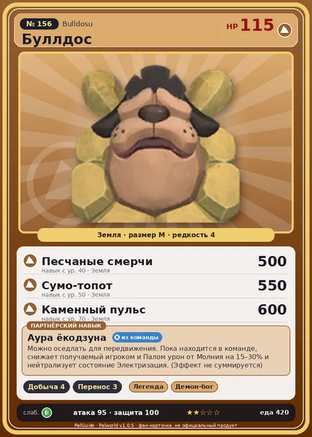

# #156 Буллдос (Bulldosu)

№ 156

Земля

Слабость: Трава

⛏️ Добыча <b>4</b>📦 Транспортировка <b>3</b>

<b>Аура ёкодзуна</b> 🎒 из команды 🐎 верхом

❤️ 115 · ⚔️ 95 · 🛡 100

| Поле | Значение |
|---|---|
| Стихия | Земля |
| Слабость (кто бьёт сильнее) | Трава |
| Редкость | 4 |
| Размер | M |
| HP / Атака / Защита (база вида) | 115 / 95 / 100 |
| Сколько ест | 420 |
| Цена продажи | 1812 |
| Множитель поимки | ×1 |
| Скорость рывка верхом | 810 |

## Работа на базе
- Добыча — ур. 4
- Транспортировка — ур. 3

## Партнёрский навык: Аура ёкодзуна
Можно оседлать для передвижения. Пока находится в команде, снижает получаемый игроком и Палом урон от Молния на (15~30)% и нейтрализует состояние Электризация . (Эффект не суммируется) Технологии 53 level value 1 SumoDog_PartnerSkill 15, 100 2 SumoDog_PartnerSkill 17, 100 3 SumoDog_PartnerSkill 20, 100 4 SumoDog_PartnerSkill 24, 100 5 SumoDog_PartnerSkill 30, 100

## Атаки по уровням
- ур. 1: Грязевой выстрел (Земля, сила 40)
- ур. 7: Каменный залп (Земля, сила 80)
- ур. 15: Камнемёт (Земля, сила 120)
- ур. 22: Камнепад (Земля, сила 300)
- ур. 30: Каменные копья (Земля, сила 400)
- ур. 40: Песчаные смерчи (Земля, сила 500)
- ур. 50: Сумо-топот (Земля, сила 550)
- ур. 70: Каменный пульс (Земля, сила 600)

## Где водится
- В дикой природе: да; точек появления днём: 52, ночью: 52; уровни в первых точках: 53–56
- Яйцо: Яйцо земли

## Дроп
- Кость — 2–3 шт., 100%
- Волокно — 1–2 шт., 100%

**Дроп альфы:**
- Деталь древней цивилизации — 2–3 шт., 100%
- Ценные внутренности — 2–3 шт., 100%

## Разведение
- Ранг разведения (CombiRank): 1190

## Лучшие пассивки по роли
- боец: Легенда, Демон-бог, Хладнокровный, Бессмертие, Император земли (вместо Бессмертия, если нет мутации)
- рабочий: Дьявольские руки, Виртуоз, Мастеровитый, Небожитель/Трудоголик
- ездовой: Божественная скорость, Легенда, Вечный двигатель, Небесное скольжение

## Чем хорош / чем плох
- ✅ можно оседлать
- ❌ явных минусов нет

> Когда-то на острове существовала забава под названием сумо Буллдос . Если Буллдос был высшего класса, то он мог выдержать даже лобовую атаку Рашоа , и в итоге в воздух отлетал уже сам Рашоа .

См. также: [Стихии](../../guide/06_stihii.md) · [Разведение](../../guide/07_razvedenie.md) · [Все палы](README.md)
