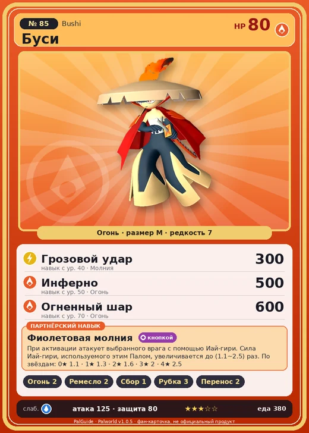

# #85 Буси (Bushi)

№ 85

Огонь

Слабость: Вода

🔥 Разжигание огня <b>2</b>🖐️ Ручная работа <b>2</b>🌾 Сбор <b>1</b>🪓 Рубка деревьев <b>3</b>📦 Транспортировка <b>2</b>

<b>Фиолетовая молния</b> 🔘 кнопкой

❤️ 80 · ⚔️ 125 · 🛡 80

| Поле | Значение |
|---|---|
| Стихия | Огонь |
| Слабость (кто бьёт сильнее) | Вода |
| Редкость | 7 |
| Размер | M |
| HP / Атака / Защита (база вида) | 80 / 125 / 80 |
| Сколько ест | 380 |
| Цена продажи | 1442 |
| Множитель поимки | ×1 |
| Скорость рывка верхом | 900 |

## Работа на базе
- Разжигание огня — ур. 2
- Ручная работа — ур. 2
- Сбор — ур. 1
- Рубка деревьев — ур. 3
- Транспортировка — ур. 2

## Партнёрский навык: Фиолетовая молния
При активации атакует выбранного врага с помощью Иай-гири . Сила Иай-гири , используемого этим Палoм, увеличивается до (1.1~2.5) раз . level value 1 MainValue 1.1 2 MainValue 1.3 3 MainValue 1.6 4 MainValue 2 5 MainValue 2.5

## Атаки по уровням
- ур. 1: Огненный выстрел (Огонь, сила 40)
- ур. 7: Ветряной клинок (Трава, сила 40)
- ур. 15: Ледяной резак (Лёд, сила 80)
- ур. 22: Иай-гири (Огонь, сила 160)
- ур. 30: Огненное дыхание (Огонь, сила 160)
- ур. 40: Грозовой удар (Молния, сила 300)
- ур. 50: Инферно (Огонь, сила 500)
- ур. 70: Огненный шар (Огонь, сила 600)

## Где водится
- В дикой природе: да; точек появления днём: 1840, ночью: 1840; уровни в первых точках: 25–28
- Подземелья: Пещера Вулкана
- Может продаваться у торговца/рекрутера
- Яйцо: Большое раскалённое яйцо

## Дроп
- Кость — 1–2 шт., 100%
- Металлический слиток — 2–3 шт., 100%

**Дроп альфы:**
- Деталь древней цивилизации — 3–5 шт., 100%
- Ценные внутренности — 3–5 шт., 100%

## Разведение
- Ранг разведения (CombiRank): 1560
- Участвует в особых парах: Гостлайт → Буси Нокт; Петаллия → Петаллия Игнис

## Лучшие пассивки по роли
- боец: Легенда, Демон-бог, Хладнокровный, Бессмертие, Император огня (вместо Бессмертия, если нет мутации)
- рабочий: Дьявольские руки, Виртуоз, Мастеровитый, Небожитель/Трудоголик
- ездовой: Божественная скорость, Легенда, Вечный двигатель, Небесное скольжение

## Чем хорош / чем плох
- ✅ очень высокая атака (125); можно оседлать
- ❌ явных минусов нет

> После смерти Буси становится мечом, передаваемым следующим поколениям. Но стоит кому-то чужому взять его в руки — и шепот мёртвых, заключённых внутри, сведёт его с ума.

См. также: [Стихии](../../guide/06_stihii.md) · [Разведение](../../guide/07_razvedenie.md) · [Все палы](README.md)
