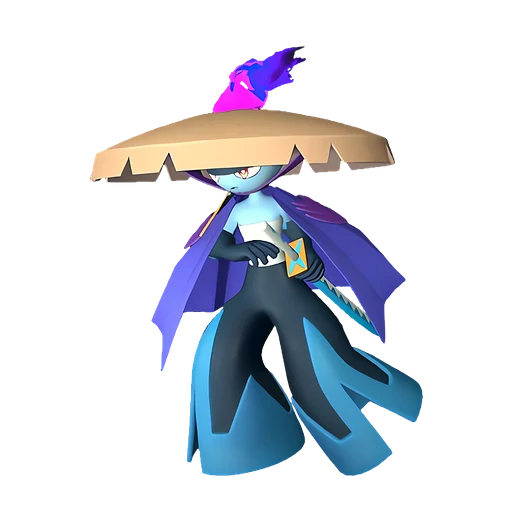

# Буси Нокт

<canvas id="fx"></canvas>

№ 85B

ОгоньТьма

Слабость: Вода <b class="mx">×1,5</b>Дракон <b class="mx">×1,5</b> <button class="hlp" data-tip="Множители перемножаются по обеим стихиям: ×1,5 за стихию, которую атака бьёт, ×0,65 за ту, что её держит. Вода: 1,5 × 1 = ×1,5; Дракон: 1 × 1,5 = ×1,5.">?</button>

Устойчив: Нейтральный <b class="mx">×0,65</b>Трава <b class="mx">×0,65</b>Лёд <b class="mx">×0,65</b>

🔥 Разжигание огня <b>2</b>🖐️ Ручная работа <b>2</b>🌾 Сбор <b>1</b>🪓 Рубка деревьев <b>5</b>📦 Транспортировка <b>2</b>

<b>Тёмная фиолетовая молния</b> 🔘 Включается кнопкой🎒 Работает из команды

❤️ 80 · ⚔️ 130 · 🛡 80

Основное

💎Редкость <button class="hlp" data-tip="Чем выше число, тем реже встречается пал. 1–4 — обычные, 5–7 — редкие, 8+ — легендарные.">?</button><b>7</b>

📏Размер<b>M</b>

💰Цена продажи <button class="hlp" data-tip="Сколько золота даст торговец за пала.">?</button><b>1857</b>

Бой

🎯Множитель поимки <button class="hlp" data-tip="Насколько легче или труднее поймать: ×1 — обычно, меньше — сложнее.">?</button><b>×1</b>

🐎Скорость рывка верхом <button class="hlp" data-tip="Скорость, если сесть на пала и бежать рывком.">?</button><b>900</b>

Ферма и еда

🍖Сколько ест <button class="hlp" data-tip="Сколько сытости пал тратит — чем больше, тем больше еды нужно на базе.">?</button><b>380</b>

Разведение

🧬Сила разведения <button class="hlp" data-tip="Скрытое число игры: у детёныша оно примерно среднее от родителей. Чем меньше — тем «сильнее» пал.">?</button><b>840</b>

💞Особая пара <button class="hlp" data-tip="Этого пала можно вывести только от этой пары.">?</button><b>Буси + Гостлайт</b>

=== "Обзор"

    #### Работа на базе

    
<a class="wbar" href="../../../2_mehaniki/rabota/?w=kindling&lv=2">🔥 Разжигание огня<i style="--v:20%"></i><b>2</b></a><a class="wbar" href="../../../2_mehaniki/rabota/?w=handiwork&lv=2">✋ Ручная работа<i style="--v:20%"></i><b>2</b></a><a class="wbar" href="../../../2_mehaniki/rabota/?w=gathering&lv=1">🧺 Сбор<i style="--v:10%"></i><b>1</b></a><a class="wbar" href="../../../2_mehaniki/rabota/?w=lumbering&lv=5">🪓 Рубка деревьев<i style="--v:50%"></i><b>5</b></a><a class="wbar" href="../../../2_mehaniki/rabota/?w=transporting&lv=2">📦 Транспортировка<i style="--v:20%"></i><b>2</b></a><a class="wb-more" href="../../../2_mehaniki/rabota/">Что значат уровни работы →</a>

    #### Партнёрский навык: Тёмная фиолетовая молния
    При активации атакует выбранного врага с помощью Иай-гири. Сила Иай-гири, используемого этим Палoм, увеличивается до (1.1~2.5) раз. Пока находится в команде, урон оружия ближнего боя игрока увеличивается на 30–65%, но действует только вне боя. (Эффект не суммируется). По звёздам: 0★ 30 · 1★ 35 · 2★ 42 · 3★ 51 · 4★ 65

    #### Чем хорош / чем плох
    - ✅ очень высокая атака (130); отличный рабочий (пригодность 5)
    - ❌ разводится только особой парой

    > После смерти Буси становится мечом, передаваемым следующим поколениям. Если Буси с неокрепшим духом примет его и не выдержит шепота мёртвых, заключённых внутри, то он превращается в пала «Буси Нокт» и обречён скитаться.

    См. также: [Стихии](../../guide/06_stihii.md) · [Разведение](../../guide/07_razvedenie.md) · [Все палы](README.md)

=== "Атаки"

    #### Атаки по уровням
    - ур. 1: Расщеплённый огонь (Огонь, сила 80)
    - ур. 7: Распространение тьмы (Тьма, сила 60)
    - ур. 15: Тёмная пушка (Тьма, сила 70)
    - ур. 18: Иай-гири (Огонь, сила 160)
    - ур. 22: Стрелы тьмы (Тьма, сила 120)
    - ур. 30: Духовное пламя (Тьма, сила 200)
    - ур. 40: Огненная стена (Огонь, сила 250)
    - ур. 50: Апокалипсис (Тьма, сила 400)
    - ур. 70: Тёмный висп (Тьма, сила 600)

=== "Где живёт"

    #### Где водится

    

<button data-k="d" class="on">☀️ День</button><button data-k="n">🌙 Ночь</button>

ур. 47–65<a class="btn hm-full" href="../../../map/?pal=">Показать на большой карте</a>

Выжженный холмЛедяной коралловый холмСакурадзимаЖёлтоземная равнина

🕳 Подземелье<b>Пещера Цветущей Сакуры</b>

🥚 Яйцо<b>Большое раскалённое яйцо</b>

=== "Дроп"

    #### Дроп
    - Огненный орган — 4–8 шт., 100%
    - Металлический слиток — 2–3 шт., 100%
    - Средняя душа Пала — 1–2 шт., 40%

    **Дроп альфы:**
    - Деталь древней цивилизации — 2–3 шт., 100%
    - Ценные внутренности — 2–3 шт., 100%

=== "Разведение"

    #### Разведение
    - Ранг разведения: 840
    - **Особая пара:** [Буси](../../4_spravochniki/paly/bushi.md) + [Гостлайт](../../4_spravochniki/paly/sootseer.md)
    - Участвует в особых парах: Кроадзиро → Кроадзиро Нокт

=== "Пассивки"

    #### Лучшие пассивки по роли

    

⚔️ Боец

максимум урона и живучести в бою

<a class="psv r-4" data-psv="Легенда" href="../../../passivki/legend/">Легенда</a><a class="psv r-4" data-psv="Демон-бог" href="../../../passivki/demon_god/">Демон-бог</a><a class="psv r-3" data-psv="Император огня" href="../../../passivki/flame_emperor/">Император огня</a><a class="psv r-3" data-psv="Хладнокровный" href="../../../passivki/serenity/">Хладнокровный</a>

🛠 Рабочий

работает быстрее и меньше устаёт на базе

<a class="psv r-5" data-psv="Дьявольские руки" href="../../../passivki/demons_hand/">Дьявольские руки</a><a class="psv r-4" data-psv="Виртуоз" href="../../../passivki/remarkable_craftsmanship/">Виртуоз</a><a class="psv r-3" data-psv="Мастеровитый" href="../../../passivki/artisan/">Мастеровитый</a><a class="psv r-3" data-psv="Трудоголик" href="../../../passivki/workaholic/">Трудоголик</a>

    <small>Нажми на пассивку, чтобы узнать, что она даёт и где её взять.</small>

<a class="card-link" href="../bushi/">← Буси</a><a class="card-link" href="../munchill/">Манчилл →</a>

