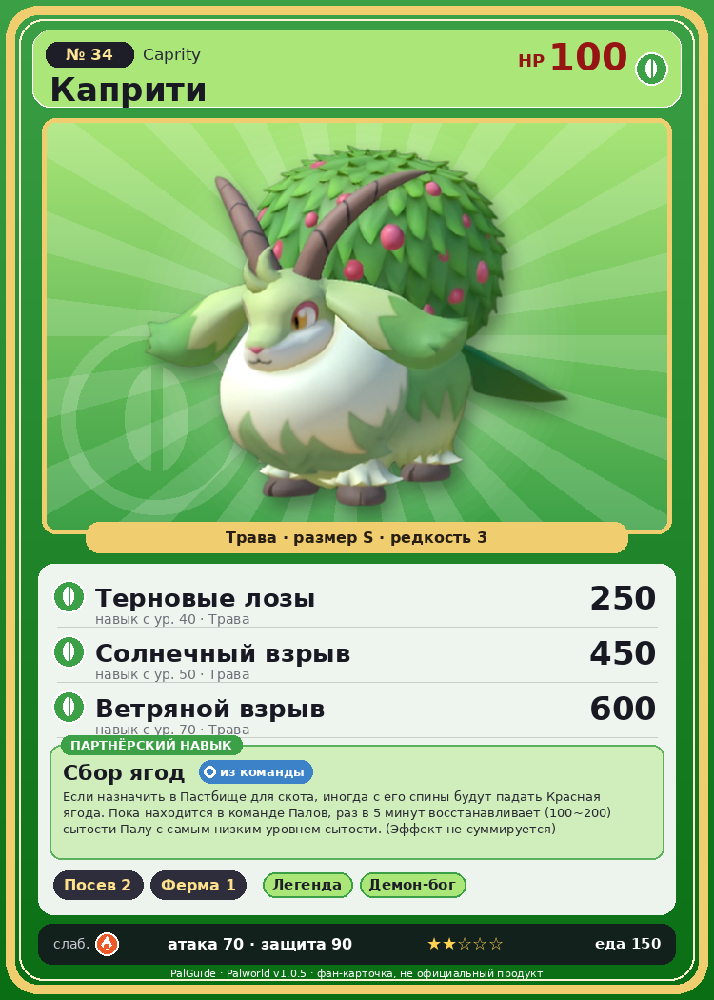

# #34 Каприти (Caprity)

{ width=360 }

| Поле | Значение |
|---|---|
| Стихия | Трава |
| Слабость (кто бьёт сильнее) | Огонь |
| Редкость | 3 |
| Размер | S |
| HP / Атака / Защита (база вида) | 100 / 70 / 90 |
| Сколько ест | 150 |
| Цена продажи | 1643 |
| Множитель поимки | ×1 |
| Скорость рывка верхом | 550 |

## Работа на базе
- Посев семян — ур. 2
- Фермерство — ур. 1

## Партнёрский навык: Сбор ягод
Если назначить в Пастбище для скота , иногда с его спины будут падать Красная ягода . Пока находится в команде Палов, раз в 5 минут восстанавливает (100~200) сытости Палу с самым низким уровнем сытости. (Эффект не суммируется) level value 1 Regene_Stomatch_Hungriest_BerryGoat 100 2 Regene_Stomatch_Hungriest_BerryGoat 120 3 Regene_Stomatch_Hungriest_BerryGoat 140 4 Regene_Stomatch_Hungriest_BerryGoat 160 5 Regene_Stomatch_Hungriest_BerryGoat 200

## Атаки по уровням
- ур. 1: Ветряной клинок (Трава, сила 40)
- ур. 7: Воздушная пушка (Нейтральный, сила 40)
- ур. 15: Грязевой выстрел (Земля, сила 40)
- ур. 22: Силовой выстрел (Нейтральный, сила 80)
- ур. 30: Травяной торнадо (Трава, сила 200)
- ур. 40: Терновые лозы (Трава, сила 250)
- ур. 50: Солнечный взрыв (Трава, сила 450)
- ур. 70: Ветряной взрыв (Трава, сила 600)

## Где водится
- В дикой природе: да; точек появления днём: 394, ночью: 394; уровни в первых точках: 14–17
- Подземелья: Пещера Отдалённого Острова, Пещера Холмов
- Яйцо: Яйцо свежей листвы

## Дроп
- Мясо Каприти — 2 шт., 100%
- Красная ягода — 2–4 шт., 100%
- Рог — 1–2 шт., 100%

**Дроп альфы:**
- Деталь древней цивилизации — 1–2 шт., 100%
- Ценный мех — 1–2 шт., 100%

## Разведение
- Ранг разведения (CombiRank): 2610
- Участвует в особых парах: Тарантрисс → Каприти Нокт

## Лучшие пассивки по роли
- боец: Легенда, Демон-бог, Хладнокровный, Бессмертие, Король духов (вместо Бессмертия, если нет мутации)
- ездовой: Божественная скорость, Легенда, Вечный двигатель, Небесное скольжение

## Чем хорош / чем плох
- ✅ можно оседлать
- ❌ слабая атака (70)

> Если Пал не голодает, в зарослях на его спине созревают ягоды. Он угощает ими понравившегося Пала, и если угощение придётся по вкусу — образуется пара.

См. также: [Стихии](../../2_mehaniki/stihii.md) · [Разведение](../../2_mehaniki/razvedenie.md) · [Все палы](README.md)
_Источник: paldb.cc v1.0.5_
