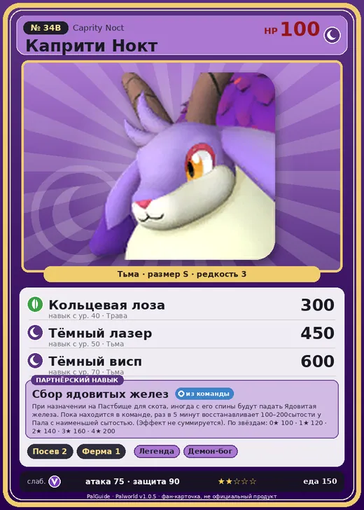

# #34B Каприти Нокт (Caprity Noct)

#34B · Caprity Noct

Тьма

Слабость: Дракон

🌱 Посев семян <b>2</b>🐑 Фермерство <b>1</b>

<b>Сбор ядовитых желез</b> 🎒 из команды 🏠 на базе

❤️ 100 · ⚔️ 75 · 🛡 90

| Поле | Значение |
|---|---|
| Стихия | Тьма |
| Слабость (кто бьёт сильнее) | Дракон |
| Редкость | 3 |
| Размер | S |
| HP / Атака / Защита (база вида) | 100 / 75 / 90 |
| Сколько ест | 150 |
| Цена продажи | 928 |
| Множитель поимки | ×1 |
| Скорость рывка верхом | 550 |

## Работа на базе
- Посев семян — ур. 2
- Фермерство — ур. 1

## Партнёрский навык: Сбор ядовитых желез
При назначении на Пастбище для скота , иногда с его спины будут падать Ядовитая железа . Пока находится в команде, раз в 5 минут восстанавливает (100~200) сытости у Пала с наименьшей сытостью. (Эффект не суммируется) level value 1 Regene_Stomatch_Hungriest_BerryGoat 100 2 Regene_Stomatch_Hungriest_BerryGoat 120 3 Regene_Stomatch_Hungriest_BerryGoat 140 4 Regene_Stomatch_Hungriest_BerryGoat 160 5 Regene_Stomatch_Hungriest_BerryGoat 200

## Атаки по уровням
- ур. 1: Ядовитый туман (Тьма, сила 0)
- ур. 7: Ветряной клинок (Трава, сила 40)
- ур. 15: Ядовитый выстрел (Тьма, сила 30)
- ур. 22: Мультиклинок (Трава, сила 160)
- ур. 30: Ядовитый душ (Тьма, сила 160)
- ур. 40: Кольцевая лоза (Трава, сила 300)
- ур. 50: Тёмный лазер (Тьма, сила 450)
- ур. 70: Тёмный висп (Тьма, сила 600)

## Где водится
- В дикой природе: да; точек появления днём: 53, ночью: 53; уровни в первых точках: 50–52
- Подземелья: Пещера Тэнраку
- Яйцо: Яйцо тьмы

## Дроп
- Мясо Каприти — 2 шт., 100%
- Красная ягода — 2–4 шт., 100%
- Рог — 1–2 шт., 100%
- Ядовитая железа — 1 шт., 100%

**Дроп альфы:**
- Деталь древней цивилизации — 3–4 шт., 100%
- Ценный мех — 2–3 шт., 100%

## Разведение
- Ранг разведения (CombiRank): 1940
- **Особая пара:** [Каприти](../../4_spravochniki/paly/caprity.md) + [Тарантрисс](../../4_spravochniki/paly/tarantriss.md)

## Лучшие пассивки по роли
- боец: Легенда, Демон-бог, Хладнокровный, Бессмертие, Король тьмы (вместо Бессмертия, если нет мутации)
- ездовой: Божественная скорость, Легенда, Вечный двигатель, Небесное скольжение

## Чем хорош / чем плох
- ✅ можно оседлать
- ❌ слабая атака (75); разводится только особой парой

> Вкус ягод, растущих в зарослях на спине, меняется в зависимости от душевного состояния. Чем суровее условия, в которых он вырос, тем слаще становится ягода. Поэтому многие Каприти Нокт , выращенные в неволе, так и не познали любви.

См. также: [Стихии](../../guide/06_stihii.md) · [Разведение](../../guide/07_razvedenie.md) · [Все палы](README.md)
