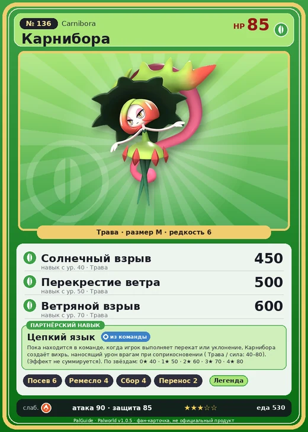

# #136 Карнибора (Carnibora)

№ 136

Трава

Слабость: Огонь

🌱 Посев семян <b>6</b>🖐️ Ручная работа <b>4</b>🌾 Сбор <b>4</b>📦 Транспортировка <b>2</b>

<b>Цепкий язык</b> 🎒 из команды

❤️ 85 · ⚔️ 90 · 🛡 85

| Поле | Значение |
|---|---|
| Стихия | Трава |
| Слабость (кто бьёт сильнее) | Огонь |
| Редкость | 6 |
| Размер | M |
| HP / Атака / Защита (база вида) | 85 / 90 / 85 |
| Сколько ест | 530 |
| Цена продажи | 1875 |
| Множитель поимки | ×1 |
| Скорость рывка верхом | 750 |

=== "Обзор"

    #### Работа на базе
    - Посев семян — ур. 6
    - Ручная работа — ур. 4
    - Сбор — ур. 4
    - Транспортировка — ур. 2

    #### Партнёрский навык: Цепкий язык
    Пока находится в команде, когда игрок выполняет перекат или уклонение, Карнибора создаёт вихрь, наносящий урон врагам при соприкосновении ( Трава / сила: 40–80). (Эффект не суммируется). По звёздам: 0★ 40 · 1★ 50 · 2★ 60 · 3★ 70 · 4★ 80

    #### Чем хорош / чем плох
    - ✅ отличный рабочий (пригодность 6)
    - ❌ много ест (530)

    > Не гнушается даже самой странной едой, поэтому рот на макушке часто покрывается ужасным стоматитом. В таких случаях пользуется обычным ртом, но привычки не меняются, и в итоге воспаляются оба рта.

    См. также: [Стихии](../../guide/06_stihii.md) · [Разведение](../../guide/07_razvedenie.md) · [Все палы](README.md)

=== "Атаки"

    #### Атаки по уровням
    - ур. 1: Ядовитый выстрел (Тьма, сила 30)
    - ур. 7: Семенной пулемёт (Трава, сила 80)
    - ур. 15: Семенная мина (Трава, сила 120)
    - ур. 22: Терновые лозы (Трава, сила 250)
    - ур. 30: Кольцевая лоза (Трава, сила 300)
    - ур. 40: Солнечный взрыв (Трава, сила 450)
    - ур. 50: Перекрестие ветра (Трава, сила 500)
    - ур. 70: Ветряной взрыв (Трава, сила 600)

=== "Где живёт"

    #### Где водится
    - В дикой природе: да; точек появления днём: 11, ночью: 11
    - Яйцо: Большое яйцо свежей листвы

=== "Дроп"

    #### Дроп
    - Ядовитая железа — 2–3 шт., 100%
    - Волокно — 2–3 шт., 100%

    **Дроп альфы:**
    - Деталь древней цивилизации — 2–3 шт., 100%
    - Ценные внутренности — 2–3 шт., 100%

=== "Разведение"

    #### Разведение
    - Ранг разведения (CombiRank): 1700

=== "Пассивки"

    #### Лучшие пассивки по роли

    

⚔️ Боец

максимум урона и живучести в бою

<a class="psv r-4" data-psv="Легенда" href="../../../passivki/legend/">Легенда</a><a class="psv r-4" data-psv="Демон-бог" href="../../../passivki/demon_god/">Демон-бог</a><a class="psv r-3" data-psv="Король духов" href="../../../passivki/spirit_emperor/">Король духов</a><a class="psv r-3" data-psv="Хладнокровный" href="../../../passivki/serenity/">Хладнокровный</a>

🛠 Рабочий

работает быстрее и меньше устаёт на базе

<a class="psv r-5" data-psv="Дьявольские руки" href="../../../passivki/demons_hand/">Дьявольские руки</a><a class="psv r-4" data-psv="Виртуоз" href="../../../passivki/remarkable_craftsmanship/">Виртуоз</a><a class="psv r-3" data-psv="Мастеровитый" href="../../../passivki/artisan/">Мастеровитый</a><a class="psv r-3" data-psv="Трудоголик" href="../../../passivki/workaholic/">Трудоголик</a>

    <small>Нажми на пассивку, чтобы узнать, что она даёт и где её взять.</small>

<a class="card-link" href="../sootseer/">← Гостлайт</a><a class="card-link" href="../blazamut/">Блазамут →</a>

