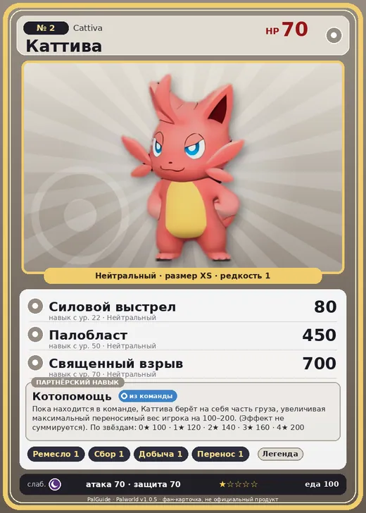

# #2 Каттива (Cattiva)

№ 2

Нейтральный

Слабость: Тьма

🖐️ Ручная работа <b>1</b>🌾 Сбор <b>1</b>⛏️ Добыча <b>1</b>📦 Транспортировка <b>1</b>

<b>Котопомощь</b> 🎒 из команды

❤️ 70 · ⚔️ 70 · 🛡 70

| Поле | Значение |
|---|---|
| Стихия | Нейтральный |
| Слабость (кто бьёт сильнее) | Тьма |
| Редкость | 1 |
| Размер | XS |
| HP / Атака / Защита (база вида) | 70 / 70 / 70 |
| Сколько ест | 100 |
| Цена продажи | 436 |
| Множитель поимки | ×1.5 |
| Скорость рывка верхом | 550 |

## Работа на базе
- Ручная работа — ур. 1
- Сбор — ур. 1
- Добыча — ур. 1
- Транспортировка — ур. 1

## Партнёрский навык: Котопомощь
Пока находится в команде, Каттива берёт на себя часть груза, увеличивая максимальный переносимый вес игрока на (100~200) . (Эффект не суммируется) level value 1 MaxInventoryWeight_up_Partnerskill_PinkCat 100 2 MaxInventoryWeight_up_Partnerskill_PinkCat 120 3 MaxInventoryWeight_up_Partnerskill_PinkCat 140 4 MaxInventoryWeight_up_Partnerskill_PinkCat 160 5 MaxInventoryWeight_up_Partnerskill_PinkCat 200

## Атаки по уровням
- ур. 1: Град ударов (Нейтральный, сила 40)
- ур. 7: Воздушная пушка (Нейтральный, сила 40)
- ур. 15: Грязевой выстрел (Земля, сила 40)
- ур. 22: Силовой выстрел (Нейтральный, сила 80)
- ур. 30: Ветряной клинок (Трава, сила 40)
- ур. 40: Семенной пулемёт (Трава, сила 80)
- ур. 50: Палобласт (Нейтральный, сила 450)
- ур. 70: Священный взрыв (Нейтральный, сила 700)

## Где водится
- В дикой природе: да; точек появления днём: 374, ночью: 374; уровни в первых точках: 1–3
- Подземелья: Пещера Отдалённого Острова, Пещера Холмов
- Может продаваться у торговца/рекрутера
- Яйцо: Обычное яйцо

## Дроп
- Красная ягода — 1 шт., 100%

**Дроп альфы:**
- Деталь древней цивилизации — 1–2 шт., 100%
- Ценный коготь — 1–2 шт., 100%

## Разведение
- Ранг разведения (CombiRank): 2760

## Лучшие пассивки по роли
- боец: Легенда, Демон-бог, Хладнокровный, Бессмертие, Святое небо (вместо Бессмертия, если нет мутации)
- ездовой: Божественная скорость, Легенда, Вечный двигатель, Небесное скольжение

## Чем хорош / чем плох
- ✅ можно оседлать
- ❌ слабая атака (70)

> С виду он кажется внушительным, но на самом деле этот Пал труслив и слаб. Если Каттива вас презирает, это, в каком-то смысле, высшее унижение.

См. также: [Стихии](../../guide/06_stihii.md) · [Разведение](../../guide/07_razvedenie.md) · [Все палы](README.md)
