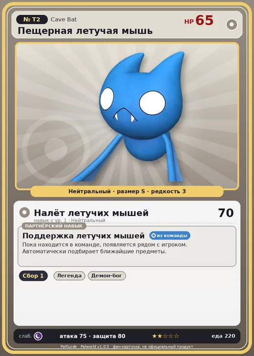

# Пещерная летучая мышь

<canvas id="fx"></canvas>

№ T2 · Cave Bat

Нейтральный

Слабость: Тьма

🌾 Сбор <b>1</b>

<b>Поддержка летучих мышей</b> 🎒 из команды

❤️ 65 · ⚔️ 75 · 🛡 80

Основное

💎Редкость <button class="hlp" data-tip="Чем выше число, тем реже встречается пал. 1–4 — обычные, 5–7 — редкие, 8+ — легендарные.">?</button><b>3</b>

📏Размер<b>S</b>

💰Цена продажи <button class="hlp" data-tip="Сколько золота даст торговец за пала.">?</button><b>1000</b>

🤝Коллаборация<b>Terraria (остров Якусима) (нет в Палпедии)</b>

Бой

🎯Множитель поимки <button class="hlp" data-tip="Насколько легче или труднее поймать: ×1 — обычно, меньше — сложнее.">?</button><b>×1</b>

🐎Скорость рывка верхом <button class="hlp" data-tip="Скорость, если сесть на пала и бежать рывком.">?</button><b>450</b>

Ферма и еда

🍖Сколько ест <button class="hlp" data-tip="Сколько сытости пал тратит — чем больше, тем больше еды нужно на базе.">?</button><b>220</b>

Разведение

🧬Сила разведения <button class="hlp" data-tip="Скрытое число игры: у детёныша оно примерно среднее от родителей. Чем меньше — тем «сильнее» пал.">?</button><b>3100</b>

=== "Обзор"

    #### Работа на базе
    - Сбор — ур. 1

    #### Партнёрский навык: Поддержка летучих мышей
    Пока находится в команде, появляется рядом с игроком. Автоматически подбирает ближайшие предметы.

    #### Чем хорош / чем плох
    - ✅
    - ❌ слабая атака (75); мало здоровья (65)

    > [Коллаборация с Terraria] Монстр из другого мира. Похоже, здесь его можно приручить.

    См. также: [Стихии](../../guide/06_stihii.md) · [Разведение](../../guide/07_razvedenie.md) · [Все палы](README.md)

=== "Атаки"

    #### Атаки по уровням
    - ур. 1: Налёт летучих мышей (Нейтральный, сила 70)

=== "Где живёт"

    #### Где водится
    - В дикой природе: да; точек появления днём: ?, ночью: ?
    - Яйцо: Обычное яйцо

=== "Дроп"

    #### Дроп
    - Святой слиток — 1 шт., 100%

=== "Разведение"

    #### Разведение
    - Ранг разведения (CombiRank): 3100

=== "Пассивки"

    #### Лучшие пассивки по роли

    

⚔️ Боец

максимум урона и живучести в бою

<a class="psv r-4" data-psv="Легенда" href="../../../passivki/legend/">Легенда</a><a class="psv r-4" data-psv="Демон-бог" href="../../../passivki/demon_god/">Демон-бог</a><a class="psv r-3" data-psv="Святое небо" href="../../../passivki/celestial_emperor/">Святое небо</a><a class="psv r-3" data-psv="Хладнокровный" href="../../../passivki/serenity/">Хладнокровный</a>

    <small>Нажми на пассивку, чтобы узнать, что она даёт и где её взять.</small>

<a class="card-link" href="../red_slime/">← Красный слизень</a><a class="card-link" href="../demon_eye/">Демонический глаз →</a>

