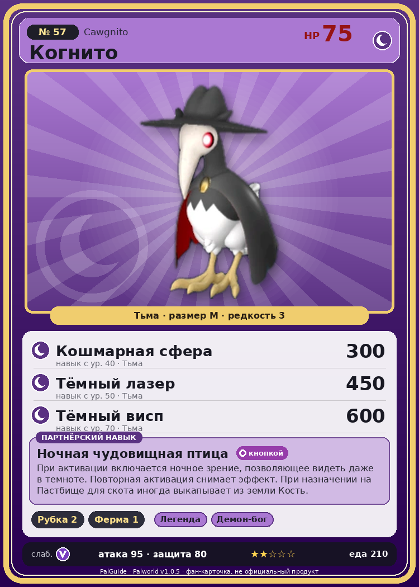

# #57 Когнито (Cawgnito)

{ width=360 }

| Поле | Значение |
|---|---|
| Стихия | Тьма |
| Слабость (кто бьёт сильнее) | Дракон |
| Редкость | 3 |
| Размер | M |
| HP / Атака / Защита (база вида) | 75 / 95 / 80 |
| Сколько ест | 210 |
| Цена продажи | 770 |
| Множитель поимки | ×1 |
| Скорость рывка верхом | 1200 |

## Работа на базе
- Рубка деревьев — ур. 2
- Фермерство — ур. 1

## Партнёрский навык: Ночная чудовищная птица
При активации включается ночное зрение , позволяющее видеть даже в темноте. Повторная активация снимает эффект. При назначении на Пастбище для скота иногда выкапывает из земли Кость .

## Атаки по уровням
- ур. 1: Воздушная пушка (Нейтральный, сила 40)
- ур. 7: Тёмный шар (Тьма, сила 50)
- ур. 15: Фантомный штурм (Тьма, сила 70)
- ур. 22: Теневой взрыв (Тьма, сила 80)
- ур. 30: Духовное пламя (Тьма, сила 200)
- ур. 40: Кошмарная сфера (Тьма, сила 300)
- ур. 50: Тёмный лазер (Тьма, сила 450)
- ур. 70: Тёмный висп (Тьма, сила 600)

## Где водится
- В дикой природе: да; точек появления днём: 276, ночью: 1476; уровни в первых точках: 14–16
- Подземелья: Пещера Песчаных Дюн, Пещера Ущелья
- Может продаваться у торговца/рекрутера
- Яйцо: Яйцо тьмы

## Дроп
- Кость — 2–4 шт., 100%
- Ядовитая железа — 2 шт., 100%
- Маленькая душа Пала — 1 шт., 1%

**Дроп альфы:**
- Деталь древней цивилизации — 1–2 шт., 100%
- Ценное перо — 1–2 шт., 100%

## Разведение
- Ранг разведения (CombiRank): 2370

## Лучшие пассивки по роли
- боец: Легенда, Демон-бог, Хладнокровный, Бессмертие, Король тьмы (вместо Бессмертия, если нет мутации)
- ездовой: Божественная скорость, Легенда, Вечный двигатель, Небесное скольжение

## Чем хорош / чем плох
- ✅ можно оседлать
- ❌ явных минусов нет

> Когда-то они свободно парили в небе, но потерпели поражение в соперничестве с Эрмург и отказались от неба, перейдя к ночному образу жизни.

См. также: [Стихии](../../2_mehaniki/stihii.md) · [Разведение](../../2_mehaniki/razvedenie.md) · [Все палы](README.md)
_Источник: paldb.cc v1.0.5_
