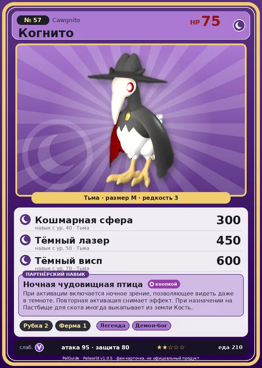

# Когнито

<canvas id="fx"></canvas>

№ 57 · Cawgnito

Тьма

Слабость: Дракон

🪓 Рубка деревьев <b>2</b>🐑 Фермерство <b>1</b>

<b>Ночная чудовищная птица</b> 🔘 кнопкой 🏠 на базе

❤️ 75 · ⚔️ 95 · 🛡 80

Основное

💎Редкость <button class="hlp" data-tip="Чем выше число, тем реже встречается пал. 1–4 — обычные, 5–7 — редкие, 8+ — легендарные.">?</button><b>3</b>

📏Размер<b>M</b>

💰Цена продажи <button class="hlp" data-tip="Сколько золота даст торговец за пала.">?</button><b>770</b>

Бой

🎯Множитель поимки <button class="hlp" data-tip="Насколько легче или труднее поймать: ×1 — обычно, меньше — сложнее.">?</button><b>×1</b>

🐎Скорость рывка верхом <button class="hlp" data-tip="Скорость, если сесть на пала и бежать рывком.">?</button><b>1200</b>

Ферма и еда

🍖Сколько ест <button class="hlp" data-tip="Сколько сытости пал тратит — чем больше, тем больше еды нужно на базе.">?</button><b>210</b>

Разведение

🧬Сила разведения <button class="hlp" data-tip="Скрытое число игры: у детёныша оно примерно среднее от родителей. Чем меньше — тем «сильнее» пал.">?</button><b>2370</b>

=== "Обзор"

    #### Работа на базе
    - Рубка деревьев — ур. 2
    - Фермерство — ур. 1

    #### Партнёрский навык: Ночная чудовищная птица
    При активации включается ночное зрение, позволяющее видеть даже в темноте. Повторная активация снимает эффект. При назначении на Пастбище для скота иногда выкапывает из земли Кость.

    #### Чем хорош / чем плох
    - ✅
    - ❌ явных минусов нет

    > Когда-то они свободно парили в небе, но потерпели поражение в соперничестве с Эрмург и отказались от неба, перейдя к ночному образу жизни.

    См. также: [Стихии](../../guide/06_stihii.md) · [Разведение](../../guide/07_razvedenie.md) · [Все палы](README.md)

=== "Атаки"

    #### Атаки по уровням
    - ур. 1: Воздушная пушка (Нейтральный, сила 40)
    - ур. 7: Тёмный шар (Тьма, сила 50)
    - ур. 15: Фантомный штурм (Тьма, сила 70)
    - ур. 22: Теневой взрыв (Тьма, сила 80)
    - ур. 30: Духовное пламя (Тьма, сила 200)
    - ур. 40: Кошмарная сфера (Тьма, сила 300)
    - ур. 50: Тёмный лазер (Тьма, сила 450)
    - ур. 70: Тёмный висп (Тьма, сила 600)

=== "Где живёт"

    #### Где водится
    - В дикой природе: да; точек появления днём: 276, ночью: 1476; уровни в первых точках: 14–16
    - Подземелья: Пещера Песчаных Дюн, Пещера Ущелья
    - Может продаваться у торговца/рекрутера
    - Яйцо: Яйцо тьмы

=== "Дроп"

    #### Дроп
    - Кость — 2–4 шт., 100%
    - Ядовитая железа — 2 шт., 100%
    - Маленькая душа Пала — 1 шт., 1%

    **Дроп альфы:**
    - Деталь древней цивилизации — 1–2 шт., 100%
    - Ценное перо — 1–2 шт., 100%

=== "Разведение"

    #### Разведение
    - Ранг разведения (CombiRank): 2370

=== "Пассивки"

    #### Лучшие пассивки по роли

    

⚔️ Боец

максимум урона и живучести в бою

<a class="psv r-4" data-psv="Легенда" href="../../../passivki/legend/">Легенда</a><a class="psv r-4" data-psv="Демон-бог" href="../../../passivki/demon_god/">Демон-бог</a><a class="psv r-3" data-psv="Король тьмы" href="../../../passivki/lord_of_the_underworld/">Король тьмы</a><a class="psv r-3" data-psv="Хладнокровный" href="../../../passivki/serenity/">Хладнокровный</a>

    <small>Нажми на пассивку, чтобы узнать, что она даёт и где её взять.</small>

<a class="card-link" href="../loupmoon_cryst/">← Лупмун Крист</a><a class="card-link" href="../arsox/">Арсокс →</a>

