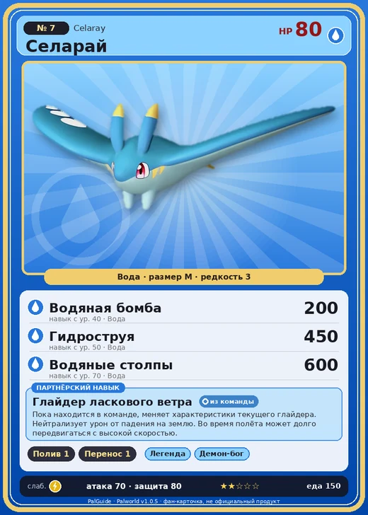

# #7 Селарай (Celaray)

№ 7

Вода

Слабость: Молния

💧 Полив <b>1</b>📦 Транспортировка <b>1</b>

<b>Глайдер ласкового ветра</b> 🎒 из команды

❤️ 80 · ⚔️ 70 · 🛡 80

| Поле | Значение |
|---|---|
| Стихия | Вода |
| Слабость (кто бьёт сильнее) | Молния |
| Редкость | 3 |
| Размер | M |
| HP / Атака / Защита (база вида) | 80 / 70 / 80 |
| Сколько ест | 150 |
| Цена продажи | 521 |
| Множитель поимки | ×1.1 |
| Скорость рывка верхом | 700 |

## Работа на базе
- Полив — ур. 1
- Транспортировка — ур. 1

## Партнёрский навык: Глайдер ласкового ветра
Пока находится в команде, меняет характеристики текущего глайдера. Нейтрализует урон от падения на землю . Во время полёта может долго передвигаться с высокой скоростью. level value 1 FallDamageInvalid_PartnerSkill 100 Пробуждение : 2 FallDamageInvalid_PartnerSkill 100 Пробуждение : (Улучшение характеристик глайдера: Небольшое ) 3 FallDamageInvalid_PartnerSkill 100 Пробуждение : (Улучшение характеристик глайдера: Среднее ) 4 FallDamageInvalid_PartnerSkill 100 Пробуждение : (Улучшение характеристик глайдера: Большое ) 5 FallDamageInvalid_PartnerSkill 100 Пробуждение : (Улучшение характеристик глайдера: Очень большое ) Lv. GliderMaxSpeed GliderGravityScale GliderSP 1 600 0.016 10 2 750 0.014 8.5 3 900 0.012 7 4 1050 0.01 5.5 5 1200 0.008 4

## Атаки по уровням
- ур. 1: Акваджет (Вода, сила 40)
- ур. 7: Водяной выстрел (Вода, сила 50)
- ур. 15: Силовой выстрел (Нейтральный, сила 80)
- ур. 22: Пузырьковый выстрел (Вода, сила 80)
- ур. 30: Семенной пулемёт (Трава, сила 80)
- ур. 40: Водяная бомба (Вода, сила 200)
- ур. 50: Гидроструя (Вода, сила 450)
- ур. 70: Водяные столпы (Вода, сила 600)

## Где водится
- В дикой природе: да; точек появления днём: 864, ночью: 864; уровни в первых точках: 1–10
- Подземелья: Пещера Отдалённого Острова, Пещера Холмов
- Яйцо: Яйцо воды

## Дроп
- Жидкость водного Пала — 1–2 шт., 100%

**Дроп альфы:**
- Деталь древней цивилизации — 1–2 шт., 100%
- Ценное перо — 1–2 шт., 100%

## Разведение
- Ранг разведения (CombiRank): 2740
- Участвует в особых парах: Юнивольт → Селарай Лакс

## Лучшие пассивки по роли
- боец: Легенда, Демон-бог, Хладнокровный, Бессмертие, Владыка морей (вместо Бессмертия, если нет мутации)
- ездовой: Божественная скорость, Легенда, Вечный двигатель, Небесное скольжение

## Чем хорош / чем плох
- ✅ можно оседлать; летает (ездовой)
- ❌ слабая атака (70)

> Несомый ветром, он вольно скитается по миру. Но как только находит себе пару, его странствия завершаются.

См. также: [Стихии](../../guide/06_stihii.md) · [Разведение](../../guide/07_razvedenie.md) · [Все палы](README.md)
