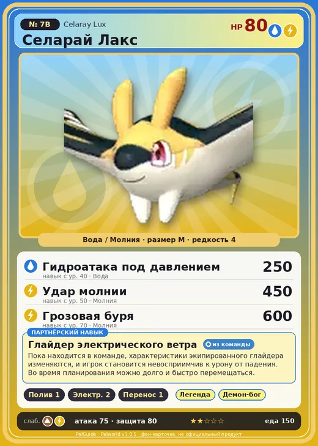

# Селарай Лакс

<canvas id="fx"></canvas>

№ 7B

ВодаМолния

Слабость: Молния <b class="mx">×1,5</b>Земля <b class="mx">×1,5</b> <button class="hlp" data-tip="Множители перемножаются по обеим стихиям: ×1,5 за стихию, которую атака бьёт, ×0,65 за ту, что её держит. Молния: 1,5 × 1 = ×1,5; Земля: 1 × 1,5 = ×1,5.">?</button>

Устойчив: Огонь <b class="mx">×0,65</b>Вода <b class="mx">×0,65</b>

💧 Полив <b>1</b>⚡ Генерация энергии <b>2</b>📦 Транспортировка <b>1</b>

<b>Глайдер электрического ветра</b> 🎒 Работает из команды

❤️ 80 · ⚔️ 75 · 🛡 80

Основное

💎Редкость <button class="hlp" data-tip="Чем выше число, тем реже встречается пал. 1–4 — обычные, 5–7 — редкие, 8+ — легендарные.">?</button><b>4</b>

📏Размер<b>M</b>

💰Цена продажи <button class="hlp" data-tip="Сколько золота даст торговец за пала.">?</button><b>658</b>

Бой

🎯Множитель поимки <button class="hlp" data-tip="Насколько легче или труднее поймать: ×1 — обычно, меньше — сложнее.">?</button><b>×1.1</b>

🐎Скорость рывка верхом <button class="hlp" data-tip="Скорость, если сесть на пала и бежать рывком.">?</button><b>700</b>

Ферма и еда

🍖Сколько ест <button class="hlp" data-tip="Сколько сытости пал тратит — чем больше, тем больше еды нужно на базе.">?</button><b>150</b>

Разведение

🧬Сила разведения <button class="hlp" data-tip="Скрытое число игры: у детёныша оно примерно среднее от родителей. Чем меньше — тем «сильнее» пал.">?</button><b>2380</b>

💞Особая пара <button class="hlp" data-tip="Этого пала можно вывести только от этой пары.">?</button><b>Селарай + Юнивольт</b>

=== "Обзор"

    #### Работа на базе

    
💧 Полив<i style="--v:10%"></i><b>1</b>⚡ Генерация энергии<i style="--v:20%"></i><b>2</b>📦 Транспортировка<i style="--v:10%"></i><b>1</b>

    #### Партнёрский навык: Глайдер электрического ветра
    Пока находится в команде, характеристики экипированного глайдера изменяются, и игрок становится невосприимчив к урону от падения. Во время планирования можно долго и быстро перемещаться.

    #### Чем хорош / чем плох
    - ✅ крепкая защита (80)
    - ❌ слабая атака (75); разводится только особой парой

    > Яркий узор на теле помогает ему найти партнера. История несчастных случаев от поражений электрическим током, связанных с этим Палом, уходит в давнее прошлое. В наше время жёлто-черная полосатая расцветка воспринимается как опасная на острове.

    См. также: [Стихии](../../guide/06_stihii.md) · [Разведение](../../guide/07_razvedenie.md) · [Все палы](README.md)

=== "Атаки"

    #### Атаки по уровням
    - ур. 1: Грозовое копьё (Молния, сила 40)
    - ур. 7: Шоковая волна (Молния, сила 80)
    - ур. 15: Пузырьковый выстрел (Вода, сила 80)
    - ур. 22: Грозовая линия (Молния, сила 160)
    - ур. 30: Полоса брызг (Вода, сила 160)
    - ур. 40: Гидроатака под давлением (Вода, сила 250)
    - ур. 50: Удар молнии (Молния, сила 450)
    - ур. 70: Грозовая буря (Молния, сила 600)

=== "Где живёт"

    #### Где водится

    

<button data-k="d" class="on">☀️ День</button><button data-k="n">🌙 Ночь</button>

ур. 26–26<a class="btn hm-full" href="../../../map/?pal=FlyingManta_Thunder">Показать на большой карте</a>

Иссохшие дюныПодножие Астральных горОстров-оазисОстров Ветровой эрозии

🥚 Яйцо<b>Яйцо воды</b>

=== "Дроп"

    #### Дроп
    - Жидкость водного Пала — 1–2 шт., 100%

    **Дроп альфы:**

    - Деталь древней цивилизации — 2–3 шт., 100%
    - Ценное перо — 2–3 шт., 100%

=== "Разведение"

    #### Разведение
    - Ранг разведения: 2380
    - **Особая пара:** [Селарай](../../4_spravochniki/paly/celaray.md) + [Юнивольт](../../4_spravochniki/paly/univolt.md)

=== "Пассивки"

    #### Лучшие пассивки по роли

    

⚔️ Боец

максимум урона и живучести в бою

<a class="psv r-4" data-psv="Легенда" href="../../../passivki/legend/">Легенда</a><a class="psv r-4" data-psv="Демон-бог" href="../../../passivki/demon_god/">Демон-бог</a><a class="psv r-3" data-psv="Владыка морей" href="../../../passivki/lord_of_the_sea/">Владыка морей</a><a class="psv r-3" data-psv="Хладнокровный" href="../../../passivki/serenity/">Хладнокровный</a>

    <small>Нажми на пассивку, чтобы узнать, что она даёт и где её взять.</small>

<a class="card-link" href="../celaray/">← Селарай</a><a class="card-link" href="../cremis/">Кремис →</a>

