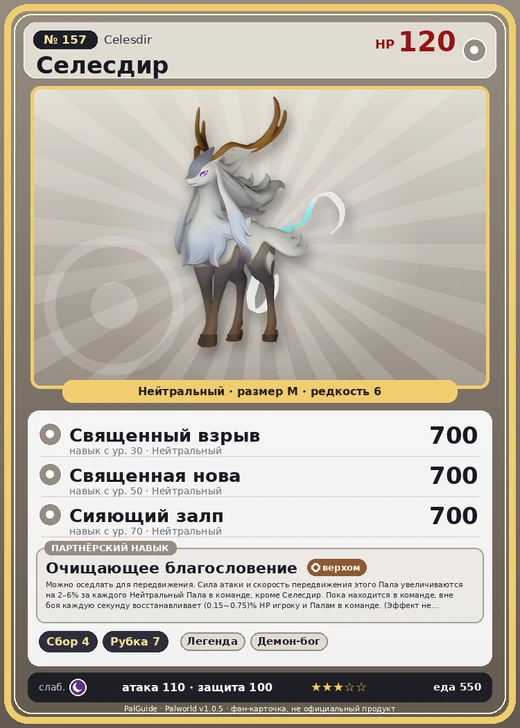

# Селесдир

<canvas id="fx"></canvas>

№ 157

Нейтральный

Слабость: Тьма <b class="mx">×1,5</b> <button class="hlp" data-tip="Множители перемножаются по обеим стихиям: ×1,5 за стихию, которую атака бьёт, ×0,65 за ту, что её держит.">?</button>

🌾 Сбор <b>4</b>🪓 Рубка деревьев <b>7</b>

<b>Очищающее благословение</b> 🐎 Верхом🐾 Когда пал выпущен

❤️ 120 · ⚔️ 110 · 🛡 100

Основное

💎Редкость <button class="hlp" data-tip="Чем выше число, тем реже встречается пал. 1–4 — обычные, 5–7 — редкие, 8+ — легендарные.">?</button><b>6</b>

📏Размер<b>M</b>

💰Цена продажи <button class="hlp" data-tip="Сколько золота даст торговец за пала.">?</button><b>2911</b>

Бой

🎯Множитель поимки <button class="hlp" data-tip="Насколько легче или труднее поймать: ×1 — обычно, меньше — сложнее.">?</button><b>×1</b>

🐎Скорость рывка верхом <button class="hlp" data-tip="Скорость, если сесть на пала и бежать рывком.">?</button><b>1200</b>

Ферма и еда

🍖Сколько ест <button class="hlp" data-tip="Сколько сытости пал тратит — чем больше, тем больше еды нужно на базе.">?</button><b>550</b>

Разведение

🧬Сила разведения <button class="hlp" data-tip="Скрытое число игры: у детёныша оно примерно среднее от родителей. Чем меньше — тем «сильнее» пал.">?</button><b>570</b>

💞Особая пара <button class="hlp" data-tip="Этого пала можно вывести только от этой пары.">?</button><b>Гилдейн + Иктирдир Тэрра</b>

=== "Обзор"

    #### Работа на базе

    
🧺 Сбор<i style="--v:40%"></i><b>4</b>🪓 Рубка деревьев<i style="--v:70%"></i><b>7</b>

    #### Партнёрский навык: Очищающее благословение
    Можно оседлать для передвижения. Сила атаки и скорость передвижения этого Пала увеличиваются на 2–6% за каждого Нейтральный Пала в команде, кроме Селесдир. Пока находится в команде, вне боя каждую секунду восстанавливает (0.15~0.75)% HP игроку и Палам в команде. (Эффект не суммируется) Технологии 54.

    #### Чем хорош / чем плох
    - ✅ хорошая атака (110); много здоровья (120); отличный рабочий (пригодность 7); можно оседлать
    - ❌ много ест (550); разводится только особой парой

    > В древних текстах его называют |Зверем-спасителем|. Свет, который излучает Селесдир, очищает всё вокруг. Буквально — стирает из этого мира без следа.

    См. также: [Стихии](../../guide/06_stihii.md) · [Разведение](../../guide/07_razvedenie.md) · [Все палы](README.md)

=== "Атаки"

    #### Атаки по уровням
    - ур. 1: Силовой выстрел (Нейтральный, сила 80)
    - ур. 7: Силовая бомба (Нейтральный, сила 120)
    - ур. 15: Воздушные клинки (Нейтральный, сила 160)
    - ур. 22: Комета (Дракон, сила 180)
    - ур. 30: Священный взрыв (Нейтральный, сила 700)
    - ур. 40: Палобласт (Нейтральный, сила 450)
    - ур. 50: Священная нова (Нейтральный, сила 700)
    - ур. 70: Сияющий залп (Нейтральный, сила 700)

=== "Где живёт"

    #### Где водится

    

<button data-k="d" class="on">☀️ День</button><button data-k="n">🌙 Ночь</button>

<button data-w=p class=on>Палпагос</button><button data-w=t>Мировое древо</button>

ур. 54–80<a class="btn hm-full" href="../../../map/?pal=WhiteDeer">Показать на большой карте</a>

Выжженный холмЛедяной коралловый холмЖёлтоземная равнинаПустынное пепельное плато

🥚 Яйцо<b>Большое обычное яйцо</b>

=== "Дроп"

    #### Дроп
    - Кожа — 2–3 шт., 100%
    - Рог — 2 шт., 100%
    - Гексокварц — 2–3 шт., 100%

    **Дроп альфы:**

    - Деталь древней цивилизации — 7–8 шт., 100%
    - Ценный мех — 2–3 шт., 100%

=== "Разведение"

    #### Разведение
    - Ранг разведения: 570
    - **Особая пара:** [Гилдейн](../../4_spravochniki/paly/gildane.md) + [Иктирдир Тэрра](../../4_spravochniki/paly/eikthyrdeer_terra.md)
    - Участвует в особых парах: [Старрион](starryon.md) → [Старрион Примо](starryon_primo.md); [Тетроис](tetroise.md) → [Тетроис Примо](tetroise_primo.md); [Кицун Нокт](kitsun_noct.md) → [Селесдир Нокт](celesdir_noct.md)

=== "Пассивки"

    #### Лучшие пассивки по роли

    

⚔️ Боец

максимум урона и живучести в бою

<a class="psv r-4" data-psv="Легенда" href="../../../passivki/legend/">Легенда</a><a class="psv r-4" data-psv="Демон-бог" href="../../../passivki/demon_god/">Демон-бог</a><a class="psv r-3" data-psv="Святое небо" href="../../../passivki/celestial_emperor/">Святое небо</a><a class="psv r-3" data-psv="Хладнокровный" href="../../../passivki/serenity/">Хладнокровный</a>

🛠 Рабочий

работает быстрее и меньше устаёт на базе

<a class="psv r-5" data-psv="Дьявольские руки" href="../../../passivki/demons_hand/">Дьявольские руки</a><a class="psv r-4" data-psv="Виртуоз" href="../../../passivki/remarkable_craftsmanship/">Виртуоз</a><a class="psv r-3" data-psv="Мастеровитый" href="../../../passivki/artisan/">Мастеровитый</a><a class="psv r-3" data-psv="Трудоголик" href="../../../passivki/workaholic/">Трудоголик</a>

🐎 Ездовой

быстрее бегает или летает с тобой верхом

<a class="psv r-4" data-psv="Божественная скорость" href="../../../passivki/swift/">Божественная скорость</a><a class="psv r-4" data-psv="Легенда" href="../../../passivki/legend/">Легенда</a><a class="psv r-4" data-psv="Вечный двигатель" href="../../../passivki/eternal_engine/">Вечный двигатель</a><a class="psv r-4" data-psv="Небесное скольжение" href="../../../passivki/sky_strider/">Небесное скольжение</a>

    <small>Нажми на пассивку, чтобы узнать, что она даёт и где её взять.</small>

<a class="card-link" href="../bulldosu/">← Буллдос</a><a class="card-link" href="../celesdir_noct/">Селесдир Нокт →</a>

