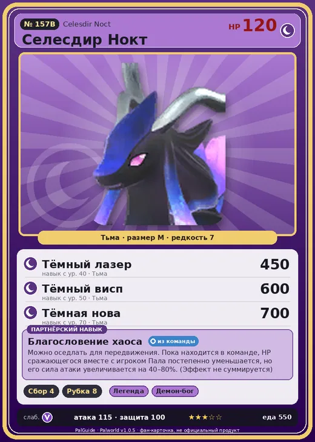

# #157B Селесдир Нокт (Celesdir Noct)

№ 157B

Тьма

Слабость: Дракон

🌾 Сбор <b>4</b>🪓 Рубка деревьев <b>8</b>

<b>Благословение хаоса</b> 🎒 из команды 🐎 верхом

❤️ 120 · ⚔️ 115 · 🛡 100

| Поле | Значение |
|---|---|
| Стихия | Тьма |
| Слабость (кто бьёт сильнее) | Дракон |
| Редкость | 7 |
| Размер | M |
| HP / Атака / Защита (база вида) | 120 / 115 / 100 |
| Сколько ест | 550 |
| Цена продажи | 3528 |
| Множитель поимки | ×1 |
| Скорость рывка верхом | 1200 |

## Работа на базе
- Сбор — ур. 4
- Рубка деревьев — ур. 8

## Партнёрский навык: Благословение хаоса
Можно оседлать для передвижения. Пока находится в команде, HP сражающегося вместе с игроком Пала постепенно уменьшается, но его сила атаки увеличивается на (40~80)% . (Эффект не суммируется) Технологии 78 level value 1 SnakeGirl_PartnerSkill 0 2 SnakeGirl_PartnerSkill 0 3 SnakeGirl_PartnerSkill 0 4 SnakeGirl_PartnerSkill 0 5 SnakeGirl_PartnerSkill 0

## Атаки по уровням
- ур. 1: Тёмная пушка (Тьма, сила 70)
- ур. 7: Стрелы тьмы (Тьма, сила 120)
- ур. 15: Духовное пламя (Тьма, сила 200)
- ур. 22: Кошмарная сфера (Тьма, сила 300)
- ур. 30: Апокалипсис (Тьма, сила 400)
- ур. 40: Тёмный лазер (Тьма, сила 450)
- ур. 50: Тёмный висп (Тьма, сила 600)
- ур. 70: Тёмная нова (Тьма, сила 700)

## Где водится
- В дикой природе: нет/особый способ; точек появления днём: 0, ночью: 0
- Яйцо: Большое яйцо тьмы

## Дроп
- Кожа — 2–3 шт., 100%
- Рог — 2 шт., 100%
- Осколок тьмы — 2–3 шт., 100%

**Дроп альфы:**
- Деталь древней цивилизации — 7–9 шт., 100%
- Ценные внутренности — 2–3 шт., 100%

## Разведение
- Ранг разведения (CombiRank): 270
- **Особая пара:** [Селесдир](../../4_spravochniki/paly/celesdir.md) + [Кицун Нокт](../../4_spravochniki/paly/kitsun_noct.md)

## Лучшие пассивки по роли
- по обзору: Мастеровитый, Виртуоз, Трудоголик, Аскет
- боец: Легенда, Демон-бог, Хладнокровный, Бессмертие, Король тьмы (вместо Бессмертия, если нет мутации)
- рабочий: Дьявольские руки, Виртуоз, Мастеровитый, Небожитель/Трудоголик
- ездовой: Божественная скорость, Легенда, Вечный двигатель, Небесное скольжение

## Чем хорош / чем плох
- ✅ Рубка 8; хорошая атака (115); много здоровья (120); отличный рабочий (пригодность 8); можно оседлать
- ❌ Поздний; много ест (550); разводится только особой парой

> Ослепительный свет одновременно породил и тень. Разбрасывая тьму, охватывающую всё, восстанавливается естественный хаос. Миру необходимо равновесие.

См. также: [Стихии](../../guide/06_stihii.md) · [Разведение](../../guide/07_razvedenie.md) · [Все палы](README.md)
