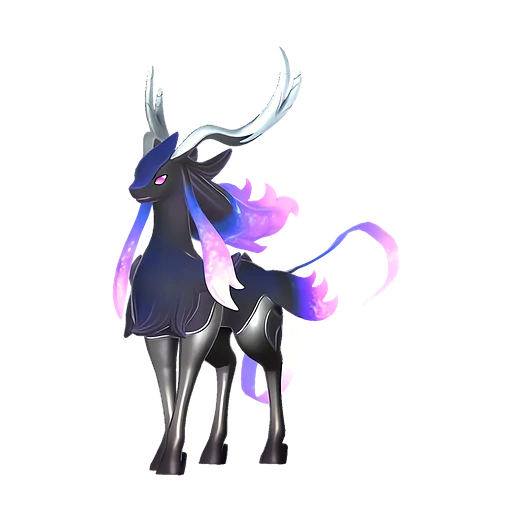

# Селесдир Нокт

<canvas id="fx"></canvas>

№ 157B

Тьма

Слабость: Дракон <b class="mx">×1,5</b> <button class="hlp" data-tip="Множители перемножаются по обеим стихиям: ×1,5 за стихию, которую атака бьёт, ×0,65 за ту, что её держит.">?</button>

Устойчив: Нейтральный <b class="mx">×0,65</b>

🌾 Сбор <b>4</b>🪓 Рубка деревьев <b>8</b>

<b>Благословение хаоса</b> 🎒 Работает из команды🐎 Верхом

❤️ 120 · ⚔️ 115 · 🛡 100

Основное

💎Редкость <button class="hlp" data-tip="Чем выше число, тем реже встречается пал. 1–4 — обычные, 5–7 — редкие, 8+ — легендарные.">?</button><b>7</b>

📏Размер<b>M</b>

💰Цена продажи <button class="hlp" data-tip="Сколько золота даст торговец за пала.">?</button><b>3528</b>

Бой

🎯Множитель поимки <button class="hlp" data-tip="Насколько легче или труднее поймать: ×1 — обычно, меньше — сложнее.">?</button><b>×1</b>

🐎Скорость рывка верхом <button class="hlp" data-tip="Скорость, если сесть на пала и бежать рывком.">?</button><b>1200</b>

Ферма и еда

🍖Сколько ест <button class="hlp" data-tip="Сколько сытости пал тратит — чем больше, тем больше еды нужно на базе.">?</button><b>550</b>

Разведение

🧬Сила разведения <button class="hlp" data-tip="Скрытое число игры: у детёныша оно примерно среднее от родителей. Чем меньше — тем «сильнее» пал.">?</button><b>270</b>

💞Особая пара <button class="hlp" data-tip="Этого пала можно вывести только от этой пары.">?</button><b>Селесдир + Кицун Нокт</b>

=== "Обзор"

    #### Работа на базе

    
<a class="wbar" href="../../../2_mehaniki/rabota/?w=gathering&lv=4">🧺 Сбор<i style="--v:40%"></i><b>4</b></a><a class="wbar" href="../../../2_mehaniki/rabota/?w=lumbering&lv=8">🪓 Рубка деревьев<i style="--v:80%"></i><b>8</b></a><a class="wb-more" href="../../../2_mehaniki/rabota/">Что значат уровни работы →</a>

    #### Партнёрский навык: Благословение хаоса
    Можно оседлать для передвижения. Пока находится в команде, HP сражающегося вместе с игроком Пала постепенно уменьшается, но его сила атаки увеличивается на 40–80%. (Эффект не суммируется) Технологии 78. По звёздам: 0★ 0 · 1★ 0 · 2★ 0 · 3★ 0 · 4★ 0

    #### Чем хорош / чем плох
    - ✅ Рубка 8; хорошая атака (115); много здоровья (120); отличный рабочий (пригодность 8); можно оседлать
    - ❌ Поздний; много ест (550); разводится только особой парой

    > Ослепительный свет одновременно породил и тень. Разбрасывая тьму, охватывающую всё, восстанавливается естественный хаос. Миру необходимо равновесие.

    См. также: [Стихии](../../guide/06_stihii.md) · [Разведение](../../guide/07_razvedenie.md) · [Все палы](README.md)

=== "Атаки"

    #### Атаки по уровням
    - ур. 1: Тёмная пушка (Тьма, сила 70)
    - ур. 7: Стрелы тьмы (Тьма, сила 120)
    - ур. 15: Духовное пламя (Тьма, сила 200)
    - ур. 22: Кошмарная сфера (Тьма, сила 300)
    - ур. 30: Апокалипсис (Тьма, сила 400)
    - ур. 40: Тёмный лазер (Тьма, сила 450)
    - ур. 50: Тёмный висп (Тьма, сила 600)
    - ур. 70: Тёмная нова (Тьма, сила 700)

=== "Где живёт"

    #### Где водится

    

<button data-k="d" class="on">☀️ День</button><button data-k="n">🌙 Ночь</button>

<a class="btn hm-full" href="../../../map/?pal=">Показать на большой карте</a>

🥚 Яйцо<b>Большое яйцо тьмы</b>

=== "Дроп"

    #### Дроп
    - Кожа — 2–3 шт., 100%
    - Рог — 2 шт., 100%
    - Осколок тьмы — 2–3 шт., 100%

    **Дроп альфы:**
    - Деталь древней цивилизации — 7–9 шт., 100%
    - Ценные внутренности — 2–3 шт., 100%

=== "Разведение"

    #### Разведение
    - Ранг разведения: 270
    - **Особая пара:** [Селесдир](../../4_spravochniki/paly/celesdir.md) + [Кицун Нокт](../../4_spravochniki/paly/kitsun_noct.md)

=== "Пассивки"

    #### Лучшие пассивки по роли

    

⚔️ Боец

максимум урона и живучести в бою

<a class="psv r-4" data-psv="Легенда" href="../../../passivki/legend/">Легенда</a><a class="psv r-4" data-psv="Демон-бог" href="../../../passivki/demon_god/">Демон-бог</a><a class="psv r-3" data-psv="Король тьмы" href="../../../passivki/lord_of_the_underworld/">Король тьмы</a><a class="psv r-3" data-psv="Хладнокровный" href="../../../passivki/serenity/">Хладнокровный</a>

🛠 Рабочий

работает быстрее и меньше устаёт на базе

<a class="psv r-5" data-psv="Дьявольские руки" href="../../../passivki/demons_hand/">Дьявольские руки</a><a class="psv r-4" data-psv="Виртуоз" href="../../../passivki/remarkable_craftsmanship/">Виртуоз</a><a class="psv r-3" data-psv="Мастеровитый" href="../../../passivki/artisan/">Мастеровитый</a><a class="psv r-3" data-psv="Трудоголик" href="../../../passivki/workaholic/">Трудоголик</a>

🐎 Ездовой

быстрее бегает или летает с тобой верхом

<a class="psv r-4" data-psv="Божественная скорость" href="../../../passivki/swift/">Божественная скорость</a><a class="psv r-4" data-psv="Легенда" href="../../../passivki/legend/">Легенда</a><a class="psv r-4" data-psv="Вечный двигатель" href="../../../passivki/eternal_engine/">Вечный двигатель</a><a class="psv r-4" data-psv="Небесное скольжение" href="../../../passivki/sky_strider/">Небесное скольжение</a>

    <small>Нажми на пассивку, чтобы узнать, что она даёт и где её взять.</small>

<a class="card-link" href="../celesdir/">← Селесдир</a><a class="card-link" href="../astegon/">Астегон →</a>

